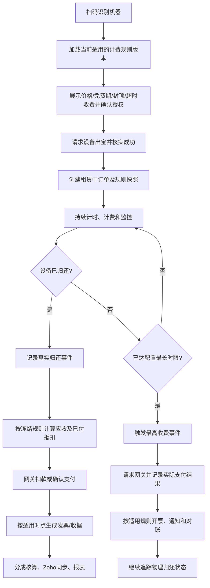
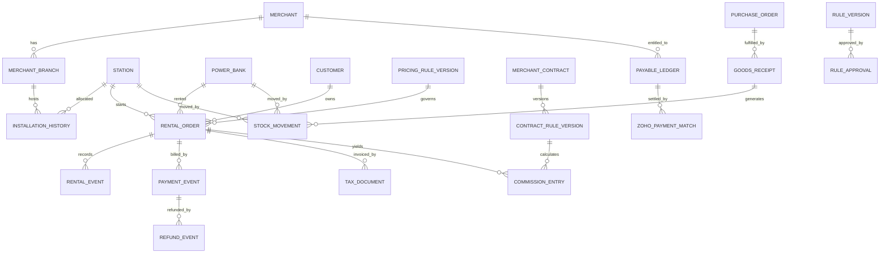

# 共享充电宝超级应用及管理看板——项目需求规格说明书（PRD/SRS）

> **文档版本**：v1.0（需求评审稿）  
> **编制日期**：2026-10-28  
> **项目主体**：君盛科技有限公司（Jun Sheng Technologies LLC）  
> **业务领域**：共享充电宝租赁（非新能源汽车充电桩）  
> **需求基线**：《共享充电宝超级应用_双文档合并需求说明_v1.0.md》  
> **原始来源**：A.《君盛科技_共享充电宝超级应用项目提案_中文版.docx》（2026-10-26，9页）；B.《Super App - Dashboard .pdf》（2026-10-26，10页）  
> **文档状态**：供产品/业务/财务/研发/供应商评审与估算，未代替正式财税或支付合规确认

---

## 0. 阅读说明及需求约定

### 0.1 本文档目的

将两份原始项目提案中分散的功能、数据、报表和验收要求转化为可追踪、可配置、可评审、可测试的项目需求规格说明，供需求确认、技术评估、研发拆解、供应商报价、测试验收和上线交接使用。

### 0.2 需求来源及标记

| 标记 | 含义 |
|---|---|
| `[A]` | 来自详细项目提案 Word 的明确要求 |
| `[B]` | 来自 Super App & Dashboard PDF 的明确要求或示例 |
| `[A+B]` | 两份来源共同覆盖 |
| `[设计细化]` | 为落地原始需求补充的业务流程、数据管理、配置和可测试性设计；需评审 |
| `[条件]` | 能力受厂商硬件接口、支付网关、Zoho Books 功能或适用法规限制 |

**P0**：项目核心业务闭环，原则上属于首期验收；**P1**：重要增强或有条件能力；**P2**：可择期实施。优先级是本需求稿建议，不代表签约范围已确认。

### 0.3 用户确认的总原则：业务规则全部动态配置

**租赁、计费、支付、费率、最长时限、最高收费、退款、通知、分成、佣金、合同提醒、结算、税务、发票、库存审批等业务规则，全部由授权人员在后台配置和管理，不能在业务代码中硬编码。原文中的数字与规则作为初始化配置（Seed Data）导入。**

该原则包含以下具体要求：

1. **配置化**：配置参数、启停、适用条件、作用范围、规则优先级、有效期和例外情形由后台管理。
2. **分层覆盖**：支持全局、地区/税务区域、商户、分支/安装点、设备、合同及所选计费方案等层级；冲突时采用明确的优先级和匹配规则。
3. **版本冻结**：每次变更产生不可覆盖的版本；已产生的租赁、分成和发票保存适用规则版本、关键参数快照及计算明细，不追溯改写历史。
4. **审批发布**：金额、税率、分成基数、超时扣款、收款授权、开票等高风险配置需审批、审计和可控发布；支持预览、模拟计算、回退到旧版本（以新版本发布）。
5. **初始化数据**：PDF 中 AED 5/30分钟、首5分钟免费、每日 AED 30 封顶、48小时/AED 69 未还收费、合同提前2个月提醒、商户分成15%/30%/50%、VAT 5%等录入**初始化模板/默认规则**，经业务与财务确认后激活。
6. **样例与正式业务数据分离**：文档中的客户名、发票示例编号、演示看板数字、库存100订购/80收货、商户应得5000/已付3000等不导入生产业务流水；只用作示例、测试数据或验收场景。
7. **业务参数可配置不等于放弃强制安全约束**：支付幂等、交易不可重复记账、审计留痕、隐私安全、法定财税要求、真实网关支付结果等是系统不可关闭的底线。后台只能在合规的可选范围内配置。

> 重要口径：原文涉及若干**数值示例与公式不一致**。所有数值可以作为初始化配置模板保存，但相互冲突的计价/税务/分成公式必须设置为“待确认/不可生产启用”，不能仅凭样例自动激活相互矛盾的规则。

### 0.4 术语

| 术语 | 定义 |
|---|---|
| Station / 机器 | 放置充电宝的借还设备、机柜或充电站，关联安装地点和商户 |
| Power Bank / 充电宝 | 可被借出、归还、流转的独立实物资产 |
| Rental / 租赁单 | 一次借出到实际归还/结案的业务过程，具有唯一租赁编号 |
| Pricing Plan / 计费方案 | 包含免费期、计费周期、费率、封顶及最长时限收费的已发布配置版本 |
| Max-duration Charge / 最长时限收费 | 达到配置租赁时限后对未归还订单自动发起的最高适用收费事件 |
| Merchant / 商户 | 设备安装合作方，按合同获得收入分成 |
| Agent / 代理 | 可根据代理协议获得佣金的合作方 |
| Payable / 应付款 | 对商户或代理的应得款项，扣减已付及合法调整后形成未结余额 |
| Zoho Books | 会计分录及已记录付款的记录来源；运营明细保留在本系统 |
| TRN | 阿联酋税务登记号（实际主体资料以财务确认结果为准） |
| Seed Data | 系统首次部署时加载的配置模板/初始参数，不等同于生产交易流水 |

---

## 1. 项目背景、目标和范围

### 1.1 业务背景 `[A]`

公司在餐厅、酒店、购物中心、健身房等场所部署共享充电宝设备；已有客户 App 与管理后台，但现有报表偏重月度汇总，缺乏完整的逐笔交易、自动发票、商户结算、设备库存、采购、运营监控与 Zoho Books 对账能力。

### 1.2 项目目标 `[A+B]`

- 将“**用户超级 App + 管理看板**”整合为同一业务平台，复用并升级现有系统；先做现状评估再决定局部重建。
- 完成“扫码借出—计费—归还/超时收费—支付—发票—分成—会计同步—报表”的端到端交易闭环。
- 全面管理机器、充电宝、安装点、商户、合同、代理、采购、收货、调拨、盘点、维修与报废。
- 提高支付成功/失败可追踪性、库存准确性、商户应付款透明度、财税合规性和三方对账效率。
- 通过**版本化动态规则平台**适配不同商户、合同、地区与业务变更，而无需修改业务代码。

### 1.3 产品交付边界

| 产品部分 | 用户群 | 核心范围 |
|---|---|---|
| 客户超级 App | 最终租赁客户 | 扫码、租赁前价格披露、借还租赁状态、收费提醒、票据接收/查看 |
| 管理后台 / Dashboard | 运营、销售、财务、管理层 | 订单支付、进行中与逾期看板、商户合同、代理分成、应付、发票、库存采购、报表、权限 |
| 业务后台服务 | 各产品端及集成服务 | 租赁、动态计费规则、支付编排、通知、分成核算、库存流转、审计、集成任务 |
| 第三方系统 | 支付网关 / Zoho Books / 硬件厂商 | 实际收退款、会计分录和商户付款、设备事件/状态（须技术评估） |

**当前不据此承诺**：必须重新开发所有现有客户端功能、必须建设独立商户 App、全部设备厂商支持远程指令，或实现 Zoho Books 不支持的会计 API。其范围应由现状调查决定。

### 1.4 成功衡量方式（验收导向）

- 所有有效租赁可逐笔查询、导出，且关联当时的商户/设备/费率。
- 租赁到达配置时限可生成正确的收费请求；支付成功与否根据网关实况更新，无重复扣款。
- 正常归还及超时收费均可按适用法规和配置生成正确单据。
- 商户/代理分成和未结应付款正确，Zoho 付款同步后及时核销。
- 已采购未到货不算实物库存；设备跨商户调拨不影响历史财务归属。
- 财务、运营和库存报表与明细一致；日志、审批、配置版本可追溯。

---

## 2. 参与角色与职责

| 角色 | 主要职责与数据范围 | 权限原则 |
|---|---|---|
| 终端客户 | 扫码租赁、查看价格和收费通知、获取租赁票据 | 仅访问本人合法关联的订单与信息 |
| 超级管理员 | 组织与用户、角色、全局字典、集成配置 | 高风险配置需要双人复核/审批；最小权限 |
| 运营人员 | 设备、商户安装、租赁异常、库存、现场维护 | 不可任意变更已入账金额、原始付款流水 |
| 销售/商务人员 | 商户、代理、合同、到期提醒、经营数据 | 合同金额规则按授权查看和提交审批 |
| 财务人员 | 计费/税费审阅、分成、付款核对、发票、退款与对账 | 可审批账务调整；Zoho 实际付款仍在 Zoho 登记 |
| 管理层 | 总览、报表、关键告警和经营指标 | 按组织与业务授权查看 |
| 审计/只读人员 | 审计日志、历史版本、账务流水和对账差异 | 禁止修改历史事实 |
| 外部集成服务账号 | 支付网关、Zoho、厂商 API 接入 | 独立凭证、最小授权、调用审计 |

角色与权限可配置，**默认分工是初始角色模板而非写死的权限**。`[A §11; B p.9; 设计细化]`

---

## 3. 核心业务流程和状态约束

### 3.1 正常租赁与结算



**设计细化**：设备实际出宝成功才确定租赁开始的事件口径应结合现有硬件接口核实；无法可靠确认时需设异常状态，不能凭接口请求成功误认实物已借出。

### 3.2 租赁状态、支付状态和设备归还状态分离

| 状态维度 | 建议主要状态 | 要求 |
|---|---|---|
| 租赁订单 | 创建中、租赁中、已结束、异常、遗失/待处理 | 保留完整状态变化和事件来源 |
| 物理归还 | 未归还、已归还、无法确认、异常 | 归还时间来自可信设备事件/业务确认 |
| 收款 | 未发起、处理中、成功、失败、部分退款、已退款 | 以实际支付网关结果为准，不以时间推定成功 |
| 发票 | 待生成、已生成、发送成功/失败、已更正/关联贷项 | 符合法定时点，重发不重新编号 |
| 会计同步 | 未同步、待同步、成功、失败、待匹配、已冲正 | 每次传输与结果可追踪 |

**硬性不变条件**：最长时限收费触发后，客户后来归还只能改变物理归还状态；**不会仅因归还自动取消或冲销此前成功的收费**。确需退款/调整必须进入独立、经过授权的流程。`[A §4]`

### 3.3 动态定价的计算和结算顺序 `[设计细化]`

1. 在租赁开始时按适用范围和生效期**确定计费方案版本**。
2. 加载免费时长、计费间隔、舍入方式、基础费率、每日/单笔封顶、最长租赁时长和未归还收费模式。
3. 运行时计算累计应收和已收金额。每日封顶、单笔封顶、未归还固定总价/追加费用等采用**独立可选策略**。
4. 到达最长时限时生成具有唯一业务事件键的收费事件，并按配置计算**本次应扣余额**，不能把“总应付金额”当作“每次追加金额”。
5. 如果此前已扣款，根据配置的累计应付/新增费用模式计算可扣余额，并进行防超额收款校验。
6. 收费失败时按重试策略补偿；请求超时先查询渠道结果再决定是否重试。
7. 历史租赁使用原规则版本重算和审计，后续配置修改只对适用的未来订单生效。

### 3.4 商户付款及 Zoho 对账流程

```text
逐笔租赁支付成功 / 发生合法退款或调整
    → 按交易时冻结的合同/佣金规则计算分成
    → 商户/代理应付款台账（应得、调整、已付、未付）
    → 按配置的期间汇总应付款报表
    → 财务在 Zoho Books 登记真实付款
    → 运营平台按唯一付款标识同步、匹配并核销
    → 未结余额更新、差异记录、对账与审计
```

**约束**：运营平台不重复手工创建 Zoho 已记录的真实付款。部分付款、多次付款、付款撤销、无法匹配和重复同步都必须正确处理。`[A §6-7]`

### 3.5 采购、收货与设备调拨流程

```text
期初资产登记 / 新采购
 → 采购订单（只增加在途，不增加实物库存）
 → 实际到货验收（按实收数量入库，防重复）
 → 仓库可用
 → 安装至指定商户/地点
 → 设备运行及租赁
 → 商户间调拨 / 退库 / 维修 / 损坏 / 遗失 / 报废
 → 当前数量 + 设备位置历史 + 盘点及财务核对
```

所有调拨记录包含发生时间、原位置、新位置、经办人和原因。历史租赁按交易时商户/设备快照归属。`[A §8-9; B p.8]`

---

## 4. 功能需求清单

> 所有 `FR-` 均作为需求唯一标识；表中的“可验收表现”是测试用例编写依据。相应的定价、税费、分成、审批、通知、同步周期等条件应引用第 5 章配置中心，而不是写死在代码里。

### 4.1 客户超级 App（APP）

| 编号 | 优先级 | 需求 | 可验收表现 | 来源 |
|---|---|---|---|---|
| FR-APP-001 | P0 | 扫码识别共享充电宝机器 | 有效扫码定位正确机器及所属地点；无效码明确报错 | B |
| FR-APP-002 | P0 | 租赁前展示适用费率及封顶/超时规则 | 展示当前有效的价格、免费时长、最高收费、时限及必要条款 | A+B |
| FR-APP-003 | P0 | 租赁/支付授权 | 记录客户必要的授权与规则版本，受网关和当地法规约束 | A+设计细化 |
| FR-APP-004 | P0 | 发起借出与租赁记录 | 成功借出后产生唯一订单，记录用户、商户、机器、起租时间 | A+B |
| FR-APP-005 | P0 | 租赁进行中状态 | 可展示用户当前租赁、累计时长、应付/预计金额及关键状态 | A+设计细化 |
| FR-APP-006 | P0 | 归还与收费结果反馈 | 归还更新归还状态，支付成功/失败按实际网关结果显示 | A+B |
| FR-APP-007 | P0 | 收费触发通知 | 达到配置的封顶/最长时限时按通知策略发送消息 | A+B |
| FR-APP-008 | P0 | 获取发票/付款收据 | 根据交易获得合规单据，重复查看/发送不新开票 | A+B |
| FR-APP-009 | P1 | 客户订单历史 | 能查询本人订单、付款/归还/发票历史（在现有功能评估后确认新建范围） | 设计细化 |
| FR-APP-010 | P1 | 借出/归还异常反馈 | 对出宝失败、归还无法识别、设备离线等提示并提交待处理事件 | 设计细化 |
| FR-APP-011 | P1 | 多语言与时区显示 | 语言和展示格式按地区配置；支持业务使用场景所需语言 | 设计细化 |

### 4.2 租赁订单与逐笔交易（RENT）

| 编号 | 优先级 | 需求 | 可验收表现 | 来源 |
|---|---|---|---|---|
| FR-RENT-001 | P0 | 唯一租赁交易编号 | 每笔租赁唯一、可跨系统追踪 | A |
| FR-RENT-002 | P0 | 客户、商户、设备关联 | 保存客户参考号、商户编号/名称、机器/位置及交易时归属 | A |
| FR-RENT-003 | P0 | 开始/归还时间和时长 | 可追溯开始、归还（如适用）和计费时长 | A |
| FR-RENT-004 | P0 | 记录计费与税费信息 | 保存费率、最高收费、计算金额、VAT及规则版本快照 | A+设计细化 |
| FR-RENT-005 | P0 | 关联支付、发票和分成 | 同一订单能查看付款、收据、VAT、商户分成、代理佣金 | A |
| FR-RENT-006 | P0 | 订单与归还/支付状态分离 | 已收费未归还、已归还未付款等状态能独立表达 | A |
| FR-RENT-007 | P0 | 多维筛选和明细导出 | 按期间、商户、设备、客户参考、租赁/支付状态查询导出 | A |
| FR-RENT-008 | P0 | 设备跨商户后的历史归属 | 调拨后旧订单仍显示原商户和当时安装点 | A+B |
| FR-RENT-009 | P0 | 进行中/逾期租赁列表 | 查看起租时间、累计时长、当前费用、时限及扣款状况 | A |
| FR-RENT-010 | P0 | 事件流水与异常核验 | 保留借出、归还、收费、通知等事件及来源、时间和处理结果 | 设计细化 |

### 4.3 动态计费引擎（BILL）

| 编号 | 优先级 | 需求 | 可验收表现 | 来源 |
|---|---|---|---|---|
| FR-BILL-001 | P0 | 可配置计费周期/单价/免费时长 | 不发版可新增和发布不同计费方案 | A+B+用户确认 |
| FR-BILL-002 | P0 | 可配置封顶与适用窗口 | 支持每日封顶、单次封顶等可选策略并定义时间边界 | A+B+用户确认 |
| FR-BILL-003 | P0 | 可配置最长租赁时限 | 按有效配置及订单快照判断触发时间 | A+用户确认 |
| FR-BILL-004 | P0 | 可配置最长时限收费 | 支持固定总额/累计上限/追加收费等可选择策略；防止重复收取 | A+B+设计细化 |
| FR-BILL-005 | P0 | 持续计费/模拟试算 | 给定借出和归还时间，可复算账单金额和分段 | A+设计细化 |
| FR-BILL-006 | P0 | 到时自动发起扣款 | 即使未归还也触发一次唯一业务收费事件 | A |
| FR-BILL-007 | P0 | 超时后归还不自动冲销 | 只变更归还状态；退款需独立审批处理 | A |
| FR-BILL-008 | P0 | 既有付款抵扣与防超收 | 同一计费事件不能重复扣、累计已收不能被误认为应再收全额 | A+设计细化 |
| FR-BILL-009 | P0 | 规则版本、适用范围与生效日期 | 历史订单不因新版本发布而改变计费 | 用户确认+设计细化 |
| FR-BILL-010 | P0 | 金额精度、舍入及计费优先级配置 | 同一条件试算和正式计算一致，尾差可解释 | 用户确认+设计细化 |
| FR-BILL-011 | P1 | 区域/商户/分支/设备差异化定价 | 命中优先级正确，且能解释采用哪条策略 | 用户确认+设计细化 |

### 4.4 支付与退款（PAY）

| 编号 | 优先级 | 需求 | 可验收表现 | 来源 |
|---|---|---|---|---|
| FR-PAY-001 | P0 | 支付网关接入与合法授权 | 支持当前已签约渠道可提供的预授权/后续扣费能力 | A、条件 |
| FR-PAY-002 | P0 | 付款指令与交易关联 | 每次请求具有业务唯一键、网关参考号、金额和状态 | A |
| FR-PAY-003 | P0 | 正常归还结算 | 根据生效计费规则计算实付余额并发起付款/确认 | B+设计细化 |
| FR-PAY-004 | P0 | 最长时限收费 | 按规则自动发起，实际网关结果独立记录 | A+B |
| FR-PAY-005 | P0 | 网关异步回调 | 可校验、去重和更新真实成功、待处理、失败、退款状态 | A+设计细化 |
| FR-PAY-006 | P0 | 失败扣款重试与提醒 | 按可配置的次数/间隔/条件重试，先核实不确定交易 | A+用户确认 |
| FR-PAY-007 | P0 | 防重复扣款及幂等 | 同一收费事件和重复回调不会多次扣款或多次记账 | A |
| FR-PAY-008 | P0 | 退款、冲回、调整关联 | 每次退款关联原支付及授权流程，有审批和审计 | A |
| FR-PAY-009 | P0 | 支付流水状态查询和导出 | 可按订单、设备、商户、时间及付款状态检索 | A |
| FR-PAY-010 | P0 | 网关对账与差异处理 | 可核对平台交易、网关收款及 Zoho 会计金额 | A |
| FR-PAY-011 | P1 | 网关费用及清算数据 | 在支付服务商可用的范围内采集手续费、结算时间和金额 | A、条件 |
| FR-PAY-012 | P0 | 支付凭证和敏感数据保护 | 不在业务库中保存完整银行卡敏感凭据；按渠道合规接入 | A+设计细化 |

### 4.5 税务发票、收据与更正（INV）

| 编号 | 优先级 | 需求 | 可验收表现 | 来源 |
|---|---|---|---|---|
| FR-INV-001 | P0 | 可配置单据类型与触发条件 | 依合法业务事件生成发票/税务发票/收据 | A+B+用户确认 |
| FR-INV-002 | P0 | 最高时限收费的单据时点 | 达到法律规定的开票时点，不强依赖物理归还 | A |
| FR-INV-003 | P0 | 公司法定资料和税务字段 | 展示真实法定名称、地址、TRN、VAT、商品服务、支付信息 | A |
| FR-INV-004 | P0 | 唯一编号和格式配置 | 仅对合法新单据分配编号，重发不重复 | A+B+用户确认 |
| FR-INV-005 | P0 | 单张 PDF 生成与下载 | 可按编号和关联租赁访问票据 | A |
| FR-INV-006 | P0 | 选定/批量发票下载 | 可按商户、设备、期间筛选并下载/导出 | A |
| FR-INV-007 | P0 | Excel 发票台账 | 含发票、金额、VAT、退款、支付与状态 | A |
| FR-INV-008 | P0 | 退款、取消、贷项、更正 | 不覆盖原票据，以关联单据记录调整链路 | A |
| FR-INV-009 | P0 | 发票创建和变更审计 | 可查是谁、何时、为何操作及前后关系 | A |
| FR-INV-010 | P0 | 按历史商户/设备归属提取 | 调拨后历史发票不改变原有归属 | A |
| FR-INV-011 | P0 | 税率与税务分类配置 | 支持税务适用范围/生效日期/审批；上线前需财税确认 | A+用户确认 |

### 4.6 商户、合同、代理、安装点（MER）

| 编号 | 优先级 | 需求 | 可验收表现 | 来源 |
|---|---|---|---|---|
| FR-MER-001 | P0 | 商户唯一档案 | 记录名称、编号、联系方式、业务信息 | A |
| FR-MER-002 | P0 | 分支和安装地点 | 每个安装点可关联商户及当前设备 | A |
| FR-MER-003 | P0 | 合同档案及附件 | 记录合同号、开始/结束、生效条款及电子附件 | A |
| FR-MER-004 | P0 | 合同历史及条款版本 | 任何新分成或计费条款保留原有版本 | A |
| FR-MER-005 | P0 | 代理资料和归属 | 可将代理与商户/合同建立有效期内的关系 | A |
| FR-MER-006 | P0 | 分成/固定金额条款配置 | 按商户、分支、合同、代理、生效期匹配规则 | A+用户确认 |
| FR-MER-007 | P0 | 合同到期提醒规则 | 默认提前2个月，管理端可按合同覆盖与调整 | B+用户确认 |
| FR-MER-008 | P0 | 机器绑定及迁移历史 | 机器调拨或撤出能查询完整时间段归属 | A+B |
| FR-MER-009 | P1 | 商户经营和合同看板 | 查看相关交易收入、分成、已付及待付 | A+B |

### 4.7 分成、佣金、应付款（SET）

| 编号 | 优先级 | 需求 | 可验收表现 | 来源 |
|---|---|---|---|---|
| FR-SET-001 | P0 | 商户分成规则引擎 | 支持固定金额/百分比、合同差异、生效日期及动态基数配置 | A+用户确认 |
| FR-SET-002 | P0 | 代理佣金计算 | 可按代理协议确定金额、期间及适用条件 | A |
| FR-SET-003 | P0 | 分成基数/扣费顺序配置 | VAT和网关费扣除顺序可配置；审批前需通过财务校验 | B+用户确认 |
| FR-SET-004 | P0 | 计提明细和历史快照 | 每笔分成关联订单、合同版本、原收入、税、费用和结果 | A+设计细化 |
| FR-SET-005 | P0 | 商户/代理应付款台账 | 应得、调整、已付和未结余额可追踪且可复算 | A |
| FR-SET-006 | P0 | 部分付款/多次付款/冲回 | Zoho 同步的付款正确冲销应付款，不重复 | A |
| FR-SET-007 | P0 | 审批后的账务调整 | 不直接覆盖历史计提，采用调整流水和关联凭证 | A |
| FR-SET-008 | P0 | 商户/代理期间结算报表 | 按期间、商户、代理展示应得、支付和未结 | A |
| FR-SET-009 | P0 | 与 Zoho 账面差异检查 | 能展示未匹配付款和差额并跟进处理 | A |
| FR-SET-010 | P0 | 动态精度和尾差归属 | 参数化舍入规则，核算结果及尾差可解释 | 用户确认+设计细化 |


### 4.8 Zoho Books 会计集成（ZHO）

| 编号 | 优先级 | 需求 | 可验收表现 | 来源 |
|---|---|---|---|---|
| FR-ZHO-001 | P0 | Zoho Books 连接及授权 | 经授权的公司账套能够建立连接；失效凭证可识别并重新授权 | A |
| FR-ZHO-002 | P0 | 会计科目与业务数据映射 | 可为销售、VAT、发票、退款、佣金、应付款配置合法科目映射 | A+用户确认 |
| FR-ZHO-003 | P0 | 销售与相关发票同步 | 按已批准的逐笔/汇总记账策略传输；平台仍保留逐笔明细 | A |
| FR-ZHO-004 | P0 | 收付款、退款、贷项同步 | 按真实会计事件建立关联并保留原始引用 | A |
| FR-ZHO-005 | P0 | 商户/代理已付款回读 | Zoho 登记付款后平台能识别、关联并更新未结余额 | A+B |
| FR-ZHO-006 | P0 | 部分付款与跨期付款识别 | 同一应付款多次支付、跨期或部分核销均能正确汇总 | A |
| FR-ZHO-007 | P0 | 同步任务监控与重试 | 每次同步显示方向、对象、结果、错误、重试次数、时间 | A |
| FR-ZHO-008 | P0 | 同步去重和幂等 | 重放同一数据不会重复生成会计记录或减记应付款 | A |
| FR-ZHO-009 | P0 | 未匹配记录与差异跟踪 | 无法按标识匹配的付款进入待核对队列，不自动错配 | A |
| FR-ZHO-010 | P0 | 应用、支付网关、Zoho 三方对账 | 按期间/币种/交易维度找到差额、来源及处理结果 | A |
| FR-ZHO-011 | P0 | VAT 数据及税务分类映射 | 税率、分类与会计处理使用财务批准的有效配置版本 | A+用户确认 |
| FR-ZHO-012 | P1 | 采购及供应商票据核对 | Zoho 实际配置支持时，同步或核对采购、供应商发票与余额 | A、条件 |
| FR-ZHO-013 | P1 | 网关手续费、清算信息核对 | 在网关与 Zoho 可用字段范围内核对结算费用与到账金额 | A、条件 |
| FR-ZHO-014 | P0 | 同步范围与运行计划配置 | 配置账套、对象、方向、增量游标、频率、批量大小及暂停策略 | 用户确认+设计细化 |

### 4.9 机器资产、充电宝、采购与库存（INVST）

| 编号 | 优先级 | 需求 | 可验收表现 | 来源 |
|---|---|---|---|---|
| FR-INVST-001 | P0 | 机器资产主档案 | 编号、序列号、型号、类型、安装点、商户、状态等唯一可查 | A |
| FR-INVST-002 | P0 | 充电宝资产主档案 | 支持每块充电宝的编号/序列号（如厂商能提供）、状态和当前位置 | A |
| FR-INVST-003 | P0 | 现有存量资产登记 | 即使无原采购发票，也可标记数据来源并导入期初资产 | A |
| FR-INVST-004 | P0 | 期初数量与价值 | 在有可靠依据时记录期初数量/价值，并保留佐证文件 | A |
| FR-INVST-005 | P0 | 供应商与采购档案 | 采购号、供应商、订单日期、发票号、数量、成本、VAT、附件完整 | A |
| FR-INVST-006 | P0 | 已订购与实际到货分离 | 创建采购仅增加在途数量，不增加可用/实物库存 | A+B |
| FR-INVST-007 | P0 | 分批收货入库 | 按实际验收数量入库；100订购/80收货则实物库存只增80 | A+B |
| FR-INVST-008 | P0 | 采购/同步收货防重复 | 同一到货凭证、源系统记录及设备唯一编号不得重复增库 | A+B |
| FR-INVST-009 | P0 | 仓库及库存位置 | 可按仓库、地点、商户、设备/型号查询当前和历史存量 | A |
| FR-INVST-010 | P0 | 安装与撤机 | 将机器从仓库分配至商户安装点或撤回仓库，并形成流转记录 | A |
| FR-INVST-011 | P0 | 跨商户调拨 | 原/目标地点、经办人、原因、时间可追踪；历史租赁归属不变 | A+B |
| FR-INVST-012 | P0 | 维修、损坏、遗失、报废 | 记录资产处理状态、原因和凭证，不允许无痕修改 | A |
| FR-INVST-013 | P0 | 状态分类和动态字典 | 支持已订购、收货、可用、安装、维修、损坏、遗失、撤出等状态 | A+用户确认 |
| FR-INVST-014 | P0 | 库存流水台账 | 采购、收货、安装、调拨、退回、维修、报废均有可追溯事件 | A |
| FR-INVST-015 | P0 | 周期盘点及盘点差异 | 实物盘点对比台账，差异须审批调整并保留原始记录 | A+设计细化 |
| FR-INVST-016 | P0 | 库存结存报表 | 提供期初、采购、实收、调拨、维修、撤出、遗失、期末余额 | A |
| FR-INVST-017 | P0 | 在途、待安装与已安装统计 | 可按供应商、型号、机器、商户和期间区分库存阶段 | A |
| FR-INVST-018 | P1 | 厂商接口在线/离线数据 | 仅在设备 API 支持时显示真实最近在线时间和状态 | A、条件 |
| FR-INVST-019 | P1 | 故障与充电宝可用数量 | 可按设备厂商实际能力读取并展示故障和可借数量 | A、条件 |
| FR-INVST-020 | P0 | 库存与会计记录核对 | 按资产/采购凭证对比实物台账及可用的 Zoho 采购会计记录 | A |
| FR-INVST-021 | P1 | 设备通信事件和异常记录 | 厂商上报事件保留幂等、时间戳、原始引用和处理结果 | 设计细化、条件 |
| FR-INVST-022 | P1 | 设备维护工作流 | 维修发起、处理、结束及可用性恢复可追踪 | A+设计细化 |

### 4.10 管理看板和运营财务报表（RPT）

| 编号 | 优先级 | 需求 | 可验收表现 | 来源 |
|---|---|---|---|---|
| FR-RPT-001 | P0 | 综合管理首页 | 展示进行中租赁、最高收费、应付商户、安装机器等关键指标 | A+B |
| FR-RPT-002 | P0 | 进行中/逾期租赁看板 | 按租赁时长、当前费用、时限、归还和支付状态筛选导出 | A+B |
| FR-RPT-003 | P0 | 日/月/年销售报表 | 可选择日期区间与相同统计口径进行多周期对比 | A |
| FR-RPT-004 | P0 | 租赁与支付逐笔报表 | 可检索所有支付状态及相关租赁信息 | A |
| FR-RPT-005 | P0 | 商户经营和收入分成报表 | 商户销售额、应分、调整、已付、未付可核对 | A+B |
| FR-RPT-006 | P0 | 设备交易和收入报表 | 按机器及历史所属商户统计收入、订单与发票 | A |
| FR-RPT-007 | P0 | 发票与 VAT 报表 | 发票编号、税率、税额、总额、退款及更正可追踪 | A |
| FR-RPT-008 | P0 | 网关手续费和结算报表 | 在源数据可用时按渠道和期间展示费用及结算情况 | A、条件 |
| FR-RPT-009 | P0 | 商户/代理未结应付报表 | 提供期初、当期应得、付款、调整及期末余额 | A |
| FR-RPT-010 | P0 | 采购、库存及设备流转报表 | 包含订购、实收、安装、调拨、维修、撤出、遗失和盘点 | A+B |
| FR-RPT-011 | P0 | Zoho 同步及对账报表 | 区分成功、失败、未匹配、待重试及差异处理结果 | A |
| FR-RPT-012 | P0 | 退款、贷项和财务调整报表 | 明细可关联原交易与审批/单据 | A |
| FR-RPT-013 | P1 | 第三方服务商费用报表 | 支持 Zhumang Technologies 费用（若适用）的配置和统计 | A、条件 |
| FR-RPT-014 | P0 | 报表筛选与 Excel/PDF 导出 | 至少支持日期、商户、机器；专用报表增加相应过滤条件 | A+B |
| FR-RPT-015 | P1 | 团队视图与授权范围 | 运营、销售、财务和管理层按权限获得对应看板 | B+设计细化 |
| FR-RPT-016 | P0 | 统计口径及导出审计 | 报表注明期间、币种、时区、规则口径、导出人及生成时间 | A+设计细化 |

### 4.11 提醒与通知（NTF）

| 编号 | 优先级 | 需求 | 可验收表现 | 来源 |
|---|---|---|---|---|
| FR-NTF-001 | P0 | 超时最高收费提示 | 按已启用且渠道可达的策略通知客户，并保存发送结果 | A+B、条件 |
| FR-NTF-002 | P0 | 失败扣款提醒 | 自动在后台生成待处理告警；渠道和接收人可配置 | A |
| FR-NTF-003 | P0 | 合同到期提醒 | 可按合同类别配置提前提醒；初始化模板为提前2个月 | B+用户确认 |
| FR-NTF-004 | P1 | 设备离线/故障提醒 | 源数据可靠且厂商接口支持时触发运营告警 | A、条件 |
| FR-NTF-005 | P0 | 同步及对账异常提醒 | 同步失败、无法匹配付款和对账差异可分配负责人 | A |
| FR-NTF-006 | P0 | 通知模板和发送条件 | 按消息类型管理模板、语言、触发规则、发送时段及启停 | 用户确认+设计细化 |
| FR-NTF-007 | P0 | 通知投递轨迹 | 区分待发送、成功、失败、重试，不将发送成功视为用户已读 | 设计细化 |
| FR-NTF-008 | P1 | 客户票据送达/重发 | 单据可按授权渠道发送，重复发送不产生新发票 | A+设计细化 |

### 4.12 权限、审批、安全和审计（ADM）

| 编号 | 优先级 | 需求 | 可验收表现 | 来源 |
|---|---|---|---|---|
| FR-ADM-001 | P0 | 用户、角色和权限维护 | 管理员、财务、运营、销售等权限可定义并赋予 | A+B |
| FR-ADM-002 | P0 | 商户/地域数据隔离 | 用户只能访问获授权的业务范围、敏感字段和报表 | A+设计细化 |
| FR-ADM-003 | P0 | 财务设置与合同限制 | 分成、税率、计费、银行及集成凭据等受单独权限保护 | A |
| FR-ADM-004 | P0 | 退款、核销、财务调整审批 | 按动态审批规则由授权人员审批，留下完整意见 | A+B+用户确认 |
| FR-ADM-005 | P0 | 重要操作审计日志 | 操作人、操作时间、对象、变更前后及来源可查询 | A |
| FR-ADM-006 | P0 | 历史记录不可静默覆盖 | 已完成票据、支付、库存流水、分成核算不可无痕删除或修改 | A+B |
| FR-ADM-007 | P0 | 第三方账号与密钥安全 | 支付、Zoho、设备接口密钥按权限加密保存和轮换 | A+设计细化 |
| FR-ADM-008 | P0 | 备份与恢复 | 具备备份策略、恢复流程和恢复结果记录 | A |
| FR-ADM-009 | P0 | 错误日志与失败记录 | 支付、库存和会计同步错误可检索、派单和恢复 | A |
| FR-ADM-010 | P0 | 客户隐私和敏感信息保护 | 遵守实际适用的数据保护要求，限制采集、访问和保留 | A |
| FR-ADM-011 | P0 | 可配置的审批策略 | 通过后台配置审批事项、角色、金额条件、流程及生效期 | 用户确认 |
| FR-ADM-012 | P1 | 审计检索和导出 | 授权审计人员可按人员、对象、日期追查关键变更 | A+设计细化 |

### 4.13 统一业务规则配置中心（CFG）——项目核心设计

> 本节为用户明确补充的**强制需求**；原始提案中的计费数值、费率、时限、分成比例、合同提醒等均是配置中心的初始化数据，不构成不可变的系统逻辑。

| 编号 | 优先级 | 需求 | 可验收表现 | 来源 |
|---|---|---|---|---|
| FR-CFG-001 | P0 | 规则目录与分类管理 | 可管理计费、支付、分成、佣金、税务、发票、通知、合同、库存和结算规则 | 用户确认 |
| FR-CFG-002 | P0 | 新建、编辑、禁用和复制规则 | 授权用户可经后台操作，无需修改代码或重启服务 | 用户确认 |
| FR-CFG-003 | P0 | 分层作用范围与继承 | 根据地区/商户/分支/设备/合同/方案匹配准确规则 | 用户确认+设计细化 |
| FR-CFG-004 | P0 | 生效与失效时间 | 规则可预约生效、到期失效；不可出现不可解释的重叠 | 用户确认+设计细化 |
| FR-CFG-005 | P0 | 多条件策略及优先级 | 匹配冲突时按确定性优先级与显式排序选择规则 | 用户确认+设计细化 |
| FR-CFG-006 | P0 | 草稿、待审批、发布、停用状态 | 只有已审批且在有效期内的版本可供正式交易命中 | 用户确认+设计细化 |
| FR-CFG-007 | P0 | 规则版本和快照 | 订单、分成、账单和票据关联规则版本及计算关键参数 | 用户确认 |
| FR-CFG-008 | P0 | 规则模拟器 | 输入时间、机器、商户、交易金额等，输出命中规则及金额明细 | 用户确认+设计细化 |
| FR-CFG-009 | P0 | 高风险配置审批和审计 | 价格、最高收费、分成基数、VAT、发票和扣款策略需授权审批 | 用户确认+设计细化 |
| FR-CFG-010 | P0 | 初始化配置导入（Seed Data） | 可重复执行初始数据脚本而不产生重复配置；支持环境隔离 | 用户确认 |
| FR-CFG-011 | P0 | 模板与生产发布分离 | 示例及未确认公式允许建草稿，但不会被错误用于生产收款 | 用户确认+设计细化 |
| FR-CFG-012 | P0 | 配置回滚 | 通过发布旧内容的新版本回退，不删除历史已发布版本 | 用户确认+设计细化 |
| FR-CFG-013 | P0 | 合法性与一致性校验 | 不允许负费率、无法解释的金额、冲突作用范围或无效税务配置被错误发布 | 用户确认+设计细化 |
| FR-CFG-014 | P0 | 配置发布差异与影响预览 | 审批前能看本次变更影响范围、版本差异和模拟案例 | 用户确认+设计细化 |
| FR-CFG-015 | P0 | 规则配置导入/导出 | 允许导出审计版本与初始化配置，不暴露密钥或个人信息 | 用户确认+设计细化 |
| FR-CFG-016 | P0 | 规则适用结果可解释 | 订单详情可看到命中规则、优先级、版本和计算结果 | 用户确认+设计细化 |

### 4.14 数据迁移、系统评估和部署（MIG）

| 编号 | 优先级 | 需求 | 可验收表现 | 来源 |
|---|---|---|---|---|
| FR-MIG-001 | P0 | 现有系统技术评估 | 提交 App、后台、数据库、支付、硬件、Zoho、报表及技术债清单 | A |
| FR-MIG-002 | P0 | 升级或部分重建决策依据 | 对比功能复用、数据兼容、风险、成本和实施周期 | A |
| FR-MIG-003 | P0 | 历史数据与主数据盘点 | 列明用户、商户、合同、机器、库存、交易、发票等可迁移范围 | A+设计细化 |
| FR-MIG-004 | P0 | 数据迁移与核对 | 按映射导入，校验总量/金额/唯一性/关联和历史归属 | 设计细化 |
| FR-MIG-005 | P0 | 系统上线回退准备 | 形成部署、备份、数据冻结/切换和失败回退方案 | A+设计细化 |
| FR-MIG-006 | P0 | 用户培训及运营交接 | 交付操作手册、管理员账号权限、培训和支持安排 | A |
| FR-MIG-007 | P0 | 源代码与交付约定 | 明确代码归属、仓库、部署配置和交接验收内容 | A |
| FR-MIG-008 | P0 | 第三方费用及限制披露 | 明确网关/厂商/Zoho授权及许可、持续费用和兼容限制 | A |

---

## 5. 动态业务规则体系与管理机制

### 5.1 规则设计原则

1. **规则不是代码常量**：业务金额、收费时间、免费窗口、税率、分成百分比、合同预警天数、失败重试间隔、审批条件均存放在可管理的规则配置中。
2. **计算逻辑与规则参数分离**：系统提供经过测试的计算策略（如分段计费、逐周期计费、单日封顶、单笔封顶、固定超时总价、百分比分成、固定佣金）；运营人员组合策略与参数。未经代码实现的新算法不因任意 JSON 就自动变成可执行逻辑。
3. **规则可审计**：修改人、审批人、发布时间、变更摘要、适用范围、旧值/新值必须可查。
4. **规则可解释**：每笔交易计算结果均可追溯命中的配置版本、执行步骤和舍入差额。
5. **未来生效与历史锁定**：新发布规则默认不改变已开始租赁和已发生分成；追溯调整必须采用单独授权、更正/调整流水，并符合税务规则。
6. **监管和安全优先**：法规强制要求、银行卡授权、支付幂等、审计与禁止重复开票不能通过后台配置关闭。

### 5.2 规则分类与可配置项

| 规则类别 | 配置内容 | 作用对象 | 默认发布控制 |
|---|---|---|---|
| 计费 | 免费时长、计费步长、单价、取整方式、累进/固定策略 | 地区、商户、安装点、设备、套餐 | 金额审批 |
| 封顶 | 每日封顶、单次封顶、自然日/滚动窗口、窗口时区 | 计费方案 | 金额审批 |
| 未归还收费 | 最长租赁时长、收费金额、类型（最终总价/追加费用）、触发条件、已付抵扣 | 计费方案、租赁 | 高风险审批 + 网关能力验证 |
| 支付 | 首扣场景、预授权模式、凭证有效期、重试次数、间隔、退款限额 | 渠道、订单、业务类型 | 财务/支付审批 |
| 发票 | 单据类型、开票触发事件、编号前缀/序列、票面字段、重发与更正 | 法人、税务地区、交易 | 财税审批 |
| VAT/税务 | 适用税务区域、税率、含税/不含税价格、分类、生效时间 | 法人、地区、服务类型 | 财税审批 |
| 商户分成 | 分成比例/固定金额、基数（税前/税后）、手续费处理、计算时点、尾差 | 合同、商户、分支 | 财务/商务联合审批 |
| 代理佣金 | 比例/固定金额、层级、对应业务、结算周期、冲回方式 | 代理、合同 | 财务审批 |
| 结算 | 结算周期、币种、应付确认事件、付款匹配优先级、最低支付阈值（如启用） | 商户、代理 | 财务审批 |
| 合同提醒 | 到期提前周期、通知时间、接收角色、重复提醒间隔 | 商户合同 | 商务审批 |
| 通知 | 触发事件、模板、渠道、语言、发送条件和重试 | 客户、运营、财务 | 业务审批 |
| 库存 | 资产分类、状态流转、盘点周期、报损与报废审批规则 | 机器、充电宝、仓库 | 运营审批 |
| 同步/对账 | 同步间隔、批处理、重试退避、匹配策略、金额容差 | Zoho、网关 | 技术/财务审批 |
| 权限审批 | 审批层级、角色、金额条件、最少审批人数 | 组织与操作类型 | 超管/内控审批 |

### 5.3 作用范围及优先级

**建议默认匹配路径**（可通过后台配置组织内策略）：

```text
精确绑定的合同/计费方案版本
    > 指定机器/设备
    > 指定商户安装点/分支
    > 指定商户
    > 指定地区/税务区域
    > 全局默认
```

- 同一类别和范围内按照明确的 `priority` 和生效期选择；未定义优先级或同优先级冲突时拒绝发布并提示。
- 同一订单在**开始时锁定**费用规则版本；后续转移设备或修改合同不应改变既有订单历史金额。
- 合同分成可按交易发生时生效的合同版本锁定；未发生的租赁仍按最新适用版本匹配。
- VAT 是否按业务事件时点选取税率，应按照真实法规和财务确定的纳税时点配置，并在账务中记录选取依据。
- 税务与开票规则不能由普通商户覆盖法人依法必须遵守的规则。

### 5.4 规则生命周期

`草稿 DRAFT → 待审批 PENDING_APPROVAL → 已批准 APPROVED → 已发布 SCHEDULED/ACTIVE → 已到期 EXPIRED / 已停用 DISABLED`

要求：

- 仅 `ACTIVE` 且处于适用有效期的规则参与新交易；未来发布版本在达到生效时刻后自动生效。
- 发布前必须校验：必要字段、策略类型、范围冲突、币种、金额精度、税务权限、历史影响、网关能力要求。
- 支持以商户、设备、订单开始/结束时间为输入的**模拟试算**，显示命中版本、所有计算步骤和结果。
- 对历史收费进行更正时，应产生**差额调整/退款/新单据**，不能修改原始支付或会计分录事实。

### 5.5 配置表和快照建议（逻辑模型）

| 对象 | 核心字段 | 用途 |
|---|---|---|
| `rule_definition` | `rule_code`, `category`, `strategy_type`, `description` | 可执行策略类型目录 |
| `rule_version` | `rule_id`, `version_no`, `status`, `config_json`, `effective_from`, `effective_to` | 不可覆盖的具体规则版本 |
| `rule_scope` | `rule_version_id`, `scope_type`, `scope_id`, `priority` | 规则作用范围及匹配优先级 |
| `rule_approval` | `rule_version_id`, `requester`, `approver`, `decision`, `at` | 配置审批和发布轨迹 |
| `rule_seed_registry` | `seed_key`, `seed_version`, `source`, `checksum`, `applied_at` | 幂等初始化和环境隔离 |
| `order_rule_snapshot` | `rental_id`, `rule_version_id`, `snapshot_json`, `resolved_at` | 租赁命中规则和关键参数冻结 |
| `calculation_trace` | `business_id`, `rule_version_id`, `input_json`, `steps_json`, `result` | 计费/分成复算与对账 |

此表为**建议逻辑模型**，不限定实际数据库必须按名称建表；最终需在系统设计阶段进一步规范化并确定审计策略。

---

## 6. 原始文档规则的初始化配置（Seed Data）

> **特别说明**：下列数据来自两份原始文档，可作为初始化的配置记录、预设模板和验收试算数据。未决事项采用 `DRAFT`/`REVIEW_REQUIRED` 标识，不直接参与生产计费。配置经过业务、财务、支付网关验证和必要审批后方可发布为 `ACTIVE`。**用户要求的是数据初始化，不是写死规则。**

### 6.1 计费和支付初始化模板

| 配置键（示例） | 初始值 | 单位 / 策略 | 来源 | 初始状态与说明 |
|---|---:|---|---|---|
| `RENTAL_FREE_MINUTES` | 5 | 分钟免费时段 | B p.3 | DRAFT；确认免费期是否包含在第1个计费阶梯 |
| `RENTAL_BILLING_INTERVAL` | 30 | 分钟/计费步长 | B p.3-4 | DRAFT |
| `RENTAL_INTERVAL_FEE` | 5.00 | AED / 每30分钟 | B p.3-4 | DRAFT |
| `RENTAL_DAILY_CAP` | 30.00 | AED / 每日封顶 | B p.4 | DRAFT；确认每日时间边界和跨日收费 |
| `RENTAL_MAX_DURATION` | 48 | 小时 | B p.3 | DRAFT；与实际合同/地区规则核实 |
| `RENTAL_MAX_DURATION_CHARGE` | 69.00 | AED / 到期未还收费 | B p.3-4 | REVIEW_REQUIRED；明确最终总价或追加费用 |
| `RENTAL_CHARGE_ON_RETURN` | `true` | 归还触发正常用量结算 | B p.4 | DRAFT；支付渠道能力核实 |
| `RENTAL_CHARGE_AT_DURATION_LIMIT` | `true` | 到时发起收费，不必等待归还 | A §4; B p.3-4 | DRAFT；实际发起仍需渠道授权 |
| `RENTAL_AUTO_REVERSE_ON_LATE_RETURN` | `false` | 已触发/已成功最高收费不因归还自动冲销 | A §4 | **业务约束**，只允许独立退款/更正 |
| `PAYMENT_RETRY_MAX_ATTEMPTS` | 待配置 | 次；失败重试策略 | A §4 | DRAFT；原文未指定次数 |
| `PAYMENT_RETRY_INTERVAL` | 待配置 | 分钟；退避策略 | A §4 | DRAFT；原文未指定时长 |
| `PAYMENT_CURRENCY` | `AED` | 初始币种模板 | B p.3-6 | DRAFT；正式支持币种与清算账户需确认 |

### 6.2 商户分成、财税、合同和通知初始化模板

| 配置键（示例） | 初始值 / 候选值 | 类型 | 来源 | 状态及说明 |
|---|---|---|---|---|
| `MERCHANT_SHARE_RATE_OPTIONS` | `15%, 30%, 50%` | 可选分成比例模板 | B p.6 | DRAFT；不是系统允许区间的硬限制 |
| `MERCHANT_SHARE_DEFAULT_RATE` | `30%` | 演示合同默认模板 | B p.5-6 | DRAFT；具体合同另行配置 |
| `MERCHANT_SHARE_CALC_BASE` | `REVIEW_REQUIRED` | 税前/税后、手续费前/后 | B p.6 | **冲突待确认**，不能据 PDF 算例启用 |
| `VAT_RATE_TEMPLATE` | `5%` | 阿联酋 VAT 演示税率 | B p.5-6 | DRAFT；税种、纳税时点由财务核对 |
| `GATEWAY_FEE_RATE_EXAMPLE` | `2.5%–3%` | 演示网关费用范围 | B p.6 | DRAFT；由实际费率合同决定 |
| `GATEWAY_FEE_EXAMPLE_AMOUNT` | `0.90 AED` | AED 30 交易示例 | B p.6 | 测试样例，不作为全局定额 |
| `INVOICE_NUMBER_EXAMPLE` | `DXB167589` | 发票号格式示例 | B p.5 | 测试样例；生产必须采用真实唯一序列 |
| `INVOICE_SERVICE_FEE_EXAMPLE` | `0.60 AED` | 票据服务费示例 | B p.5 | 测试样例；与网关手续费不等同 |
| `CONTRACT_EXPIRY_REMINDER_LEAD` | 2 | 月（不是固定60天） | B p.2, p.7 | DRAFT；按合同支持覆盖 |
| `INVOICE_ON_RETURN` | `true` | 正常归还后按合规时点开票 | B p.2-5 | DRAFT；必须结合实际法定时点 |
| `INVOICE_ON_LIMIT_CHARGE` | `true` | 到期收费时按法定要求生成单据 | A §5; B p.4 | DRAFT；法规校验 |
| `LOST_DEVICE_FEE_RULE` | 未启用 | 独立遗失收费策略 | A §4 | 需公司单独批准且符合法律要求 |
| `ZHO_SYNC_FREQUENCY` | 待配置 | 分钟/小时；同步周期 | A §6-7 | DRAFT；未提供具体频率 |
| `STOCK_RECEIPT_COUNT_MODE` | `ACTUAL_RECEIVED_ONLY` | 仅实收增加库存 | A §8; B p.8 | **强制一致性规则** |

### 6.3 票据主体及财务账套的初始化边界

- 原文法定项目主体：`Jun Sheng Technologies LLC`；PDF 演示发票填 `Junverse Technologies LLC`，两者不同。**不能将演示名称视为生产开票主体**。
- 公司 TRN、注册地址、税务分类、发票/贷项编号、实际支付渠道商户号、Zoho 组织 ID、银行/资金账户、汇率或多币种策略均须由获授权人员核实填入。
- 所有演示用 `100-XXXX`、`LizzyTot`、`R-10234`、`Hotel A`、`M-12` 仅属测试样例，不可当作生产主数据。

### 6.4 样例数据集（仅测试 / 演示环境）

| 数据集 | 示例输入 | 应验证行为 |
|---|---|---|
| 阶梯租赁 | 每30分钟 AED 5；3小时 | 按已确认的免费期、取整规则产生应收；每日封顶候选 AED 30 |
| 正常归还 | 客户归还后按实际时长收费 | 租赁物理状态已归还、网关收款状态独立更新并生成单据 |
| 到时未归还 | 48小时、未归还、候选 AED 69 | 仅触发一次收费；后续归还不自动冲销 |
| 付款失败 | 渠道返回失败/超时/重复回调 | 正确标识失败或未知，先查询真实结果后补偿 |
| 商户分成 | AED 30、15%/30%/50%、VAT 和手续费示例 | 仅测试候选计算策略，不将矛盾算例作为真实分成基数 |
| 商户应付款 | 应得 AED 5,000；Zoho 已付 AED 3,000 | 未结 AED 2,000；重复同步余额不再变化 |
| 采购收货 | 订购 100，实际收到 80 | 实物库存增加 80；在途数量保留 20 |
| 历史商户 | M-12 曾安装 Hotel A，后转 Mall B | 调拨后历史订单依然属于 Hotel A |
| 合同到期 | 2026-12-26 到期、提前2个月提醒 | 按日期规则在 2026-10-26 产生候选提醒 |
| 管理看板 | 进行中128、最高收费7、商户应付12,400、在装540 | 只作为演示图稿数据，不导入生产报表事实 |

### 6.5 初始化、环境和升级约束

- 每条 Seed 需有稳定 `seed_key`、来源、版本、适用环境、审批状态及校验摘要。
- 首次部署或升级均支持**幂等执行**；不覆盖已人工批准或已经在用的业务规则版本。
- `DEV/TEST` 可装载完整样例数据集；`PROD` 仅导入审核允许的规则模板及基础字典，不导入虚拟交易、客户或金额。
- 应提供初始化核验清单，列明“已导入、需审批、未满足依赖、可发布”状态。

---
## 7. 领域对象、核心数据要求与数据归属

> 本章定义**业务需要保存的数据及关联关系**，用于系统设计、数据库建模和接口对齐；建议的逻辑实体名称仅作参考，不强制指定物理表结构。

### 7.1 核心领域对象清单

| 领域 | 核心业务对象 | 关键字段与要求 | 数据权威来源 |
|---|---|---|---|
| 客户 | 客户/客户参考 | `customer_ref`、授权记录、联系方式（仅在必要且合法时保存）、隐私标记 | 平台/现有账号系统 |
| 组织与商户 | 商户、分支、安装点 | 唯一商户编码、名称、联系人、地址、状态、有效期、安装点 | 平台 |
| 合同 | 商户合同、合同版本、代理协议 | 合同编号、关联方、起止时间、规则版本、附件、审批历史 | 平台合同档案 |
| 设备 | 充电机器、充电宝、厂商设备映射 | 唯一编号、厂商编号、型号、序列号、状态、当前位置、更新时间 | 平台资产档案；设备遥测由厂商 |
| 安装与移动 | 安装记录、设备流转、历史归属 | 设备、起止位置、时间、经办人、原因、凭证 | 平台库存/运营 |
| 租赁 | 租赁订单、租赁事件、归还事件 | 唯一租赁 ID、商户/机器快照、开始/归还时间、状态、计费版本 | 平台 |
| 计费 | 计费规则、收费事件、计费明细 | 计费方案版本、时长、费率、封顶、计算步骤、金额、状态 | 平台规则及计算引擎 |
| 支付 | 支付指令、渠道流水、退款 | 业务收费键、渠道参考、金额/币种、状态、授权及回调时间 | 交易记录平台；真实支付结果由网关 |
| 发票 | 发票、票据明细、更正/贷项 | 发票编号、法人/TRN、税额、日期、租赁/付款关联、单据状态 | 按已确认主系统产生并同步 |
| 分成 | 商户分成计提、代理佣金、应付款 | 合同规则、计算基数、应得、冲回、付款、未付、期间 | 运营计提平台 |
| 会计 | 会计映射、Zoho记录、付款同步 | 会计对象 ID、同步批次、付款日期、金额、科目、账套 | Zoho Books 作为会计及实际付款来源 |
| 采购 | 供应商、采购订单、到货单 | 采购号、型号、数量、实收、价格、VAT、附件 | 平台运营采购；账务核对 Zoho |
| 库存 | 库存余额、实物流转、盘点 | 设备/型号、位置、变动类型、数量、原记录、差异及审批 | 平台实物资产台账 |
| 配置 | 规则定义、版本、作用范围、审批、快照 | 规则键、版本、JSON参数、优先级、生效期、审批 | 平台规则中心 |
| 通知 | 模板、事件、发送记录 | 事件键、对象、渠道、模板版本、状态、时间、重试 | 平台及发送服务 |
| 审计 | 用户、角色、操作/审批日志 | 操作人、动作、对象、前后值、时间、IP/来源、审批记录 | 平台 |

### 7.2 单笔租赁完整记录（最小字段基线）

| 字段组 | 必存信息 | 说明 |
|---|---|---|
| 标识 | 租赁编号、客户参考/ID | 标识不可重复；客户信息满足隐私要求 |
| 商户上下文 | 商户编号/名称、分支、安装点 | 保存交易时快照，而非仅关联可变化的当前商户 |
| 机器上下文 | 机器编号、充电宝编号（如可得）、位置 | 保存设备身份和历史地点 |
| 时间 | 开始时间、归还时间、租赁时长、系统时区/UTC | 允许未归还订单归还时间为空 |
| 规则 | 计费规则版本、计费周期、适用费率、最高收费、最长时限 | 保留当时生效的配置和重要参数 |
| 金额 | 计费应收、服务费、折扣（若适用）、税率/税额、实付和退款 | 金额需要币种与一致的舍入策略 |
| 支付 | 支付方式、支付参考号、支付及退款状态 | 一笔租赁可关联多次支付尝试，不能只存单个状态字段 |
| 票据 | 发票/收据编号、开具日期、状态、贷项关联 | 保留原票据不可静默覆盖 |
| 分成 | 商户应分、代理佣金、合同规则版本 | 使用交易当时的商业关系和规则 |
| 状态 | 租赁状态、物理归还状态、收款状态 | 各状态维度独立维护 |
| 审计 | 创建时间、最后事件时间、异常标记、事件来源 | 支持按租赁追溯全链路 |

### 7.3 实物资产与库存主数据

- 机器与充电宝是两种独立资产；对于不能单独识别的充电宝，应根据厂商能力在“独立设备跟踪”与“型号数量库存”之间明确方案，并标记精度限制。
- 同一机器在不同时间可属于不同商户或安装点，关系记录必须具有**有效开始/结束时间**。
- 库存余额应通过可信收货/移动/盘点调整事件维护；禁止从当前数量直接反推出缺失的历史交易。
- 同一设备/序列号不得同时处于互相矛盾的实际位置；若厂商反馈的状态与平台记录冲突，应产生差异记录供核对。
- 缺少历史采购发票的现有资产可建档，但应标记 `legacy_no_invoice` 等“来源和可信度”属性。

### 7.4 核心对象关联（概念 ER）



此图是帮助识别关联的概念模型，实际业务中部分归还事件、退款、税务单据、付款和合同有多对多或跨期关系，数据库实现需使用关联表而非强制一对一。

### 7.5 数据一致性、归属和历史不可变要求

1. 每笔支付尝试、会计同步、收货凭证、库存移动都必须有跨重试不变的业务幂等标识。
2. “设备当前商户”可以变化，但历史订单中的商户/地点快照不可被改写。
3. Zoho 的付款记录更新应付款台账，不反向篡改交易真实收款记录。
4. 退款、发票更正、分成冲回、库存报损使用新增关联流水而非覆盖原记录。
5. 外部系统引用（网关交易号、Zoho会计对象ID、厂商事件ID）与平台内部ID分开保存。
6. 数值金额采用可控精度计算，数据库类型和舍入口径需统一；不使用浮点误差作为资金计算依据。

---

## 8. 产品页面、菜单与业务交互需求

### 8.1 用户超级 App 页面清单

| 页面编号 | 页面/功能 | 核心内容 | 主要操作 | 关联需求 |
|---|---|---|---|---|
| UI-C-01 | 扫码/设备识别 | 扫码、机器信息、商户/安装点、可借状态（可获取时） | 扫码、重试 | FR-APP-001 |
| UI-C-02 | 租赁确认与价格说明 | 当前计费方案、免费期、每周期收费、每日/单次封顶、最长时限/最高收费、客户条款 | 阅读、确认、授权 | FR-APP-002/003 |
| UI-C-03 | 租赁进行中 | 订单号、起租时间、累计时长、当前费用、已扣/预计收费、状态 | 查看详情、获取帮助 | FR-APP-005 |
| UI-C-04 | 租赁结算结果 | 实际归还、应收、已收、退款/失败状态、收费原因 | 查看结果、查看票据 | FR-APP-006/008 |
| UI-C-05 | 订单/票据历史 | 本人租赁记录、付款状态、发票或收据 | 筛选、下载/重发 | FR-APP-008/009 |
| UI-C-06 | 异常/提示 | 无法出宝、归还异常、收费失败、通知 | 重试、联系支持 | FR-APP-010/NTF |

UI-C-05、UI-C-06 是否需要全新开发取决于现有 App 能力评估；当前文件只定义业务交互范围，不指定原生、H5 或小程序技术栈。

### 8.2 管理后台菜单建议

| 一级菜单 | 二级页面 | 必要能力 |
|---|---|---|
| 首页 | 综合 Dashboard、待办和告警 | 进行中租赁、逾期、最大收费、应付款、装机数、合同到期 |
| 租赁运营 | 租赁列表、租赁详情、进行中/逾期 | 多维搜索、事件/扣款/归还独立状态、明细导出 |
| 计费和支付 | 收费记录、失败扣款、支付流水、退款审批 | 查看请求/回调/重试、金额构成、操作审批 |
| 发票税务 | 发票列表、单据详情、贷项/更正、税务台账 | 下载、批量导出、状态、审计 |
| 商户和商务 | 商户档案、分支安装点、合同、代理、到期提醒 | 归属、分成协议、历史合同与提醒 |
| 分成结算 | 商户分成、代理佣金、应付台账、核销和差异 | 应得/已付/未付、会计关联、报表 |
| 设备与库存 | 机器、充电宝、仓库、采购、收货、安装、调拨、维修、盘点 | 全生命周期台账和历史追踪 |
| 财务集成 | Zoho 连接、会计映射、同步任务、对账差异 | 连接状态、重试、匹配、日志 |
| 规则配置 | 定价、超时收费、税务、合同、分成、通知、审批 | 草稿、试算、审批、发布、版本对比 |
| 报表分析 | 销售、设备、商户、税务、支付、库存、集成 | 多维查询、Excel/PDF |
| 系统管理 | 用户、角色、审计、通知模板、备份/运行状态 | 权限管理、日志、设置 |

### 8.3 管理看板指标与交互

原 PDF p.7 给出的数字仅是**设计占位**，不能被实现为固定指标结果。看板应通过接口根据可选期间和权限返回真实数据：

- 进行中租赁数及逾期数；
- 已触发最高时限收费订单数、成功收款数、失败/待处理数；
- 商户/代理累计应得、已付与未结应付款；
- 已安装机器、在库/维修机器及充电宝数量；
- 本期租赁收入、退款与 VAT；
- 合同到期提醒与待审批事项；
- Zoho 同步/网关对账的异常数量。

点击指标应在权限允许时跳转到**带相同筛选条件的明细**，并支持一致的金额计算口径。

---

## 9. 报表目录、统一统计口径和导出规范

### 9.1 报表目录（覆盖原文 15 项）

| 报表编号 | 报表名称 | 最小维度与统计内容 | 筛选条件 |
|---|---|---|---|
| RP-01 | 日/月/年租赁销售 | 订单数、应收、实收、退款、净额、VAT | 期间、商户、设备 |
| RP-02 | 逐笔租赁交易 | 租赁ID、客户参考、设备、起止时间、计费、付款 | 期间、商户、设备、状态 |
| RP-03 | 商户销售与分成 | 销售额、规则版本、应得、调整、已付、未付 | 商户、合同、期间 |
| RP-04 | 设备交易及收入 | 机器、历史商户、订单数、收入、发票数量 | 设备、商户、期间 |
| RP-05 | 发票登记与VAT | 发票号、税率/税额、金额、支付及更正状态 | 商户、设备、期间 |
| RP-06 | 进行中/逾期租赁 | 进行中时长、当前费用、时限、最高收费状态 | 商户、设备、租赁状态 |
| RP-07 | 支付状态报表 | 成功/待处理/失败/退款、渠道、参考号 | 渠道、时间、状态 |
| RP-08 | 商户/代理未结应付 | 应得、付款、冲回、调整、余额、匹配状态 | 商户、代理、期间 |
| RP-09 | 网关手续费和清算 | 手续费、结算金额、到账日期与差异 | 渠道、结算期间 |
| RP-10 | Zhumang Technologies 费用 | 适用时按费用类别及所属期间统计 | 服务商、期间 |
| RP-11 | 退款和贷项/调整 | 原交易、原票、退款额、贷项、审批状态 | 期间、业务类型 |
| RP-12 | 库存余额及流转 | 期初、入库、安装、退库、调拨、损坏、期末 | 设备类型、位置、商户 |
| RP-13 | 采购及采购金额 | 采购数量、实收、在途、单位成本、金额、VAT | 供应商、采购日期 |
| RP-14 | 安装/调拨/撤出/维修 | 设备、原地点、新地点、原因、经办人及时间 | 设备、商户、状态 |
| RP-15 | Zoho同步与三方对账 | 同步状态、差额、未匹配、待重试、处理结果 | 期间、来源系统 |

### 9.2 所有报表共同规范

- 筛选：至少按日期区间、商户、机器编号筛选；根据主题增加客户参考、供应商、发票、代理、状态、期间、设备类型等过滤。
- 导出：Excel 和 PDF；发票 PDF 可单张、选定批量或在技术可行时打包下载。
- 历史归属：以**交易发生时的商户/设备关系**为依据，不以当前分配关系覆盖历史。
- 期间：报表必须声明业务时区、开始/结束边界、会计/结算期间和币种；禁止将不同币种简单相加而不转换或分组。
- 金额：区分订单计费额、支付成功额、退款额、网关手续费、VAT、商户分成、公司留存和未结应付；不可统称“收入”。
- 版本：可展示当前统计口径和规则配置版本；更改规则后不应无解释地改变旧报表。
- 权限：导出与屏幕可见数据范围相同，敏感金额和客户资料实施授权控制。
- 审计：记录报表导出时间、导出人、主要筛选范围和文件生成状态。

### 9.3 财务余额及分成计算口径

核心应付款口径：

```text
期末未结应付款 = 期初未结应付款
              + 本期有效分成/佣金计提
              + 本期经审批的增加调整
              - Zoho已确认的有效付款
              - 本期经审批的减少调整/冲回
```

**说明**：该等式是台账汇总关系，不意味着所有退款均自动冲回商户分成。退款冲回策略需作为规则配置，并由财务确认适用条件。

---

## 10. 外部系统集成与业务接口边界

### 10.1 系统集成清单

| 集成对象 | 方向 | 主要业务对象 | 核心约束 | 前置依赖 |
|---|---|---|---|---|
| 支付网关 | 双向 | 授权/预授权、扣款、支付查询、退款、回调、对账 | 防重复、真实结果、客户授权、退款关联 | 当前已签约渠道、API、合规要求 |
| Zoho Books | 双向 | 销售、发票、退款、贷项、VAT、账务及商户/代理付款 | Zoho 为会计和实际付款权威；映射/去重/审计 | 公司账套、科目、API配额及权限 |
| 设备厂商/运营云 | 双向或单向（待调查） | 机器标识、出宝/还宝事件、在线、故障、可借数量 | 厂商接口能力差异、消息乱序/重复、状态核实 | 设备型号、协议与测试设备 |
| 通知渠道 | 平台 → 渠道；回执 ← 渠道 | 最高收费、失败、合同、账务异常通知 | 发送成功不等于送达/已读；用户隐私 | 渠道能力、模板/授权政策 |
| 历史系统数据库 | 历史 → 新平台（按迁移方案） | 客户、商户、订单、设备、合同、库存、发票 | 迁移幂等、源数据质量、历史完整性 | 数据字典、访问权限、停机安排 |

### 10.2 集成接口与事件清单（业务级，不代表最终技术协议）

| 编号 | 接口/事件 | 请求或输入关键信息 | 结果或输出 | 失败处理 |
|---|---|---|---|---|
| INT-01 | 设备扫码识别 | 二维码/机器编码、客户端区域 | 机器、商户、可用规则版本 | 未识别/停用/无有效规则时拒绝出租 |
| INT-02 | 借出确认事件 | 机器、充电宝（如有）、租赁请求ID、设备事件ID | 借出结果、开始时间、订单ID | 超时待核验，不凭猜测创建有效计费 |
| INT-03 | 归还确认事件 | 设备、机器、事件ID、归还时间 | 归还事实、订单关联 | 重复/无法匹配事件入异常队列 |
| INT-04 | 计费/收费触发 | 租赁ID、规则快照、收费事件键 | 金额计算明细、付款指令ID | 模拟/校验失败不发起付款 |
| INT-05 | 网关支付指令/结果 | 付款指令ID、金额、币种、授权标识 | 渠道交易号、真实状态 | 超时查单；重复请求幂等 |
| INT-06 | 网关退款/回调 | 原支付参考、金额、回调事件 | 更新退款/支付状态 | 验签、去重、重试、人工核验 |
| INT-07 | 发票生成/重发 | 合法计费/付款事件、规则、开票主体 | 唯一发票号、PDF、同步任务 | 同一业务开票事件去重；失败可补偿 |
| INT-08 | Zoho会计同步 | 业务记录、会计映射版本、同步幂等键 | Zoho会计对象ID、同步状态 | 重试/未匹配/异常告警 |
| INT-09 | Zoho付款回读 | 账套、付款ID、日期、收款对象、金额 | 匹配的应付记录和核销流水 | 未匹配不自动扣减任何商户余额 |
| INT-10 | 仓储采购/收货 | 采购单号、收货单ID、实收设备及数量 | 库存流水与实时库存 | 重复收货检测、差异处理 |
| INT-11 | 规则发布/试算 | 规则版本、范围、生效日、试算输入 | 校验结果、命中和计算轨迹 | 冲突阻止发布并返回明细 |
| INT-12 | 告警/通知发送 | 事件键、模板、渠道、接收对象 | 发送状态及回执 | 退避重试、失败追踪 |

### 10.3 可靠性与一致性要求

- **至少一次送达可接受、业务结果必须幂等**：外部回调、事件通知和同步任务可能重复到达，但不得重复支付、重复开票或重复入库。
- **不确定状态先核实**：网关超时、Zoho成功写入但本地超时、厂商出宝指令丢应答，都要先向权威系统查证后才能重试。
- **异常保留可见**：不可匹配的 Zoho 付款、厂商归还事件和采购收货事件应进入可检索待办，不可静默丢弃。
- **密钥隔离**：不同集成环境独立管理凭证，不在导出文件或前端日志泄露。
- **原始引用**：每项同步/回调保存外部对象标识、来源系统、接收时间和处理状态，以便复核。

---

## 11. 非功能需求（NFR）

> 原始材料要求系统可靠、可扩展、安全且可备份，但未给出具体性能 SLA。以下给出可验收的**能力要求**；数值阈值需在技术评估和合同范围确认后定义，不擅自假定。

| 编号 | 范畴 | 需求 | 验收方法/待确定阈值 |
|---|---|---|---|
| NFR-001 | 可用性 | 核心租赁、计费、支付和后台服务有健康检查与故障恢复机制 | 测试单点故障；月度可用性目标待确认 |
| NFR-002 | 性能 | 支持实际高峰租赁、设备上报及报表查询负载 | 按现网峰值确定 TPS、响应时间和并发量 |
| NFR-003 | 扩展性 | 新商户、安装点、设备、计费规则可以按配置扩容 | 压测多商户与大规模订单查询 |
| NFR-004 | 数据一致性 | 支付、开票、应付核销、收货具有幂等与可恢复性 | 重放回调/同步/收货事件后数量和金额不重复 |
| NFR-005 | 安全 | 用户权限、敏感操作审计、传输加密、密钥保护 | 权限与渗透测试、密钥管理检查 |
| NFR-006 | 隐私 | 遵循适用的个人信息和数据保留规则 | 访问控制、字段最小化、删除/保留策略审阅 |
| NFR-007 | 税务合规 | 票据、TRN、VAT、作废/贷项处理符合实际适用义务 | 法定主体和财税顾问签字确认、样票验收 |
| NFR-008 | 可观测性 | 支付、设备、Zoho、库存、后台任务可监控并关联追踪 | 订单ID/事件ID可串联诊断日志、指标、告警 |
| NFR-009 | 可恢复性 | 有完整备份、恢复演练和灾难处理流程 | RPO/RTO 阈值由运维与业务确定并演练 |
| NFR-010 | 兼容性 | 在确认的设备型号、手机端环境和浏览器范围可稳定运行 | 形成支持矩阵并按矩阵验收 |
| NFR-011 | 多语言/区域 | 日期、时区、金额、币种及消息模板具备国际化能力 | 实际发布语言由业务确定，不自动承诺全部语种 |
| NFR-012 | 报表规模 | 明细多、时间跨度长时可分页查询与异步导出 | 导出数据量、时限和文件大小限额待确认 |
| NFR-013 | 数据保留 | 订单、票据、会计/审计/库存历史满足内部及法定保留要求 | 由财务/法务确定保留年限，配置归档策略 |
| NFR-014 | 可维护性 | 规则配置、集成映射、消息模板等不依赖应用版本发布 | 使用后台变更并通过版本审计和试算验证 |
| NFR-015 | 发布与回退 | 应用部署、数据库变更和规则发布具备可审查回退方案 | 预演回退并检查交易数据完整性 |
| NFR-016 | 时间与币种 | 事件用统一时间基准记录，展示按业务时区转换；金额携带币种 | 跨日封顶、跨时区、闰日、DST边界测试 |

---

## 12. 数据迁移与现有系统评估要求

### 12.1 现状评估输入

需由当前系统/供应商提供：

1. 客户 App、管理后台与服务器端技术栈、版本、部署拓扑、数据库类型和数据字典；
2. 现有租赁、支付、计费、退款、发票、通知和报表功能覆盖范围；
3. 机器/充电宝品牌、型号、SDK、厂商云接口、出宝/归还事件和运行协议；
4. 支付网关名称、签约能力、凭证/预授权方式、webhook、对账文件及手续费信息；
5. 当前商户、合同、代理、库存、采购、历史资产和可用资料；
6. Zoho Books 组织、会计科目、VAT/票据方案、API 权限、现有供应商记录；
7. 当前交易量、设备数量、客户规模、数据增长量、异常数量和高峰访问量；
8. 现有授权、第三方许可、代码所有权、托管、运维和支持约束。

### 12.2 迁移批次与核对原则

| 数据批次 | 内容 | 迁移校验 |
|---|---|---|
| 基础档案 | 商户、代理、分支、地点、供应商 | 唯一编号、重复合并、引用完整 |
| 合同规则 | 合同、协议、历史分成与有效期 | 历史版本可追溯，迁移后规则不自动重算历史 |
| 资产库存 | 机器、充电宝、期初资产、历史采购/收货 | 设备唯一性、库存数量、凭证来源 |
| 租赁支付 | 历史订单、收款/退款、支付参考 | 总金额、状态分布、外部引用一致性 |
| 财税单据 | 历史发票、VAT、贷项 | 唯一票号、原交易关联、数据归属 |
| 会计同步 | Zoho 对象映射、历史已付款 | 防止迁移后重复生成付款或会计凭证 |

禁止用“统一重算”覆盖不完整的历史财务事实。缺失字段通过显式标记和迁移差异台账处理。

### 12.3 上线切换

- 完成预迁移演练、增量策略与最终核对；
- 确定业务冻结窗口、双写/同步或停机切换方案；
- 确定新旧设备事件、支付回调、Zoho 同步任务的责任归属，避免两套系统同时向同一事件收费；
- 备份历史库、配置与文件附件；
- 正式上线后对关键账务进行首日及首个结算周期对账；
- 形成旧系统归档与下线条件，未完成对账不得盲目销毁旧记录。

---
## 13. 异常场景、补偿机制与运营处理

| 异常编号 | 场景 | 系统行为 | 人工介入条件 |
|---|---|---|---|
| EX-01 | 扫码机器不存在或已停用 | 不允许开始新租赁，提示原因并记录异常事件 | 需要核查设备资料时 |
| EX-02 | 出宝请求已发送但无确认 | 进入“结果待核实”，不得直接以出宝成功作为已确定事实 | 厂商不支持查证或设备实际异常 |
| EX-03 | 设备确已归还但事件延迟/丢失 | 通过可信设备事件或核验流程补录归还事实，保留事件来源 | 无法自动确定归还时间 |
| EX-04 | 同一归还事件重复上报 | 按来源事件键去重，不重复结束订单或再次收费 | 设备标识无法匹配时 |
| EX-05 | 租赁到期收费请求超时 | 保留待确认状态，先向网关查询原请求，再决定补偿 | 渠道长时间无法确定最终状态 |
| EX-06 | 重复到期调度执行 | 同一订单+收费事件仅创建一条有效收费意图 | 存在历史数据冲突时 |
| EX-07 | 超时扣款成功后客户归还 | 更新物理归还状态，原扣款继续保留 | 客户申请退款则走独立审批 |
| EX-08 | 实际累计收费大于配置上限 | 阻断异常新增扣款并进入差异核验 | 需要人工更正或退款时 |
| EX-09 | 支付失败或支付凭证失效 | 按策略标记失败、有限重试或通知，不伪造“已支付” | 需要客户重新授权/客服联系时 |
| EX-10 | 发票任务重复触发 | 原票号和原单据复用，重发不得创建新发票 | 原票据存在税务更正需求时 |
| EX-11 | 收款已成功而发票生成失败 | 付款成功记录保留，单据任务独立补偿 | 超出自动重试次数时 |
| EX-12 | Zoho付款重复同步 | 相同 Zoho 付款ID不重复冲销应付款 | 付款ID缺失、对账不一致时 |
| EX-13 | Zoho付款找不到对应商户或应付款 | 转入未匹配队列，不错误更新任何余额 | 财务负责映射与核销确认 |
| EX-14 | 账务同步“远端成功/本地超时” | 先核实 Zoho 目标对象是否存在，再重试 | 目标系统无稳定查询条件时 |
| EX-15 | 采购下单100，实收80 | 仅增加80实物库存，余20仍为在途 | 收货数量超过订单或数据冲突时 |
| EX-16 | 同一收货单重复提交/从Zoho重复导入 | 幂等处理，不重复增加库存 | 供应商/设备识别不一致时 |
| EX-17 | 机器从商户A调拨到商户B | 新交易归属B；历史交易和票据仍归属A | 调拨时段和订单时间冲突时 |
| EX-18 | 合同版本变更后重跑历史分成 | 默认按冻结版本复算；更正走差额调整及审批 | 调整需跨期追溯时 |
| EX-19 | 业务规则存在重叠/冲突 | 阻止不安全发布，展示冲突作用范围和生效期 | 需要产品/财务确认优先级时 |
| EX-20 | 规则已发布但税务/支付前置条件不满足 | 不启动受影响规则，记录不可执行原因 | 财务或支付网关能力需进一步确认时 |
| EX-21 | 报表明细和汇总不一致 | 产生数据质量告警，可追溯原始流水与口径 | 数据修复需更正/补账时 |
| EX-22 | 退款后分成需要冲回 | 按订单冻结的退款冲回规则生成负向/调整分录 | 规则未定义或跨期影响时 |

### 13.1 统一异常处置原则

- 自动补偿必须具备事件唯一键、最大次数或停止条件及执行日志。
- 付款与会计事件始终以权威第三方返回结果为准；不得通过人工修改一个状态字段伪造真实资金流动。
- 针对“已知失败、处理中、结果未知”采用不同处理方式；未知不能直接当失败重发扣款。
- 影响财务事实、发票编号、分成已结算和实物库存的修复，必须保留原记录和修正依据。

---

## 14. 验收标准与测试用例矩阵

> `UAT-` 是可追溯的验收场景编号；实际测试阶段应逐项补充前置数据、执行步骤、输入输出证据及测试结论。原文要求的全部验收要点在本章覆盖，扩充案例标为设计细化。

### 14.1 客户 App、计费与支付

| 用例编号 | 测试场景 | 可验收结果 | 对应需求 |
|---|---|---|---|
| UAT-001 | 有效机器二维码扫码 | 展示正确机器/商户及当前规则，不显示过期配置 | APP-001/002、CFG-003 |
| UAT-002 | 租赁前价格及收费披露 | 客户可看到免费期、费率、封顶、最长时限和最高收费 | APP-002、BILL-001/004 |
| UAT-003 | 正常租赁和归还 | 生成唯一租赁记录，含开始/归还时间、设备和金额 | APP-004、RENT-001/003 |
| UAT-004 | 不同配置的计费方案 | 同一时长在不同合法方案下得出对应结果 | BILL-001/005、CFG-003 |
| UAT-005 | 免费期和时间取整边界 | 在免费结束前后、计费步长边界按配置正确计算 | BILL-001/010 |
| UAT-006 | 每日封顶与跨日窗口 | 依据配置的日边界和时区计算，且输出计算过程 | BILL-002、NFR-016 |
| UAT-007 | 48小时候选最长时限触发 | 使用已审批的初始模板后，未还订单发起一次对应最高收费 | BILL-003/004/006 |
| UAT-008 | 最高收费已成功后归还 | 归还状态更新，既有成功收费不自动作废 | BILL-007、RENT-006 |
| UAT-009 | 同一最高收费事件重复执行 | 不重复创建有效扣款和重复计收 | PAY-007、BILL-008 |
| UAT-010 | 支付网关请求超时 | 状态待查证，查单后再按安全策略处理 | PAY-005/006、EX-05 |
| UAT-011 | 失败扣款和重试策略 | 按有效版本执行重试，并记录每次结果与提醒 | PAY-006、NTF-002 |
| UAT-012 | 已付款抵扣/防止超收 | 既有付款参与余额计算，不能将总价作为重复新增收费 | BILL-008 |
| UAT-013 | 重复出宝/归还事件 | 订单/库存/支付不重复更新 | RENT-010、INVST-021 |
| UAT-014 | 退款审批与资金回执 | 退款关联原付款、审批和真实网关结果 | PAY-008、ADM-004 |

### 14.2 发票、合同、分成和会计

| 用例编号 | 测试场景 | 可验收结果 | 对应需求 |
|---|---|---|---|
| UAT-015 | 归还后按配置开票 | 符合有效规则及法定时点，字段完整，票号唯一 | INV-001/003/004 |
| UAT-016 | 超时收费未归还的开票 | 不仅依赖归还事件，按适用时点开具单据 | INV-002 |
| UAT-017 | 重复发送及下载发票 | PDF可正常下载；重发使用原编号、无重复单据 | INV-005/006/008 |
| UAT-018 | 退款/贷项/更正 | 以关联新单据调整，原税务单据和日志可追踪 | INV-008/009 |
| UAT-019 | 按商户与设备导出发票 | 支持期间筛选、Excel和PDF，历史关联正确 | INV-006/007/010 |
| UAT-020 | 分成比例/固定金额规则 | 同订单按生效合同可得到可解释的商户/代理计算结果 | SET-001/002/004 |
| UAT-021 | 分成基数与舍入方案 | 切换税前/税后、扣费前/后策略后试算结果可核对 | SET-003/010 |
| UAT-022 | Zoho付款核销余额 | 应得5000、已付3000得到未付2000；重复同步不再扣减 | SET-005/006、ZHO-005/008 |
| UAT-023 | 商户部分付款、多次付款 | 每笔付款和期间可追溯，余额正确 | SET-006、ZHO-006 |
| UAT-024 | 无匹配Zoho付款 | 不强制映射商户，不改变余额，产生待核对项 | ZHO-009 |
| UAT-025 | 支付/Zoho/平台三方对账 | 差额、来源、处理状态可查询和导出 | ZHO-010、RPT-011 |
| UAT-026 | 合同提前提醒 | 以已发布的“提前2个月”默认模板触发，允许商户覆盖 | MER-007、NTF-003 |
| UAT-027 | 商户设备迁移历史 | 老订单/分成/发票属于老商户，后续订单属于新商户 | RENT-008、MER-008 |

### 14.3 库存、后台、配置中心和安全

| 用例编号 | 测试场景 | 可验收结果 | 对应需求 |
|---|---|---|---|
| UAT-028 | 期初无发票资产导入 | 可建档、标记缺失凭据及来源，数量和资产不丢失 | INVST-003/004 |
| UAT-029 | 订购100实收80 | 实物库存只增80，余20为在途且不重复入库 | INVST-006/007/008 |
| UAT-030 | 资产从仓库安装到商户 | 流转台账、当前地点、安装状态一致 | INVST-010/014 |
| UAT-031 | 资产调拨与维修/报废 | 原地点、目标地点、经办人、原因可追溯 | INVST-011/012/014 |
| UAT-032 | 库存盘点差异 | 盘点差异记录完整，审核后的调整单独记流水 | INVST-015 |
| UAT-033 | 管理首页下钻 | 首页指标与列表/报表同口径、符合权限过滤 | RPT-001/016 |
| UAT-034 | Excel和PDF导出 | 正常输出、字段完整且按权限过滤 | RPT-014 |
| UAT-035 | 规则新增审批发布 | 非技术人员通过后台发布新版本，无需重新部署 | CFG-002/006/009 |
| UAT-036 | 区域/商户/设备规则继承 | 命中确定规则，能查到匹配原因与优先级 | CFG-003/005/016 |
| UAT-037 | 历史订单规则快照 | 费率和分成新版本发布后旧订单计算及归属保持不变 | CFG-007、BILL-009、SET-004 |
| UAT-038 | 规则试算与冲突拦截 | 正确试算并阻止重叠、不合法或高风险未批准配置 | CFG-008/013/014 |
| UAT-039 | Seed Data重复部署 | 模板和版本数量不重复，既有生效人工规则不被覆盖 | CFG-010/011 |
| UAT-040 | 未授权查询或修改财务配置 | 拒绝操作并留下可审计记录 | ADM-001/002/003/005 |
| UAT-041 | 退款与账务修改未审批 | 无法直接操作资金/历史账务，审批后产生关联记录 | ADM-004/006 |
| UAT-042 | 备份恢复演练 | 可恢复关键业务数据、配置版本和附件 | ADM-008、NFR-009 |
| UAT-043 | 设备遥测不支持 | 条件能力标记“不支持/数据不可用”，不伪造实时数值 | INVST-018/019 |
| UAT-044 | 旧数据迁移核对 | 订单、支付、库存和商户历史关联与核对结果一致 | MIG-003/004 |

### 14.4 验收通过原则

1. 全部 P0 范围应完成测试并由相应业务/财务/运营负责人验证；P1/P2是否首期验收以双方签署范围为准。
2. 支付资金安全、重复扣款、发票合规、商户应付款、库存数量、历史归属等**关键缺陷不能带入正式生产**。
3. 以真实支付网关及 Zoho 沙盒/测试组织完成端到端验证，生产切换前完成最小额度的受控实测（具体方式须符合法规与渠道约定）。
4. 所有高风险 Seed Data 在生产前必须完成业务与财务审批及计费试算；未批准规则不得生效。
5. 条件能力（设备在线、故障、部分Zoho采购接口、通知渠道）应以经确认的第三方功能矩阵为验收依据，并明确不支持的范围。

---

## 15. 实施阶段、里程碑及依赖关系

原始材料提出五个实施阶段，保留其主顺序，补充必要的配置与核对活动。

| 阶段 | 工作范围 | 关键产物 | 阶段完成标准 |
|---|---|---|---|
| 第一阶段：评估及确认 | 现有代码/数据/设备/支付网关调查；财税及Zoho映射；规则初值评审 | 现状评估、差距分析、最终范围与风险清单 | 确定升级/重建策略、设备/支付技术可行性及首期范围 |
| 第二阶段：客户端及管理后台 | 租赁交易、商户设备、合同、看板、发票、采购库存等基础模块 | 可演示的业务页面、基础 API、数据迁移方案 | 基础档案可管理、租赁与库存可追踪、报表可检索 |
| 第三阶段：动态计费与支付 | 规则中心、初始化配置、最长时限收费、付款、通知、退款和票据联动 | 计费策略、发布审批、支付联调、业务自动化测试 | 不重扣、不超收、扣款与归还分离、各规则可试算 |
| 第四阶段：Zoho Books 集成 | 会计映射、销售/票据/退款同步、商户代理付款回读、对账 | 同步服务、核销台账、差异处理和日志 | 重复同步不重复记账，应付款余额正确、差异可定位 |
| 第五阶段：全链路验收与上线 | 功能/UAT、税务/安全测试、数据迁移、监控备份、培训与部署 | 测试报告、验收单、部署与回退方案、运维手册 | 关键用例通过、缺陷闭环、交付和维护责任明确 |

**不在本需求阶段承诺具体工期、人员数量或金额。** 这些需要基于代码复用程度、硬件接口、支付网关授权方式、历史数据质量和 Zoho 订阅权限形成估算。

---

## 16. 开发商与项目团队交付物清单

| 交付编号 | 交付物 | 内容要求 | 验收责任角色建议 |
|---|---|---|---|
| DEL-01 | 系统现状与可行性评估报告 | 技术栈、数据库、设备/网关/Zoho能力、复用与重建建议 | 项目负责人/技术负责人 |
| DEL-02 | 项目范围与 PRD/SRS 签审版 | 需求编号、优先级、边界、规则初值、验收标准 | 产品/运营/财务 |
| DEL-03 | 系统架构及接口设计 | 业务模块、外部系统接口、支付/设备可靠性与安全方案 | 技术负责人 |
| DEL-04 | 领域模型、数据字典和数据库设计 | 核心对象、关系、索引、快照、审计及迁移字段 | 技术负责人/数据负责人 |
| DEL-05 | 用户 App 与后台界面 | 扫码、租赁与票据、运营/财务/库存管理页面 | 产品/运营 |
| DEL-06 | 动态规则管理及 Seed Data | 可配置规则、试算、审批、版本、初始化及变更说明 | 产品/财务/运营 |
| DEL-07 | 租赁、计费、支付与发票服务 | 出借归还、超时收费、支付状态、合规票据 | 业务/财务/测试 |
| DEL-08 | 商户合同、分成、佣金及应付台账 | 合同版本、分成/佣金、付款与余额核对 | 商务/财务 |
| DEL-09 | 资产、采购与库存系统 | 期初、采购、收货、调拨、维修、盘点及报表 | 运营/仓储 |
| DEL-10 | Zoho Books 数据同步与对账 | 映射配置、接口、同步任务、未匹配记录及异常日志 | 财务/技术 |
| DEL-11 | 管理看板与报表导出 | 指标、明细、权限过滤、Excel/PDF及一致性 | 管理层/财务 |
| DEL-12 | 安全、权限、日志与备份 | RBAC、审批、审计、告警、备份恢复与监控 | 技术/安全/内控 |
| DEL-13 | 自动化测试/UAT证据 | 功能用例、规则边界、支付幂等、发票/VAT、对账库存 | 测试/业务 |
| DEL-14 | 部署、运维、培训与交接资料 | 源码、仓库、管理员权限、配置、接口文档、部署操作手册 | 技术/运营 |
| DEL-15 | 商务报价及项目计划 | 阶段周期、资源投入、里程碑、付款条款、第三方及长期成本 | 项目管理/采购 |
| DEL-16 | 代码与资产权属约定 | 代码所有权、第三方许可、托管及持续支持责任 | 法务/项目负责人 |

---

## 17. 待确认决策、风险与依赖

> “动态可配置”已由用户确认，因此**无需再讨论规则能否修改**；以下问题主要用于**确定初始配置值、策略语义及财税/技术可行性**。

### 17.1 必须在生产启用前确认的决策

| 决策ID | 优先级 | 主题 | 待确认内容 | 默认处理 |
|---|---|---|---|---|
| DEC-01 | 阻断 | 法定开票主体 | Jun Sheng 与 PDF票据示例 Junverse 名称不同；准确名称、地址、TRN、主体与地区 | 票据正式发布前必须校验 |
| DEC-02 | 阻断 | 免费时长和时长取整 | 5分钟免费是否与30分钟梯度叠加；跨日、跨时区及小时边界如何计费 | 规则草稿，不自动生产生效 |
| DEC-03 | 阻断 | AED30每日封顶与AED69到期收费 | AED69是“最终总收费”还是“追加收费”；日封顶是否在最长时限前累计 | 规则保留候选策略，待审批后发布 |
| DEC-04 | 阻断 | 后续扣款和客户授权 | 现有支付网关是否支持必要授权、卡凭证保存、预授权及到期代扣 | 无法证明支持则不能承诺全自动成功扣款 |
| DEC-05 | 阻断 | 分成计算基数 | 原图“手续费前”文字与“先扣手续费”演算冲突；VAT含税或未含税 | 分成基数模板待财务审核 |
| DEC-06 | 阻断 | 发票/VAT处理 | 什么业务事件触发开票、信用票据与退款；适用税率、税码和合法时点 | 财税审核前不上生产 |
| DEC-07 | 高 | 商户分成/代理关系 | 15%-50%是否仅示例；固定金额和代理佣金能否并存；退单如何冲回 | 允许可配置，初始合同待录入 |
| DEC-08 | 高 | 商户结算周期 | 结算期间、最小付款金额、部分付款、跨期调整及Zoho匹配键 | 配置待业务财务确认 |
| DEC-09 | 高 | 设备厂商能力 | 能否准确获知机器出宝/归还、在线/离线、故障及库存可用量 | 依实际 API 能力划定首期范围 |
| DEC-10 | 高 | 资产管理粒度 | 单独追踪每个充电宝，还是仅部分机器按数量跟踪 | 由硬件能力/资产管理要求决定 |
| DEC-11 | 高 | Zoho账套与同步模式 | 组织/会计科目、销售入账粒度、付款同步方向、发票和采购接口 | 先财务映射，再做接口开发 |
| DEC-12 | 中 | 合同提醒机制 | 提前2个月按自然月、固定天数或其他周期；提醒对象和重复次数 | 以自然月2个月作为初始候选策略 |
| DEC-13 | 中 | 费用项目 | PDF票面服务费、图示网关费以及 Zhumang Technologies 费用分别是什么 | 独立费用类别，禁止混算 |
| DEC-14 | 高 | 现有技术与数据迁移 | 保留/重建的边界；现有订单/客户/资产的历史质量 | 由第一阶段评估决定 |
| DEC-15 | 中 | 运营指标与性能 | 现有在线机器数、租赁峰值、订单量、报表保留时间、SLA | 需以实际业务数据制定非功能指标 |
| DEC-16 | 中 | APP发布终端 | 现有App支持的平台、语言、通知渠道和需要兼容的设备 | 输出正式支持矩阵 |
| DEC-17 | 高 | 收入/税务/费用舍入 | AED小数位、单次订单尾差、分成尾差、含税价拆税顺序 | 由财务确认金额精度和归属规则 |
| DEC-18 | 高 | 历史财务与库存调整 | 迁移差异、资产缺发票及跨期更正的审批/记录方式 | 禁止无审计的覆盖或删除 |

### 17.2 风险登记

| 风险 | 可能影响 | 控制建议 |
|---|---|---|
| 支付网关不支持到期后续扣款 | 不能实现原文约定的完全自动最高收费 | 第一阶段先完成支付概念验证并明确替代流程 |
| 厂商接口无法可靠确认借出/归还 | 订单、收费和实物状态可能不一致 | 设备事件隔离、异常队列、状态核验及硬件沙盒测试 |
| 原始分成算例与说明不一致 | 商户应付、VAT和公司收入可能计算错误 | 配置化策略、财务样本签字、规则模拟器与账务对账 |
| Zoho接口、权限和订阅限制 | 会计同步、付款核销或采购联动范围受限 | 尽早验证真实账套权限与 API 能力 |
| 存量数据质量不足 | 设备资产、历史交易与报表失真 | 数据治理、可信度标记、对账和人工差异清单 |
| 同一任务被反复执行 | 资金重复扣款、库存重复入账、重复开票 | 业务幂等键、外部回执查证、唯一约束和审计 |
| 动态规则未设审批直接生效 | 收费策略失控或违反财税规则 | 版本审批、灰度发布、风险规则拦截和审计 |
| 法定开票主体/税务规则错误 | 发票不合规或需要批量更正 | 法务/财务确认主体、TRN及票据流程后再上线 |

---

## 18. 原始需求映射与范围追踪

### 18.1 原始章节与本需求文档的映射

| 原始文件范围 | 本文档章节/需求组 |
|---|---|
| A §1-2 背景与目标；B p.1-2 系统概览 | 第1、2章 |
| A §3 租赁交易；B p.3 用户旅程 | 第3章、FR-APP、FR-RENT、FR-BILL |
| A §4 最长时限、计费、扣款；B p.3-4 示例 | 第3、5、6章、FR-BILL、FR-PAY、FR-NTF |
| A §5 自动发票及下载；B p.4-5 票据示例 | FR-INV、第6、8、9章 |
| A §6 分成、代理、应付款；B p.5-6 算例 | FR-MER、FR-SET、第6、9章 |
| A §7 Zoho Books | FR-ZHO、第10章 |
| A §8-9 采购、设备、库存、合同；B p.7-8 | FR-INVST、FR-MER、第7、8、9章 |
| A §10 报表；B p.7、p.9 团队看板 | FR-RPT、第8-9章 |
| A §11 安全权限；B p.9 | FR-ADM、第11、13章 |
| A §12-14 实施、交付与验收；B p.10 | 第14-16章 |
| 用户补充：业务规则均可动态配置、原始数值为初始化数据 | 第0.3、5、6章、FR-CFG、UAT-035至039 |

### 18.2 原始内容与设计细化的区别

| 分类 | 示例 | 处理原则 |
|---|---|---|
| 原始强制要求 | 逐笔交易、到时最高收费、自动发票、Zoho付款同步、资产库存、报表和审计 | 按已约定范围实施并验收 |
| 用户新确认的强制要求 | 所有业务规则动态配置、历史版本、初始化数据配置化 | 作为正式需求基线，必须落实 |
| 开发落地的设计细化 | 幂等键、收费事件、规则模拟器、异常队列、审批版本、迁移核对 | 作为评审建议，需转为设计与测试 |
| 受第三方支持限制的条件功能 | 设备实时状态、某些Zoho采购数据、后续银行卡扣款 | 先证明技术/授权可行性，再确认交付范围 |
| 原文演示数据 | AED 5/30分钟、AED30、AED69、15%至50%、看板128/540 | 作为初始规则模板或样例测试数据，不写死、不伪造真实数据 |

---

## 19. 需求确认与签审记录

| 审核维度 | 建议签审负责人 | 审核重点 | 状态 |
|---|---|---|---|
| 项目范围 | 项目负责人 / 产品负责人 | 已有系统复用与新开发边界、优先级、成本和阶段 | 待确认 |
| 租赁与设备运营 | 运营负责人 | 借还流程、设备协议、安装调拨、库存与异常处理 | 待确认 |
| 商务与商户合同 | 商务/销售负责人 | 商户/代理分成、合同规则、提醒策略 | 待确认 |
| 计费、支付与客服 | 支付负责人/运营负责人 | 免费期、封顶、最长时限扣款、授权、退款策略 | 待确认 |
| 财务税务 | 财务负责人/当地税务顾问 | VAT、开票主体、税务票据、分成基数、Zoho科目 | 待确认 |
| 技术与安全 | 技术负责人 | 接口能力、幂等、隐私、性能、日志、备份、迁移 | 待确认 |
| 最终基线 | 项目 Sponsor / 业主代表 | 需求冻结、例外与待定事项、验收边界 | 待确认 |

需求变更建议格式：`CR编号 / 提出人 / 关联FR编号 / 原要求 / 新要求 / 影响对象 / 数据迁移与账务影响 / 评估 / 审批 / 生效版本`。

---

## 附录 A：建议规则初始化示例（结构示意，不作为生产可直接执行脚本）

以下 YAML 仅用于说明“将原文规则作为初始配置”的数据形态：

```yaml
seed_bundle: junsheng_power_bank_proposal_2026_10
seed_version: 1
business: power_bank_rental
currency: AED
environment: template
rules:
  - code: RENTAL_STANDARD_SAMPLE
    category: pricing
    strategy: interval_with_cap
    status: DRAFT
    scope: {type: GLOBAL, id: default}
    config:
      free_minutes: 5
      interval_minutes: 30
      fee_per_interval: '5.00'
      daily_cap: '30.00'
      currency: AED
      rounding_mode: REVIEW_REQUIRED
      daily_window: REVIEW_REQUIRED
  - code: RENTAL_UNRETURNED_LIMIT_SAMPLE
    category: overdue_charge
    strategy: max_duration_charge
    status: REVIEW_REQUIRED
    scope: {type: GLOBAL, id: default}
    config:
      max_duration_hours: 48
      amount: '69.00'
      amount_semantics: REVIEW_REQUIRED  # FINAL_TOTAL or ADDITIONAL_CHARGE
      auto_reverse_on_late_return: false
  - code: CONTRACT_EXPIRY_DEFAULT_SAMPLE
    category: contract_reminder
    strategy: lead_period
    status: DRAFT
    config:
      lead_value: 2
      lead_unit: CALENDAR_MONTH
  - code: MERCHANT_SHARE_SAMPLE
    category: merchant_share
    strategy: percentage
    status: REVIEW_REQUIRED
    config:
      rate: '0.30'
      example_available_rates: ['0.15', '0.30', '0.50']
      calculation_base: REVIEW_REQUIRED
      rounding_mode: REVIEW_REQUIRED
  - code: VAT_SAMPLE
    category: tax
    strategy: vat_rate
    status: REVIEW_REQUIRED
    config:
      rate: '0.05'
      taxable_entity: REVIEW_REQUIRED
      tax_classification: REVIEW_REQUIRED
      tax_point: REVIEW_REQUIRED
```

**导入要求**：幂等 `upsert` 配置模板但不得改写在用已审批版本；`REVIEW_REQUIRED` 字段属于未明确参数，须经审核后填写完整；禁止让该示例直接向真实客户自动扣款或生成正式票据。

## 附录 B：项目原始资料及文档版本

| 来源ID | 文件 | 用途 |
|---|---|---|
| A | `君盛科技_共享充电宝超级应用项目提案_中文版.docx`（9页，2026-10-26） | 详细需求、业务规则、库存、集成、实施及验收 |
| B | `Super App - Dashboard .pdf`（10页，2026-10-26） | 客户 App/管理 Dashboard 示意、收费/分成案例、合同提醒、角色收益 |
| C | `共享充电宝超级应用_双文档合并需求说明_v1.0.md` | 两份原始资料的内容归并与差异清单 |
| D | 用户补充确认（2026-10-28） | 业务规则均动态配置，原始规则数字作为初始化配置 |

**版本历史**：

| 版本 | 日期 | 说明 |
|---|---|---|
| v1.0 | 2026-10-28 | 首版完整 PRD/SRS：合并原文、功能编号、动态规则、Seed Data、领域对象、接口边界、验收及交付范围 |

**文档声明**：本规格书是完整的**需求评审稿**，并不意味着第三方接口能力、财税判断及全部配置已完成法定或商务批准。签审后的生效版本、开发设计和验收证据应另行归档并与需求编号关联。
