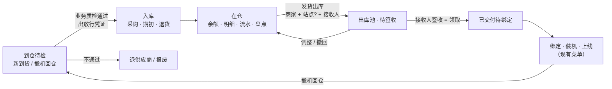

# 设备库存 · 运营端功能清单与矩阵（补「入库 → 出库」段）

> 2026-10-29 · 状态：草稿 · 待确认
> 补的是 [设备生命周期管理-运营端设计](设备生命周期管理-运营端设计.md) 里缺的 **① 入库 → ② 仓储 → ③ 出库交接** 一段，以及 ⑦ 回仓接回 ① 的那条回边。
> 依据：独立进销存的业务侧方案 [D-业务系统对接-需求方案与开发计划](../technical/独立进销存/D-业务系统对接-需求方案与开发计划.md)（下称 D）、[B-租户身份与权限方案](../technical/独立进销存/B-业务系统对接-租户身份与权限方案.md)（下称 B）、用户裁决 R1 ~ R4d（[评审](../technical/评审-独立进销存方案.md) §六）。
> 编号沿用 [运营端菜单功能矩阵](运营端菜单功能矩阵.md) 的 OM03-xx：已有功能保留原号，新功能从 **OM03-18** 起。
> 2026-10-29 补：参照 ai-shop B 端 app 的进销存 14 屏（`b-app/src/pages/stock*`、`purchase-edit`、`transfer`、`suppliers`、`locations`；ai-shop 文档《进销存-界面清单》《进销存-B端交互梳理》《进销存-录入效率-扫码与拍照》）补齐页面功能，见 §六、§七。

## 〇、一页看懂

**这一段管什么**：一台设备从「到了仓库门口」到「交到商家手里（签收）」，以及撤机后「回到仓库」。签收之后的绑定、装机、上线、监控、维修沿用现有菜单，不在本清单。

**谁在做**（D §〇）：入库、在仓、出库、盘点、流水记在**独立库存服务**；到仓待检、质检、签收后的归属、仓外履历、统一视图与报表在 **ShareHub**。运营人员只用 ops-web，看不出两边之分。

**数量**：「入库与质检」「仓储与出库」两组共 **11 个菜单叶**（新增 7、改造 3、沿用 1）；另在「设备档案」组新增「设备履历」，改造设备台账与撤机与回仓；外加 1 个报表叶、1 个商家门户页签；共 **38 个功能点**（其中 12 个参照 ai-shop B 端补齐）。

---

## 一、菜单（目标）

设备管理的分组从 6 组变 7 组：在「设备档案」与「仓储与出库」之间**新增「入库与质检」组**。其余分组不动。

| 组 | 叶 | 路径 | 权限码（读） | 编码 | 状态 | 数据在哪 | 阶段 |
|---|---|---|---|---|---|---|---|
| 设备档案 | 设备台账 | `/devices` | `device:cabinet:read` | OM03-01 | ◐ 改造：加「库存阶段」列与筛选（D §2.2） | 本地 | S2 |
| | 充电宝管理 | `/devices?tab=powerbanks` | `device:powerbank:read` | OM03-02 | ✅ 沿用 | 本地 | — |
| | **设备履历** | `/devices?tab=movements` | `device:inventory:read` | OM03-10 | 🆕 新增 | 本地履历 + 库存流水 | S2 / S4 |
| **入库与质检**（新组） | **到仓待检** | `/devices?tab=intakes` | `device:inventory:inbound` ＊ | OM03-18 | 🆕 新增 | 本地 | S2 |
| | **入库单** | `/devices?tab=inbounds` | `device:inventory:read` | OM03-07 | 🆕 新增（原「收货入库」，含采购 / 期初 / 退货三种用途） | 库存服务 | S4 |
| | 期初登记 | 并入「入库单」（用途 = 期初） | `device:cabinet:import` | OM03-03 | ◐ 改造：台账页「导入台账」按钮迁入入库单 | 库存服务 | S4 |
| | **供应商** | `/devices?tab=suppliers` | `device:inventory:read` | OM03-05 | 🆕 新增：**轻量档案**（参照 ai-shop：新建、改名不改历史、停用 / 启用），供入库与退供应商选择；不含采购单 | 库存服务 | S4 |
| **仓储与出库** | **库存总览** | `/devices?tab=inventory-overview` | `device:inventory:read` | OM03-19 | 🆕 新增：统一视图（到仓待检 · 在仓 · 待签收 · 已交付 · 投放中…） | 本地 + 库存服务 | S6 |
| | **仓库** | `/devices?tab=warehouses` | `device:inventory:read` | OM03-20 | 🆕 新增：S0 只读（接口已有）→ S4 可管理 | S0 本地 → 库存服务 | S0 / S4 |
| | 库存余额 | `/devices?tab=stock` | `device:inventory:read` | OM03-08 | ◐ 改造：改读后端；页内三个视图：按仓汇总 · 在仓明细 · 库存流水 | 库存服务 | S4 |
| | **发货出库** | `/devices?tab=outbounds` | `device:inventory:read` | OM03-09 | ◐ 改造：原「库存调拨」改名改造；仓间调拨放二期 | 库存服务 | S4 |
| | 出库池 | `/devices?tab=issued` | `device:inventory:read` | OM03-21 | ◐ 改造：四态（待签收 / 已签收 / 已撤回 / 已退回）+ 调整 / 撤回 | 库存服务 + 本地归属 | S4 |
| | **待我签收** | `/devices?tab=my-receipts` | `device:inventory:receive` ＊ | OM03-22 | 🆕 新增：运维的签收入口 | 库存服务 | S4 |
| | **盘点** | `/devices?tab=stocktakes` | `device:inventory:stocktake` | OM03-11 | 🆕 新增 | 库存服务 | S4 |
| | 资产差异 | `/devices?tab=asset-diffs` | `device:inventory:read` | OM03-12 | ✅ 沿用：只放业务差异（撤机清点缺件 / 多件） | 本地 | — |
| 维护与退出 | 撤机与回仓 | `/devices?tab=removals` | `workorder:wo:read` | — | ◐ 改造：去向「回仓」→ 生成到仓待检（不再生成本地回仓调拨单） | 本地 | S2 |
| 数据报表（L1） | **库存报表** | `/reports?tab=inventory` | `report:inventory:read` ＊ | OM10-xx | 🆕 新增：期初 · 入 · 出 · 期末（AC-08） | 本地 + 库存服务 | S6 |
| 商家门户 › 我的资产 | **待交付设备**（页签） | `/devices?tab=dispatch`（商家门户） | `device:cabinet:read` | OM12-xx | 🆕 新增：只读，强制本商家 | 库存服务 | S4 |

＊ 未在 [功能权限清单](功能权限清单.md) 登记，**先登记再用**。读权限统一用 `device:inventory:read`，写动作用各自的码（见 §三）。

**不进菜单的**（说明为什么，免得以后重提）：

| 原规划 | 去向 | 理由 |
|---|---|---|
| 采购单（OM03-06） | **待裁决 D1**，建议二期 | 采购是否纳入平台未定（K7）。供应商**档案**参照 ai-shop 与采购单分开、一期就上（见上表）；采购单流程（提交、审核、部分收货）二期 |
| 质检（独立页） | 并入「到仓待检」 | 质检只发生在到货 / 回仓这一刻，独立成页会让人去两个地方找同一台设备 |
| 库存流水（独立叶） | 库存余额页内视图 | 流水只在对账时看，单独占叶会把组撑到 10 个叶以上 |
| 仓间调拨 | 「发货出库」二期 | 一期只有发货与退货（D §3.5 D1） |

---

## 二、功能清单

编号 `INV-OP-xx`。「承载页」= 在哪个菜单叶里操作。

### ① 入库与质检

| 编号 | 功能 | 关键操作 | 承载页 | 权限码 | 数据在哪 | 阶段 |
|---|---|---|---|---|---|---|
| INV-OP-01 | **到货登记**：新到货设备登记为待检（仓、来源单、到达时间、SN / 数量） | 新建 · 扫码加设备 | 到仓待检 | `device:inventory:inbound` ＊ | 本地 | S2 |
| INV-OP-02 | **回仓登记**：撤机去向「回仓」自动生成待检单（无仓时生成待办） | 自动生成 · 查看 | 到仓待检 | 同上 | 本地 | S2 |
| INV-OP-03 | **业务质检**：机柜 / 充电宝逐台检测，留阈值快照，结论即放行凭证 | 检测 · 判定 · 查看记录 | 到仓待检 | `device:cabinet:update` / `device:powerbank:update` | 本地 | S2 |
| INV-OP-04 | **不合格处置**：退供应商 / 报废，原因必填 | 处置 | 到仓待检 | `device:inventory:inbound` ＊ | 本地 | S2 |
| INV-OP-05 | **采购入库**：选质检通过的设备 → 入库（供应商名、发票号、单价） | 新建 · 确认入库 | 入库单 | `device:inventory:inbound` ＊ | 库存服务 | S4 |
| INV-OP-06 | **期初入库**：存量设备无发票登记；依据（发票 / 送货单 / 合同 / 盘点 / 其他）、附件、期初价值 | 导入 · 校验 · 确认 | 入库单 | `device:cabinet:import` | 库存服务 | S4 |
| INV-OP-07 | **退货入库**：回仓设备复检通过 → 入库，关联原出库池记录；业务确认后解冻 | 确认入库 · 业务确认 | 入库单 | `device:inventory:inbound` ＊ | 库存服务 + 本地 | S4 |

### ② 在仓

| 编号 | 功能 | 关键操作 | 承载页 | 权限码 | 数据在哪 | 阶段 |
|---|---|---|---|---|---|---|
| INV-OP-08 | **仓库列表**（只读） | 查看 | 仓库 | `device:inventory:read` | 本地（S0 已有接口） | S0 |
| INV-OP-09 | **仓库管理**：新建、编辑、停用（区域必填；停用前逐项检查） | 新建 · 编辑 · 停用 | 仓库 | `device:inventory:warehouse` ＊ | 库存服务 | S4 |
| INV-OP-10 | **按仓汇总**：仓 × 型号，在手 / 不可用 / 可用 | 查看 · 导出 | 库存余额 | `device:inventory:read` | 库存服务 | S4 |
| INV-OP-11 | **在仓明细**：在仓 SN、冻结原因、入库单 | 查看 · 导出 | 库存余额 | 同上 | 库存服务 | S4 |
| INV-OP-12 | **库存流水**：按仓、型号、SN、单号、期间 | 查看 · 导出 | 库存余额 | 同上 | 库存服务 | S4 |
| INV-OP-13 | **盘点**：开盘（显示冻结范围与阻塞项）→ 扫码 → 提交 → 复核 → 过账 / 作废 | 开盘 · 扫码 · 提交 · 复核 · 过账 · 作废 | 盘点 | 录入 `device:inventory:stocktake`；复核 `device:inventory:stocktake-review` ＊ | 库存服务 | S4 |

### ③ 出库交接

| 编号 | 功能 | 关键操作 | 承载页 | 权限码 | 数据在哪 | 阶段 |
|---|---|---|---|---|---|---|
| INV-OP-14 | **发货出库**：来源仓 → **商家**（可选站点，须属于该商家）→ **内部接收人** → 扫 SN / 填数量 → 预览 → 确认 | 新建 · 预览 · 确认出库 | 发货出库 | `device:inventory:transfer` | 库存服务 | S4 |
| INV-OP-15 | **处置出库**：报废、退供应商（不进出库池） | 新建 · 确认 | 发货出库 | 同上 | 库存服务 | S4 |
| INV-OP-16 | **出库池查询**：按商家（含其站点）、站点、接收人、状态 | 查看 · 导出 | 出库池 | `device:inventory:read` | 库存服务 | S4 |
| INV-OP-17 | **出库调整**：待签收的改商家 / 站点 / 接收人，原因必填，留前后快照 | 调整 | 出库池 | `device:inventory:adjust` ＊ | 库存服务 | S4 |
| INV-OP-18 | **出库撤回**：待签收的撤回回仓 | 撤回 | 出库池 | 同上 | 库存服务 | S4 |
| INV-OP-19 | **释放领取**：已签收、未绑定、无业务占用的，受控释放后再调整 | 释放 | 出库池 | 同上 | 库存服务 + 本地 | S4 |
| INV-OP-20 | **签收（领取）**：接收人逐台 / 整单签收；本地写商家归属与履历 | 签收 | 待我签收 | `device:inventory:receive` ＊ | 库存服务 + 本地 | S4 |
| INV-OP-21 | **退回仓库（过渡期）**：出库池设备选仓退回（S0 已上线） | 选仓退回 | 出库池 | `device:inventory:transfer` | 本地 | S0 ✅ |

### ⑥ 参照 ai-shop B 端补齐的功能

| 编号 | 功能 | ai-shop 出处 | 关键操作 | 承载页 | 权限码 | 数据在哪 | 阶段 |
|---|---|---|---|---|---|---|---|
| INV-OP-27 | **安全库存与缺货预警**：型号 × 仓设安全库存，低于即进「要处理」；0 = 不预警 | 库存明细「安全库存」、库存「缺货」 | 设置 · 查看 | 库存余额 | 设置 `device:inventory:warehouse` ＊ | 库存服务（沿用 `safety_stock`） | S4 |
| INV-OP-28 | **跨仓视图**：一型号一行、各仓可用合计；展开看每个仓；页签「有仓缺货」 | 跨店库存 | 查看 · 展开 | 库存余额 | `device:inventory:read` | 库存服务 | S4 |
| INV-OP-29 | **统一单据**：入库 / 出库 / 盘点 / 调拨一张表；「只看这张单」；就地展开「这张单动了哪些设备」；作废草稿 | 单据 | 查看 · 展开 · 作废草稿 | 库存余额 | 读 `:read`；作废按单据类型的写权限 | 库存服务 | S4 |
| INV-OP-30 | **型号库存详情**：账面 / 不可用 / 可用、按仓分布、变动明细（点一行看那张单）、安全库存 | 库存明细 | 查看 · 设安全库存 | 库存余额（抽屉） | 同上 | 库存服务 | S4 |
| INV-OP-31 | **盘这一台 / 这一型号**：从型号详情或设备详情发起单项盘点（明确告知「会生成一张盘点单」） | 「盘这一件」 | 盘点 | 型号详情 · 设备详情 | `device:inventory:stocktake` | 库存服务 | S4 |
| INV-OP-32 | **挑设备**（共用件）：扫 SN / 搜索 / 按型号与仓筛选 / 已选计数；入库、发货、处置、盘点四处共用 | 「挑货」件 | 扫码 · 搜索 · 勾选 | 入库单 · 发货出库 · 盘点 | — | — | S4 |
| INV-OP-33 | **连续扫码**：扫中即加、不退出扫码；重复扫只提示不重计；未知 SN 列异常 | 盘点「连续扫码点数」 | 扫码 | 到仓待检 · 入库单 · 盘点 · 待我签收 | — | — | S4 |
| INV-OP-34 | **发货物流信息**：承运方、运单号（选填）；在途列表可按运单号查 | 调拨「发货信息」 | 填写 · 查询 | 发货出库 · 出库池 | `device:inventory:transfer` | 库存服务（出库单需加两列，回写 A 文档） | S4 |
| INV-OP-35 | **供应商档案**：新建；改名后历史单据仍显示当时的名字；停用 / 启用；入库时输入名称可就地新建 | 供应商 | 新建 · 改名 · 停用 · 启用 | 供应商 | `device:inventory:inbound` ＊ | 库存服务（沿用 `inv_supplier`） | S4 |
| INV-OP-36 | **库存设置**：型号跟踪方式（按台 / 按数量）与是否必须质检、默认回仓仓、到仓待检超时天数、盘点超时小时、安全库存默认值 | 库存设置、库位「发货源」 | 设置 | 仓库（设置区） | `device:inventory:warehouse` ＊ | 库存服务 + 本地参数 | S4 |
| INV-OP-37 | **报表平衡校验与压库**：报表顶部显示「台账平衡 / 不平衡，请勿据此对账」；列出在仓超过 N 天未动的设备（压库） | 报表「台账平衡」「滞销」 | 查看 · 下钻 | 库存报表 | `report:inventory:read` / `:export` ＊ | 本地 + 库存服务 | S6 |
| INV-OP-38 | **迁移对齐**：切换前对照「旧台账在仓」与「库存服务在仓」逐台差异，逐条选以哪边为准 | 期初对齐 | 对照 · 选择 · 确认 | 一次性页（切换期，`/devices?tab=inventory-align`，不进常驻菜单） | `device:inventory:warehouse` ＊ | 本地 + 库存服务 | S7 |

不借鉴的：线上库存同步、同步记录、线上可售规则（商城专用，设备没有「线上可售」）；预留（设备发货不走下单预留）；销货成本与毛利（设备不销售）。

### ④ 总览、履历与报表

| 编号 | 功能 | 关键操作 | 承载页 | 权限码 | 数据在哪 | 阶段 |
|---|---|---|---|---|---|---|
| INV-OP-22 | **统一库存视图**：按仓 / 商家 / 型号 × 阶段（到仓待检 · 在仓 · 待签收 · 已交付待绑定 · 已绑定待上线 · 投放中 · 故障维修 · 已离开） | 查看 · 下钻 | 库存总览 | `device:inventory:read` | 本地 + 库存服务 | S6 |
| INV-OP-23 | **设备履历**：全量查询（日期必填）；单台在设备详情时间轴 | 查看 · 导出 | 设备履历 | 同上 | 本地 + 库存服务 | S2 / S4 |
| INV-OP-24 | **库存报表**：期初 · 本期入（采购 / 期初 / 退货）· 本期出（发货 / 报废 / 遗失）· 期末 | 查看 · 导出 | 库存报表 | `report:inventory:read` / `:export` ＊ | 本地 + 库存服务 | S6 |
| INV-OP-25 | **到仓待检超时告警**（默认 7 天） | — | 到仓待检（标红）+ 工作台待办 | — | 本地 | S2 |

### ⑤ 商家门户

| 编号 | 功能 | 关键操作 | 承载页 | 权限码 | 数据在哪 | 阶段 |
|---|---|---|---|---|---|---|
| INV-OP-26 | **待交付设备**：出给本商家及其站点的设备，待交付 / 已交付 / 退回中；字段裁剪 | 查看 | 我的资产 › 待交付设备 | `device:cabinet:read`（商家） | 库存服务 | S4 |

---

## 三、矩阵

### 3.1 页面 × 角色

角色用现有角色码；**仓管**为建议新建角色（B §九 P1）。✏️ = 可操作 · 👁 = 只读 · 空 = 不可见。

| 页面 | 仓管 | 运维 `OPS` | 主管 `ADMIN` | 财务 `FINANCE` | 客服 `CS` | BD | 只读 `VIEW` | 商家 |
|---|---|---|---|---|---|---|---|---|
| 设备履历 | 👁 | 👁 | 👁 | 👁 | | | 👁 | |
| 到仓待检（含质检） | ✏️ | ✏️ 质检 | ✏️ | | | | 👁 | |
| 入库单 | ✏️ | 👁 | ✏️ | 👁 | | | 👁 | |
| 供应商 | ✏️ | | ✏️ | 👁 | | | 👁 | |
| 库存总览 | 👁 | 👁 | 👁 | 👁 | | 👁 | 👁 | |
| 仓库 | 👁 | 👁 | ✏️ | 👁 | | | 👁 | |
| 库存余额（含流水） | 👁 | 👁 | 👁 | 👁 | | | 👁 | |
| 发货出库 | ✏️ | 👁 | ✏️ | | | | 👁 | |
| 出库池 | 👁 | 👁 | ✏️ 调整 / 撤回 / 释放 | | | 👁 | 👁 | |
| 待我签收 | | ✏️ 本人 | ✏️ 本人 | | | | | |
| 盘点 | ✏️ 录入 | | ✏️ 复核 | 👁 | | | 👁 | |
| 资产差异 | 👁 | ✏️ | ✏️ | 👁 | | | 👁 | |
| 库存报表 | 👁 | | 👁 | 👁 | | | 👁 | |
| 待交付设备（商家门户） | | | | | | | | 👁 本商家 |

数据范围（B §3.4）在角色之上再收窄：`AGENT`（指定商家）的人在出库池 / 总览只看指定商家；`SELF` 只看自己作为接收人的出库。

### 3.2 权限码 × 角色

| 权限码 | 状态 | 仓管 | 运维 | 主管 | 财务 | 只读 |
|---|---|---|---|---|---|---|
| `device:inventory:read` | 已登记 | ✓ | ✓ | ✓ | ✓ | ✓ |
| `device:inventory:warehouse` | **新** | | | ✓ | | |
| `device:inventory:inbound` | **新** | ✓ | ✓（仅到仓登记与质检） | ✓ | | |
| `device:inventory:transfer` | 已登记 | ✓ | | ✓ | | |
| `device:inventory:receive` | **新** | | ✓ | ✓ | | |
| `device:inventory:adjust` | **新** | | | ✓ | | |
| `device:inventory:stocktake` | 已登记 | ✓ | | ✓ | | |
| `device:inventory:stocktake-review` | **新** | | | ✓ | | |
| `device:cabinet:import` | 已登记 | ✓ | | ✓ | | |

### 3.3 功能 × 阶段 × 依赖

| 阶段 | 功能 | 依赖 |
|---|---|---|
| **S0 ✅ 已完成** | INV-OP-08 仓库只读（接口）· INV-OP-21 出库池选仓退回 | — |
| **S2 业务侧**（现在可做） | INV-OP-01 ~ 04 到仓待检与质检 · INV-OP-23 本地履历 · 台账库存阶段列 · 撤机回仓改造 · INV-OP-25 | 无 |
| **S4 运营端**（页面先跑 mock） | INV-OP-05 ~ 07、09 ~ 20、26、27 ~ 36 | 库存服务 M1 ~ M2 联调；先按契约在 mock 上做 |
| **S6 总览与报表** | INV-OP-22、24、37 | 库存服务 M3（期间汇总） |
| **S7 迁移切换** | INV-OP-38 | 库存服务 M4（迁移工具） |
| **二期 / 待裁决** | 采购单（D1）· 仓间调拨 | 用户裁决 |

### 3.4 生命周期环节 × 菜单（补齐后）

| 环节 | 菜单叶 | 本次 |
|---|---|---|
| ① 入库 | 到仓待检 · 入库单（采购 / 期初 / 退货）· 供应商 | **补** |
| ② 仓储 | 仓库 · 库存余额 · 盘点 · 库存总览 | **补** |
| ③ 出库交接 | 发货出库 · 出库池 · 待我签收 | **补** |
| ④ 部署与安装 | 部署与装机 | 现有 |
| ⑤ 绑定上线 | 待上线 · 设备编码 · 厂商接入 | 现有 |
| ⑥ 运行监控 | 实时监控 · 远程控制 · 设备日志 · 固件 OTA | 现有 |
| ⑦ 维护与退出 | 故障与维修 · 撤机与回仓（→ 到仓待检）· 报废与遗失 | 现有（撤机改造） |
| 贯穿 | 设备台账 · 充电宝管理 · 设备履历 · 资产差异 | 履历补 |

---

## 四、与现有文档的差异（定稿后同步）

| 文档 | 要改的 |
|---|---|
| [运营端菜单功能矩阵](运营端菜单功能矩阵.md) OM03 | 分组按生命周期重排（10-28 起菜单已是新分组，矩阵还是旧的）；OM03-05/06 标「待裁决 D1」；OM03-07 改名「入库单」；新增 OM03-18 ~ 22；补出库池与五个生命周期视图 |
| [设备生命周期管理-运营端设计](设备生命周期管理-运营端设计.md) §四 ①②、§五.1 | ① 入库改为「到仓待检 → 业务质检 → 入库」；② 出库改为「发货出库 → 出库池 → 签收」；菜单表按本文 §一 |
| [功能权限清单](功能权限清单.md) | 登记 5 个新码；建议新增「仓管」角色 |
| `ops-web/lib/nav.ts` + 迁移 | 新增「入库与质检」组与 7 个新叶，改名 2 个；按菜单约定四件套（迁移、nav-seed PATCH、nav.test、可见性快照、nav-labels、后端 MenuTreeTest） |

## 五、待确认（2026-10-29 用户「按照建议执行」：M1 ~ M5 均按建议定；并定页面原则——基于组件库、表格为核心、弹窗表单围绕表格、少解释文字、一页只做一个领域的增删查改）

| # | 事项 | 建议 |
|---|---|---|
| M1 | 新增「入库与质检」组，还是把入库放进「仓储与出库」 | 新增组：入库是生命周期的独立环节，放进去后「仓储与出库」会有 11 个叶 |
| M2 | 「库存调拨」改名「发货出库」 | 改：一期它只做发货；仓间调拨二期再加回来时作为页内用途 |
| M3 | 「仓库」叶 S0 就上（只读） | 上：接口已有，运营能看到有哪几个仓、哪个是默认回仓 |
| M4 | 仓管是否单独建角色 | **已定（2026-10-29）**：单独建；授权见 [设备管理-运营端菜单角色功能矩阵](设备管理-运营端菜单角色功能矩阵.md) |
| M5 | 供应商档案一期（轻量）、采购单二期 | 参照 ai-shop：档案与采购流程分开；采购单等 D1 |

---

## 六、页面功能明细（参照 ai-shop B 端补齐）

每页按「视图 / 顶部统计 / 筛选 / 列表列 / 操作 / 提示与空态 / 回链」写。「回链」= 从这一页的结果直接到它的对象，不用退回菜单重走（ai-shop《B端交互梳理》§3.3 的做法）。

### 6.1 到仓待检（入库与质检）

| 项 | 内容 |
|---|---|
| 视图 | 页签：**要处理**（待检 · 不合格待处置 · 超时）/ 全部 / 已入库 / 已处置 |
| 顶部统计 | 待检台数 · 不合格待处置 · 超过 N 天未处理（标红） |
| 筛选 | 仓 · 来源（新到货 / 撤机回仓）· 型号 · 到达日期 |
| 列表列 | 待检单号 · 来源（到货单号 / 撤机工单号，可点）· 仓 · 设备（柜 SN / 宝数量）· 质检结论 · 到达时间 · 已等待天数 |
| 操作 | 新建到货登记（**连续扫码**加设备）· 逐台质检（检测项 + 结论，阈值随记录留快照）· 不合格处置（退供应商 / 报废，原因必填）· 勾选合格设备 →「去入库」（带到入库单，用途按来源自动选采购 / 退货） |
| 提示 | 「待检设备还不在库存里，入库后才计入仓库余额」· 「质检记录就是入库的放行凭证，一条只能用一次」· 撤机回仓的设备：「回仓必须重新质检，不能沿用上次的结论」 |
| 空态 | 「没有待检设备。新到货请点「到货登记」；撤机回仓的会自动出现在这里」 |
| 回链 | 撤机工单号 → 工单详情；入库后 → 那张入库单；设备 SN → 设备详情 |

### 6.2 入库单（入库与质检）

| 项 | 内容 |
|---|---|
| 视图 | 页签：全部 / 草稿 / 已入库；用途：采购 / 期初 / 退货 |
| 列表列 | 入库单号 · 用途 · 仓 · 供应商（快照名）· 台数 / 数量 · 实际入库日期 · 状态 · 经办人 |
| 编辑（参照「进货」） | 用途 · 仓 · 供应商（从档案选，**输入新名称可就地建档**）· **实际入库日期**（可回填，报表按它而不是录入时间算）· 用**挑设备**选「质检已通过」的设备（扫码优先）· 单价（选填）· 合计；期初额外：依据（发票 / 送货单 / 合同 / 盘点 / 其他）、附件、期初价值（可空） |
| 操作 | **存草稿 · 过账入库** · 作废草稿 · 期初批量导入（原台账「导入台账」迁来：先校验、一次列全错误、再确认） |
| 提示 | 「草稿不影响库存」· 过账确认框：「入库后计入 {仓} 余额；已过账的入库单不能作废，纠错走盘点或退货」 |
| 空态 | 「还没有入库单。到货设备先在「到仓待检」质检，合格后从那里一键入库」 |
| 回链 | 每行设备 → 设备详情；单号 → 统一单据「只看这张单」 |

### 6.3 供应商（入库与质检）

| 项 | 内容 |
|---|---|
| 列表 | 名称 · 联系人 / 电话 · 状态（启用 / 已停用）· 最近入库日期 |
| 操作 | 新建 · 改名 · 停用 / 启用（不删除） |
| 提示 | 「入库单与退供应商单指向这里的档案。改了名，历史单据仍显示当时那个名字。」 |
| 空态 | 「还没有供应商。记入库时输入名称就能建。」 |

### 6.4 库存总览（仓储与出库）

| 项 | 内容 |
|---|---|
| 视图 | 维度切换：按仓 / 按商家 / 按型号 |
| 阶段列 | 到仓待检 · 在仓（可用 / 不可用）· 已发货待签收 · 已交付待绑定 · 已绑定待上线 · 投放中 · 故障维修 · 已离开 |
| 操作 | 点任意数字下钻到对应页面并带上筛选（例：「AG001 · 已发货待签收 3」→ 出库池筛 AG001 + 待签收） |
| 提示 | 「同一台设备只出现在一个阶段。仓内数据来自库存服务，仓外来自设备台账」 |

### 6.5 仓库（仓储与出库）

| 项 | 内容 |
|---|---|
| 列表（S0 只读） | 仓号 · 名称 · 区域 · 地址 · 默认回仓（标记）· 在仓台数 |
| 操作（S4） | 新建仓库 · 编辑 · 停用（不删除；停用前逐项检查：有余额 / 有未完成单 / 盘点中，列出原因） |
| 设置区（库存设置，INV-OP-36） | 默认回仓仓 · 到仓待检超时天数 · 盘点超时小时 · 型号跟踪方式与是否必须质检 · 安全库存默认值 |
| 提示 | 在途不是一个仓：「已发货待签收的设备不在任何仓，见出库池」 |
| 空态 | 「还没有仓库」+「新建仓库」 |

### 6.6 库存余额（仓储与出库；参照「库存」「跨店库存」「库存明细」「单据」）

| 项 | 内容 |
|---|---|
| 视图 | **要处理**（低于安全库存 · 有冻结 · 退货待业务确认）/ 按仓汇总 / **跨仓**（一型号一行，展开看各仓）/ 在仓明细（SN）/ 流水 / **单据** |
| 顶部统计 | 在仓 · 不可用（冻结）· 低于安全库存的型号数 · 已发货待签收 |
| 每行数字 | 实存 · 不可用 · 可用，旁边一行公式提示：「可用 = 实存 − 不可用；不可用 = 盘点冻结 + 退货待确认」 |
| 型号详情（抽屉） | 账面 / 不可用 / 可用 · 按仓分布 · 变动明细（**点一行看那张单**）· 安全库存（「低于这个数进「要处理」；0 = 不预警」）· 「盘这一型号」 |
| 单据视图 | 页签：全部 / 入库 / 出库 / 盘点 / 调拨；「只看 {单号}」/「看全部」；就地展开「这张单动了这些设备」；草稿可作废；提示「按单看变动。想知道某型号怎么变的，去型号详情」 |
| 空态 | 无仓：「还没有仓库，去仓库页看看」（链接）；无数据：「这个仓还没有设备」 |
| 回链 | 流水行 → 单据；单据行 → 设备；SN → 设备详情 |

### 6.7 发货出库（仓储与出库；参照「报损」「调拨」）

| 项 | 内容 |
|---|---|
| 视图 | 页签：全部 / 草稿 / 已出库；用途：发货给商家 / 报废 / 退供应商 |
| 新建发货 | 来源仓 → **商家**（必选）→ 站点（可选，只列该商家的站点）→ **内部接收人**（必选，只列启用的运维）→ 用**挑设备**选在仓可用设备（显示「可用 {n}」）/ 充电宝填数量 → **物流信息**（承运方、运单号，选填）→ 预览（来源、目的地、接收人、台数、冻结提示）→ 确认出库 |
| 新建处置 | 类型（报废 / 退供应商）· 退给（选供应商）· 日期 · 原因（必填，词表）· 挑设备 → 过账出库 |
| 提示 | 「确认后设备离开仓库，进入出库池等接收人签收；签收前可在出库池调整或撤回」· 「已出库的单不能作废」 |
| 空态 | 「还没有出库单」 |
| 回链 | 出库单 → 出库池「只看这张单」；接收人 → 待我签收（主管视角） |

### 6.8 出库池（仓储与出库）

| 项 | 内容 |
|---|---|
| 视图 | 页签：**待签收**（= 在途）/ 已签收 / 已撤回 / 已退回 |
| 筛选 | 商家（含其站点）· 站点 · 接收人 · 型号 · 出库单号 · **运单号** · 日期 |
| 列表列 | 设备 · 商家 › 站点 · 接收人 · 出库单号 · 运单号 · 发出时间 · 状态 · 已签收的绑定情况 |
| 操作 | 待签收：调整（商家 / 站点 / 接收人，原因必填，显示调整前后）· 撤回回仓；已签收未绑定：释放领取；过渡期：选仓退回（S0） |
| 提示 | 已签收行的调整按钮置灰并说明：「已签收，先释放领取（须未绑定、无业务占用）再调整」 |
| 回链 | 设备 → 设备详情（签收后看绑定进度）；出库单号 → 单据 |

### 6.9 待我签收（仓储与出库）

| 项 | 内容 |
|---|---|
| 视图 | 只显示当前登录人作为接收人的待签收设备，按出库单分组 |
| 操作 | 整单签收 · 逐台签收（**连续扫码**核对：扫中即勾，少扫的不能签）· 有问题联系发货人（显示出库单经办人） |
| 提示 | 签收后：「设备已交给 {商家}，下一步在出库池绑定点位」；处理中：「签收处理中，可稍后刷新查看结果」（不让重复点） |
| 空态 | 「没有要你签收的设备」 |

### 6.10 盘点（仓储与出库；参照「盘点」）

| 项 | 内容 |
|---|---|
| 开盘 | 选仓 → 选型号（搜索、全选 / 清空，显示「账面 {n}」）→ 开盘前列出**阻塞项**（有未完成出入库单、退货待确认）→「开始盘点（{n} 型号）」 |
| 进行中 | 「账面数已于 {时间} 锁定」· 冻结说明：「盘点期间该仓的入库、发货、签收暂停，盘点完成或作废后恢复」· 超过 N 小时提醒：「请完成并提交，或确认后作废以恢复出入库」 |
| 录入 | **连续扫码**（按台）/ 录数（按数量的型号）· 重扫只提示 · 未知 SN 列为异常候选 · 「还有 {n} 型号未录入实盘数；实盘为 0 也请填 0」 |
| 差异 | 有差异的行原因必填 · 合计差异 |
| 提交与复核 | 提交 → 复核（复核人 ≠ 录入人）→ 过账；过账前提示：「盘盈生成入库单，盘亏生成出库单」· 驳回回到录入 |
| 作废 | 「作废这张单」，立即解冻 |
| 回链 | 过账后 → 生成的盘盈 / 盘亏单 |

### 6.11 资产差异（仓储与出库）

沿用现页。只放业务差异（撤机清点缺件 / 多件），仓内差异由盘点产生、在单据里看。

### 6.12 设备履历（设备档案）

| 项 | 内容 |
|---|---|
| 筛选 | 日期范围（必填）· 设备 · 事件类型 · 仓 / 商家 / 站点 · 操作人 |
| 列表列 | 时间 · 设备 · 事件 · 从 → 到 · 负责人 · 原因 · 来源单（可点） |
| 单台 | 设备详情「库存时间轴」：仓内段（库存服务流水）+ 仓外段（本地履历）+ 状态日志合并 |

### 6.13 库存报表（数据报表；参照「报表」）

| 项 | 内容 |
|---|---|
| 选择 | 月份（或起止日期）· 仓 · 型号 |
| 数量表 | 期初 · 入（采购 / 期初 / 退货）· 出（发货 / 报废 / 退供应商 / 遗失）· 调整（盘盈 / 盘亏 / 撤回）· 期末 |
| 平衡校验 | 表头显示「台账平衡」或「台账不平衡，请勿据此对账」 |
| 压库 | 在仓超过 N 天未动的设备，按型号汇总（「压 {n} 台」），可下钻 |
| 口径说明 | 「仓内数字来自库存服务，按实际入库 / 出库日期算；仓外数字来自设备台账」 |
| 导出 | 走导出中心 |

### 6.14 待交付设备（商家门户）

| 项 | 内容 |
|---|---|
| 视图 | 待交付 / 已交付 / 退回中 |
| 列 | 设备 · 站点 · 发出日期 · 状态（不含仓库、接收人工号、成本；接收人显示「平台运维」） |
| 空态 | 「平台还没有给你发货」 |

---

## 七、跨页交互规则（参照 ai-shop《B端交互梳理》）

| # | 规则 | 防住什么 |
|---|---|---|
| 1 | **开单动作共用「挑设备」件**：扫码 / 搜索 / 按型号与仓筛选 / 已选计数（入库、发货、处置、盘点四处） | 几百台设备时开单不可用；四种挑法四种学习成本 |
| 2 | **扫码优先、连续扫码**：扫中即加、不退出；重复只提示 | 盘点、签收逐台过，每扫一台退出重进效率低 |
| 3 | **草稿不影响库存，过账才影响**，按钮写「存草稿」「过账入库 / 出库」 | 把「保存」当成「已入库」 |
| 4 | **已过账的单不能作废**，纠错路径在提示里写出来（盘点 / 退货 / 撤回） | 作废只改账不改实物，账实不符 |
| 5 | **结果到对象的回链**：流水 → 单据、单据 → 设备、设备 → 履历 | 查一件事要退回菜单重走三次 |
| 6 | **「盘这一台 / 这一型号」写明会生成盘点单** | 莫名其妙多出一张盘点单（ai-shop 曾把它叫「调整数量」踩过） |
| 7 | **数字旁边写公式**（可用 = 实存 − 不可用） | 运营看到「可用 < 实存」以为数错了 |
| 8 | **空态指向下一步**（「去建仓」「在到仓待检一键入库」） | 空白页不知道该去哪 |
| 9 | **超时提醒**（待检 N 天、盘点 N 小时） | 冻结忘了解、待检设备在仓库角落放半年 |
| 10 | **网络慢时显示「处理中」，不让重复提交** | 重复签收、重复出库 |

## 八、对上游文档的回写（2026-10-29 已回写）

| 文档 | 要补的 |
|---|---|
| ai-shop `handoff/sharehub-进销存/进销存-独立服务改造方案.md` | 出库单加承运方、运单号（INV-OP-34）；沿用 `inv_supplier` 与 `safety_stock` 供 ShareHub 使用（INV-OP-35、27）；单据统一查询支持按类型与单号（INV-OP-29） |
| [D-业务系统对接](../technical/独立进销存/D-业务系统对接-需求方案与开发计划.md) | 菜单从 8 个页签增至本文 §一；库存设置参数（待检超时、盘点超时、默认回仓） |
