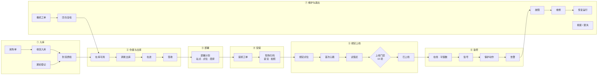
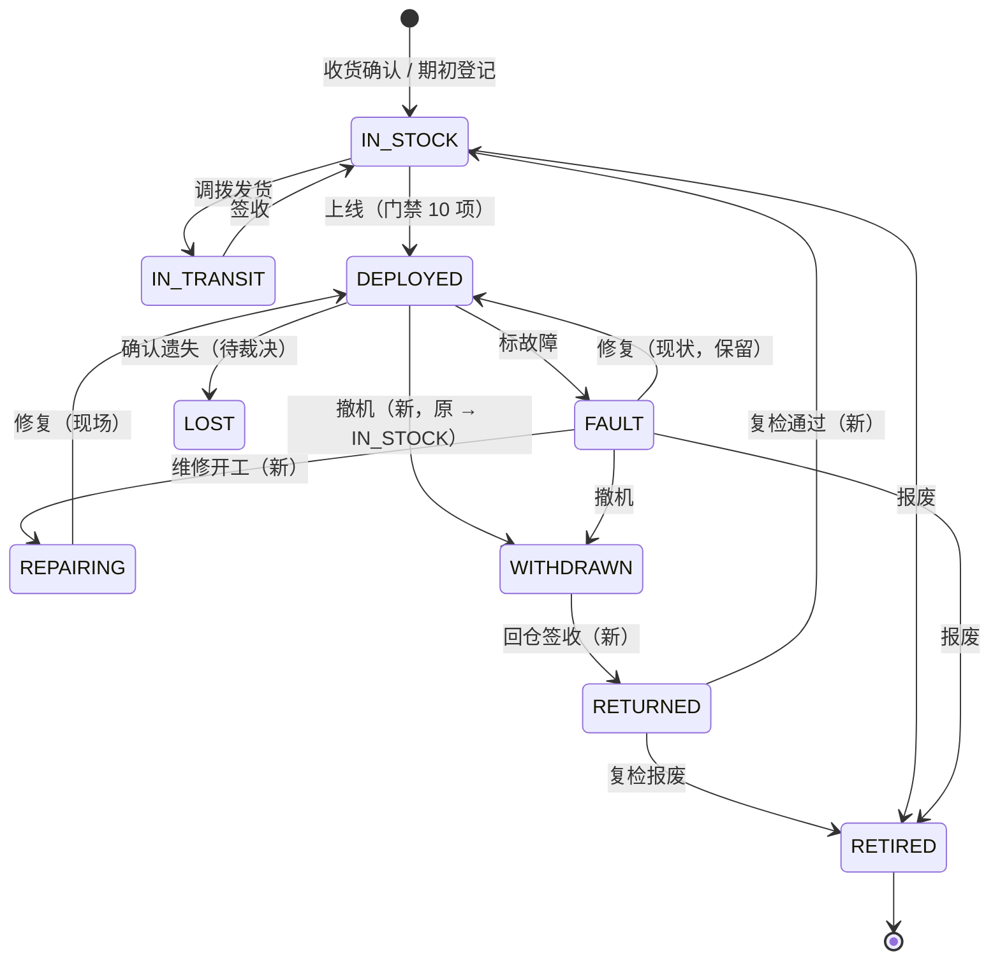

# 设备生命周期管理 · 运营端设计（以设备为核心）

> 状态：**待确认**（2026-10-28）· 适用：运营端「设备管理」（OM03）重整
> 依据：服务端评审 [S4 设备采购入库](../technical/功能评审/S4-设备采购入库.md)、[S5 设备上线与归属](../technical/功能评审/S5-设备上线与归属.md)、[S10 资产流转与撤场](../technical/功能评审/S10-资产流转与撤场.md)，以及当前代码（引用格式 `文件:行`，后端路径省略 `backend/…/ai/neargo/sharehub/`）。
> 本文是方案，不改代码。确认后按 §八 的两期落地。

---

## 一、为什么要重整

今天的设备管理（V150，OM03）按「资产台账 → 库存与流转 → 设备接入 → 在线运行」四组排列，组是**数据类型**，不是设备经历的**环节**。一台柜子从到货到上线要经过的「装机」「绑定」「试借还」「上线门禁」在菜单里找不到：

- 装机与撤机在运维管理 › 工单里，与报修、清洁混在一起；
- 绑定点位藏在台账的「编辑」里，上线门禁、试借还藏在设备详情页；
- 维修、撤出、报废只是台账上的几个状态值，没有入口能回答「现在有多少台在修、修了多久」。

运营要回答的问题是**「这台设备现在在生命周期的哪一步、卡在哪、下一步谁做」**。本方案把设备管理改成按生命周期排列：**入库 → 出库 → 部署 → 安装 → 绑定上线 → 监控 → 维护与退出**，每一步有一个入口、一类单据、一个负责岗位、一组门禁。

---

## 二、全流程总览

| # | 环节 | 回答 | 主单据 | 负责岗位 | 机柜进入的状态 |
|---|---|---|---|---|---|
| ① | 入库 | 买了多少、到了多少、能不能用 | 采购单 · 收货单 · 期初批次 · 质检记录 | 运营采购 · 仓管 | 已订购 → 已收货（待质检）→ 库存可用 |
| ② | 仓储与出库 | 每个仓有什么、发去哪、到了没有 | 调拨单 · 盘点单 · 资产差异 | 仓管 | 库存可用 → 在途 → 库存可用（目的仓） |
| ③ | 部署 | 这台柜子要装到哪个站点哪个点位、归哪个商家 | 部署计划（装机工单的派单前半段）· 划拨 | 运营 · BD | 库存可用（已指派） |
| ④ | 安装 | 装上了没有、装了多少宝、现场照片 | 装机工单 | 运维 | 库存可用（已装待绑定） |
| ⑤ | 绑定上线 | 系统认不认得它、能不能借还、满足上线条件没有 | 绑定（点位 · 网关）· 试借还 · 上线门禁 | 运维 · 运营 | **已上线** |
| ⑥ | 监控 | 现在在不在线、能借几个、出了什么信号 | 信号 · 保护动作 · 告警 · 指令记录 | 运维 · 客服 | 已上线 / 故障 |
| ⑦ | 维护与退出 | 坏了谁修、撤下来去哪、什么时候报废 | 故障工单 · 撤机工单 · 回仓调拨 · 报废 | 运维 · 仓管 · 财务 | 故障 → 维修中 → 已上线；已撤出 → 退回仓库；报废 / 遗失 |

**用户提的顺序「入库 → 出库 → 部署 → 安装 → 绑定 → 监控」照搬**，只补两件事：
1. **「绑定」放在安装之后**，与今天的代码一致 —— 装机完工时现场扫码的点位才是真位置（`core/dev/port/InstallCompletedListener.java:50-53` 会按扫码点位改绑），之后才谈得上心跳、试借还与上线。办公室里预先填的点位只是「部署计划」，不是绑定。
2. 末尾补一环 **「维护与退出」**：设备不会停在监控，故障、维修、撤机、报废都要有去处，否则「已撤出」「维修中」的设备在任何列表里都找不到。

---

## 三、设备状态模型

### 3.1 两层状态：存储态 + 展示态

运营要的是看板与报表上的**十个运营状态**（RQ-AST-07），不是十个状态机节点。沿用 S4 §2.3 的建议：**存储态少而严（状态机强制），展示态由存储态 + 单据派生（`assetStatus` 出参）**。「已订购」时设备行还不存在，不能是设备状态。

| 运营状态（展示态） | 所在环节 | 机柜存储态 | 充电宝存储态 | 派生口径 | 今天 |
|---|---|---|---|---|---|
| 已订购 | ① | — | — | 采购单行 `订购数 − 已收数` | ❌ 无采购单（OPT-S4-01） |
| 已收货（待质检） | ① | `IN_STOCK` | `IN_STOCK` | `qcStatus = PENDING` | ◐ 柜可；宝新建不进质检（OPT-S4-14） |
| 库存可用 | ② | `IN_STOCK` | `IN_STOCK` | 质检放行、无点位 | ✅ |
| 在途 | ② | `IN_TRANSIT` | （派生） | 在未完结调拨单上 | ✅ 柜 · ◐ 宝（S10 §五 #3） |
| 待安装 | ③④ | `IN_STOCK` | — | 已绑点位、有未完结装机工单 | ◐ 有数据无派生 |
| 待上线 | ⑤ | `IN_STOCK` | — | 装机工单已完工、上线门禁未通过 | ◐ 有数据无派生 |
| 已上线 | ⑥ | `DEPLOYED` | `IN_CABINET` · `RENTED` | — | ✅ |
| 故障 | ⑦ | `FAULT` | `FAULT` | 已标故障、未开工维修 | ✅ |
| 维修中 | ⑦ | `REPAIRING` | `FAULT` | 维修工单开工即进入 | ❌ 与故障合并（OPT-S5-04，待裁决） |
| 已撤出 | ⑦ | `WITHDRAWN` | — | 撤机完工、回仓调拨未签收 | ❌ 今天撤机直接回 `IN_STOCK`（S5 P0-6） |
| 退回仓库 | ⑦→② | `RETURNED` | `IN_STOCK` | 回仓签收、未复检 | ❌ 同上 |
| 遗失 | ⑦ | `LOST`（待裁决） | `LOST` | 宝经「疑似丢失 → 人工确认」 | ◐ 宝有、柜无 |
| 报废 | ⑦ | `RETIRED` | `SCRAP` | — | ✅ |

### 3.2 机柜状态机（目标）

今天 5 个存储态、7 条迁移（`core/dev/CabinetStateMachine.java:15-23`），动作都按原状态条件更新、并发输家 409（`CabinetLifecycleServiceImpl.java:255-266`）—— 骨架是对的，只补节点：

带「新」的迁移都在 S5 §4.2 的契约草案里（`receive-back`、`send-repair`、`repair-done`、`mark-lost`），**待运营方裁决「维修中 / 损坏如何区分、机柜是否需要遗失」后生效**。

### 3.3 充电宝生命周期

宝跟着柜走，但有自己的一条线：

| 环节 | 状态 | 进入方式 | 今天 |
|---|---|---|---|
| 入库 | `IN_STOCK` + 待质检 | 收货 / 期初 / 新建 | ◐ 新建不进质检（OPT-S4-14） |
| 装柜 | `IN_CABINET` | 装机时随柜装入、补货工单 | ❌ **没有任何动作把宝从在库变成在柜**；今天只能靠设备上报（`PowerbankStateMachine` 的 `DEPLOY` 无调用方） |
| 借出 / 归还 | `RENTED` ↔ `IN_CABINET` | 订单驱动（`PowerbankTracker.java`） | ✅ |
| 疑似丢失 → 遗失 | `LOST` | 超时打标记、人工确认（`PowerbankLossServiceImpl.java:124`） | ✅ |
| 故障 / 维修 | `FAULT` → `IN_STOCK` | 报故障、维修 | ✅（但「修改」接口接受全部 11 个事件，S4 P0-2） |
| 老化 | 健康度 `AGED` | ≥ 500 次循环（`PowerbankAgingJob.java:31-43`） | ✅ 不再出借，但不自动报废 |
| 售出 / 报废 | `SOLD` / `SCRAP` | 买断订单 / 人工 | ✅ |

---

## 四、逐环节设计

每环节写：**目的 · 入口 · 前置条件 · 产出 · 现状 · 差距与依赖**。

### ① 入库

- **目的**：确认实际收货才增加库存（RQ-AST-05 · AC-07）；存量设备有据可查地登记进来。
- **入口**：供应商 · 采购单 · 收货入库 · 期初登记。
- **流程**：采购单 `草稿 → 提交 → 审核（四眼）→ 收货中 → 已收齐 / 人工关闭`；收货单逐台扫 SN，确认后生成设备行，`IN_STOCK + 待质检 + origin=PURCHASE`；**超收拒绝、SN 重复一次列全**。期初批次 `草稿 → 确认`，标依据（发票 / 送货单 / 合同 / 盘点 / 其他）、附件、期初价值。
- **产出**：设备行、质检待办、履历 `STOCK_IN`。
- **现状**：❌ 采购与收货整项不存在；设备**建档即 `IN_STOCK`**，绕过收货（`CabinetServiceImpl.java:62-69`）；期初导入**必然失败**（从不写 `sn`，S4 P0-1），前端模板带的 `sn / model / slotTotal` 被丢弃。
- **依赖**：OPT-S4-01 ~ 12（契约 S4 §4.1 ~ 4.4）；**裁决 K7「采购是否纳入平台」**、直接建档入口是否关闭（S4 §五 #2）。

### ② 仓储与出库

- **目的**：每个仓有什么、发去哪、到了没有、账实对不对。
- **入口**：仓库 · 库存余额 · 调拨出库 · 盘点 · 资产差异。
- **流程**：调拨单 `草稿 → 加明细 → 发货（柜须在库且质检放行）→ 在途 → 签收（逐件核对，缺件 / 多件落资产差异）`；盘点 `计划 → 实盘扫码 → 提交 → 审批 → 差异`；差异 `提出处置 → 审批（四眼）→ 执行调整`。
- **产出**：履历 `TRANSFER_OUT / TRANSFER_IN / ADJUST`；资产差异。
- **现状**：✅ 发货、签收两个动作写得对（条件更新、缺件落差异，`TransferOpsServiceImpl.java:145-185`）。❌ 仓库**没有任何写入方与读取端点**，调拨单的仓填的是自由文本；生产若没有仓，撤机回仓**静默不生成回仓单**（S10 P0-2）。❌ 调拨单「保存」端点可直接改状态，绕过发货校验（S10 P0-1）。◐ 库存余额今天由前端把柜 / 宝列表拉回来现算（`components/device/stock-balance.tsx`）。❌ 盘点不存在。
- **依赖**：OPT-S10-01 ~ 06、14、15、17（契约 S10 §4.1 ~ 4.3、4.5、4.6）；裁决：调拨终点是否只允许仓（S10 §五 #2，**建议只到仓，仓 → 点位由装机工单落位**）、盘点是否一期（#1）、盘点期间是否冻结（#5）。

### ③ 部署

- **目的**：在办公室把「哪台柜子、装到哪个站点哪个点位、归哪个商家」定下来，派出去装。
- **入口**：部署与装机（新页签，见 §五）。
- **前置条件**：站点处于筹备 / 营业；点位已建；合同有效；首台柜的站点已勘测。
- **产出**：装机工单（`INSTALL`，带计划点位与柜号）；必要时随单生成「仓 → 站点」的出库调拨。
- **现状**：◐ 装机工单**只能人工新建**，在运维管理 › 工单列表里与报修、清洁混在一起；计划点位写在机柜「编辑」里（改点位只允许在库，`CabinetServiceImpl.java:47-118`）。归属由点位反查（`siteNo / agentNo` 不收入参），与划拨（商家管理 › 设备/点位划拨）有六个写入方互相覆盖（S5 §二）。
- **依赖**：可先做（前端按类型过滤工单 + 发起装机工单）；归属单一写入口随 OPT-S5-08 ~ 12。

### ④ 安装

- **目的**：现场装好、装够宝、拍照留证。
- **入口**：部署与装机 · 运维 App / H5 完工。
- **前置条件**：装机工单已派；柜子已到站（若调拨终点只到仓，则由运维从仓领用）。
- **产出**：完工照片、实际点位（现场扫码）、装宝数；完工事件触发绑定与上线判定。
- **现状**：✅ 装机完工须带照片、可带扫码点位；完工后若柜在库则按扫码点位改绑、再尝试上线（`InstallCompletedListener.java:44-63`）。◐ **门禁不过时静默停在在库**，运营不知道它卡在哪一项。❌ 装宝不落宝的状态（§3.3）。
- **依赖**：门禁不过时生成待办或在工单上回写未通过项（前端可先在「待上线」列表里显示门禁结果）；宝装柜动作（新，建议并入 OPT-S4-13 ~ 17）。

### ⑤ 绑定上线

- **目的**：系统认得这台设备（网关、点位），它能借能还，满足上线条件。
- **三层绑定**：
  1. **设备码 ↔ 设备**：二维码 / SN 码段与柜号对应（设备编码）。今天码段只是登记，`bound` 没有写入方、不校验柜的 SN 是否在码段内（`CodeBatchServiceImpl.java:59`）。
  2. **网关 ↔ 设备**：厂商的设备 ID 与本系统柜号对应（`gw_device_binding` 已建表、无人使用）；未知设备的上报被丢弃并打 WARN（`DeviceSignalServiceImpl.java:139-142`），不会自动登记。
  3. **设备 ↔ 点位**：`locationNo`，站点与商家由点位反查。
- **上线门禁 10 项**（服务端强制，`CabinetLifecycleServiceImpl.java:91-134`）：质检 · 勘测（筹备站首台）· 装机工单已完工 · 装宝比例 50% ~ 80% · 点位 · 站点营业 · 合同有效 · 在线（3 分钟内心跳）· 试借还通过（晚于最近一次绑定）· 计费方案。
- **产出**：`IN_STOCK → DEPLOYED`、`went_live_at`（即安装日期，S5 §4.2）、站点 `筹备 → 营业`（`CabinetWentLiveEvent`）、履历 `INSTALL`。
- **现状**：✅ 门禁与手动 / 完工自动上线都在。❌ **所有指令都是桩**：试借还的弹仓、扫码借出都落到返回假编号的 `sendCommand`，且模拟出宝回执默认开启（S5 P0-2）—— 今天没有一台真柜机能接进来（S5 P0-3）。
- **依赖**：设备对接服务（OPT-S5-13 ~ 23，第一阶段前置）；码段校验（OPT-S4-19，裁决「设备码与设备号是否分离」S4 §五 #9）。

### ⑥ 监控

- **目的**：在不在线、能借几个、出了什么信号、系统自动做了什么。
- **入口**：实时监控 · 远程控制与指令记录 · 设备日志 · 固件 OTA；信号 → 保护动作 → 告警 → 工单（告警在运维管理）。
- **现状**：✅ 心跳、可借数、信号字典、保护动作（引用计数，`dev_protection`）、信号转告警都在。◐ 离线不落库，靠 3 分钟窗口现算；**故障信号与告警从不改机柜状态**，标故障只能人工。❌ 指令是桩（同 ⑤）；「故障自动开工单」按钮读的字段与后端出参对不上（前端读 `created / skipped / eligible`，后端回 `{raised}`）。
- **依赖**：OPT-S5-13、23（指令真实化与回执）；告警驱动标故障（新，建议与 S9 一起定：严重设备告警是否自动 `MARK_FAULT`）。

### ⑦ 维护与退出

- **目的**：坏了谁修、修了多久；撤下来去了哪；什么时候报废、价值怎么处理。
- **入口**：故障与维修 · 撤机与回仓 · 报废与遗失（新页签，见 §五）。
- **流程**：
  - 维修：告警 / 巡检 → 故障工单 → 标故障 → 维修开工（维修中）→ 修复上线，或撤机返修；
  - 撤机：站点撤场（提前 ≥ 7 天，`SiteServiceImpl.java:326-349`）或单台撤机 → 撤机工单（须清点宝数）→ 已撤出 → 回仓调拨签收 → 退回仓库 → 复检 → 库存可用 / 报废；
  - 报废：在库 / 故障 → 报废（原因必填），资产价值随财务处理（S4 §2.4，价值不落在设备表上）。
- **现状**：✅ 撤机完工会解绑、清点比对、生成回仓调拨草稿（`RemovalCompletedListener.java:95-107`）。❌ **撤机直接回在库**，且撤机 / 报废原因写进会被覆盖的 `fault_reason`（S5 P0-6）；故障机撤机后质检结论不重置；❌ 维修没有独立状态与单据，故障工单完工不改设备状态；❌ 报废没有下游（无报废记录、不影响价值）。
- **依赖**：OPT-S5-03、04（状态日志与词表）；裁决「维修中 / 损坏」「机柜遗失」（S4 §五 #8）。

### 贯穿全程：设备履历

每次**位置或归属**变化记五要素（RQ-AST-08）：日期 · 原位置 · 新位置 · 负责人 · 原因，外加来源单号。契约已与后端商定（S10 §4.4）：`GET /api/ops/devices/{deviceNo}/movements`（事件 `STOCK_IN / TRANSFER_OUT / TRANSFER_IN / INSTALL / RELOCATE / UNDEPLOY / REPAIR_OUT / REPAIR_IN / OWNER_CHANGE / LOST / FOUND / RETIRE / ADJUST`）+ `status-logs`（状态迁移，S5 §4.2），前端按时间合并成一条时间轴。**今天不存在**（S10 P0-3、4），是整个方案里最重要的后端依赖：没有它，「以设备为核心」只能看到当前状态，看不到它经历过什么。

---

## 五、菜单重组（设备管理）

### 5.1 目标菜单

组按生命周期排；**第一组是「设备档案」**——以设备为核心，落地页仍是设备台账，从任何一台设备都能看到它在生命周期的哪一步。

| 组 | 叶 | 路径 | 权限码 | 状态 | 说明 |
|---|---|---|---|---|---|
| **设备档案** | 设备台账 | `/devices` | `device:cabinet:read` | ◐ | 加「生命周期环节」列与筛选（按 §3.1 展示态） |
| | 充电宝管理 | `/devices?tab=powerbanks` | `device:powerbank:read` | ✅ | |
| | 设备履历 | `/devices?tab=movements` | `device:cabinet:read` | 🆕 等后端 | 全量履历查询；单台履历在设备详情 |
| **① 入库** | 供应商 | `/devices?tab=suppliers` | `device:procurement:read` ＊ | 🆕 等后端 | 与「厂商接入」的硬件厂商分开 |
| | 采购单 | `/devices?tab=purchase-orders` | `device:procurement:read` ＊ | 🆕 等后端 | |
| | 收货入库 | `/devices?tab=receipts` | `device:procurement:receive` ＊ | 🆕 等后端 | |
| | 期初登记 | `/devices?tab=opening` | `device:cabinet:import` | ◐ | 把台账上的「导入台账」按钮挪成独立页签 |
| **② 仓储与出库** | 库存余额 | `/devices?tab=stock` | `device:inventory:read` | ✅ | 后端出余额端点后改读它 |
| | 调拨出库 | `/devices?tab=inventory` | `device:inventory:read` | ✅ | 原「库存调拨」改名，强调出库 |
| | 盘点 | `/devices?tab=stocktakes` | `device:inventory:stocktake` | 🆕 等后端 | 待裁决是否一期 |
| | 资产差异 | `/devices?tab=asset-diffs` | `device:inventory:read` | ✅ | |
| **③④ 部署与安装** | 部署与装机 | `/devices?tab=installs` | `workorder:wo:read` | 🆕 可先做 | 装机工单（`INSTALL`）按「待派 / 待装 / 已完工」看；可发起装机工单。复用工单列表接口按类型过滤 |
| **⑤ 绑定上线** | 待上线 | `/devices?tab=pending-live` | `device:cabinet:read` | 🆕 可先做 | 在库且已绑点位的柜子 + 上线门禁逐项结果（复用 `go-live-gate`），一键上线 |
| | 设备编码 | `/devices?tab=codes` | `device:cabinet:read` | ✅ | |
| | 厂商接入 | `/devices?tab=vendors` | `device:vendor:read` | ✅ | 原「供应商接入」改名，避免与采购供应商混淆 |
| **⑥ 运行监控** | 实时监控 | `/devices?tab=monitor` | `device:cabinet:read` | ✅ | |
| | 远程控制与指令记录 | `/devices?tab=commands` | `device:command:send` | ✅ | |
| | 设备日志 | `/devices?tab=logs` | `device:cabinet:read` | ✅ | |
| | 固件 OTA | `/devices?tab=ota` | `device:ota:read` | ✅ 二期 | |
| **⑦ 维护与退出** | 故障与维修 | `/devices?tab=repairs` | `device:cabinet:read` | 🆕 可先做 | 故障柜 / 故障宝 + 关联的故障工单与时长 |
| | 撤机与回仓 | `/devices?tab=removals` | `workorder:wo:read` | 🆕 可先做 | 撤机工单（`REMOVE`）+ 回仓调拨 + 清点差异 |
| | 报废与遗失 | `/devices?tab=retired` | `device:cabinet:read` | 🆕 可先做 | 已报废柜、报废 / 遗失宝，含原因与时间 |

＊ 权限码未登记真源表，后端登记后再接（OPT-S4-03）。
「等后端」的叶**不建**（沿用本项目约定：没有后端的配置页不做）；表里列出是为了让结构一次定下来。

### 5.2 与今天的差别

- 组：「资产台账 / 库存与流转 / 设备接入 / 在线运行」→「设备档案 / 入库 / 仓储与出库 / 部署与安装 / 绑定上线 / 运行监控 / 维护与退出」。
- 改名：库存调拨 → 调拨出库；供应商接入 → 厂商接入（「供应商」留给采购）。
- 挪动：设备编码从「资产台账」挪到「绑定上线」（码是绑定的第一层）；期初导入从台账按钮挪成「入库」组的页签。
- 新增（可先做，5 项）：部署与装机、待上线、故障与维修、撤机与回仓、报废与遗失 —— **都是既有数据的新视图**，不新增后端端点。
- 装机 / 撤机工单仍在运维管理 › 工单里可见（工单是运维的工作面）；设备管理里的两个页签是**设备视角**的同一批工单，不是第二份数据。两处用同一个查询、同一个详情抽屉。

### 5.3 设备详情页：生命周期中心

设备详情（`app/devices/detail`，今天页签：概览 · 仓位 · 试借还 · 保护动作 · 质检 · 信号）加两样：

1. **顶部生命周期进度条**：入库 → 仓储 → 部署 → 安装 → 绑定上线 → 运行 → 维护 / 退出，高亮当前环节；下面一行写「卡在哪 / 下一步谁做」：
   - 在库未质检：「待质检 · 仓管」
   - 已绑点位无装机工单：「待派装机 · 运营」（按钮：发起装机工单）
   - 装机已完工门禁未过：「待上线 · 缺：试借还、在线」（按钮：上线，门禁逐项可点）
   - 故障：「故障 3 天 · 工单 WO70401 处理中」
2. **「履历」页签**：位置与归属时间轴（S10 §4.4）+ 状态日志（S5 §4.2）合并；后端落地前先显示状态日志与关联工单 / 调拨单。

---

## 六、分两期落地

### 第一期（不等后端，前端 + 菜单迁移）

| # | 内容 | 用到的既有接口 |
|---|---|---|
| A1 | 设备管理按 §5.1 重组（只建「✅ / ◐ / 可先做」的叶），改名两项，新迁移（V160 起；V157 ~ V159 已被商家入驻会话占用，写之前先 ls 确认） | — |
| A2 | 部署与装机：`INSTALL` 工单按阶段分栏；发起装机工单（带柜号与计划点位） | `listWorkOrders({type})`、工单新建 |
| A3 | 待上线：在库且有点位的柜子，展开即调门禁，显示未通过项与「去处理」；通过即可上线 | `listCabinets`、`goLiveGate`、`goLive` |
| A4 | 故障与维修 / 撤机与回仓 / 报废与遗失：按状态与工单类型的设备视图 | `listCabinets`、`listPowerbanks`、`listWorkOrders`、`listInventoryTransfers` |
| A5 | 台账加「生命周期环节」列（前端按 §3.1 派生，后端出 `assetStatus` 后改读）；详情页加进度条与「下一步」 | 同上 |
| A6 | 期初登记挪成页签；导入模板只保留后端真正写入的字段并写明（导入修好前不让人以为 `sn` 已入库） | `importCabinets` |
| A7 | 修两处前端对不上的：「故障自动开工单」读后端真实出参 `{raised}` | `autoRaiseWorkOrders` |

### 第二期（随后端任务逐项接入）

| 后端任务 | 解锁 |
|---|---|
| OPT-S4-01 ~ 10（+ K7 裁决） | 供应商 · 采购单 · 收货入库；「已订购」「已收货」展示态 |
| OPT-S4-11 / 12 | 期初登记改批次制（依据、附件、价值） |
| OPT-S10-02 / 03 | 仓库只读列表、库存余额改读后端（带仓库名、在途） |
| OPT-S10-10 ~ 13 · OPT-S5-03 | 设备履历页签与详情时间轴 |
| OPT-S10-15 | 盘点 |
| OPT-S10-14 / 17 | 资产差异「提出 → 审批」 |
| OPT-S5-04（+ 裁决） | 维修中、已撤出、退回仓库、遗失四个状态与动作按钮 |
| OPT-S5-13 ~ 23 | 指令真实化：试借还、远控提示改「已受理」，终态看记录 |

---

## 七、需运营方裁决

来自 S4 / S5 / S10，**直接决定生命周期的形状**，建议一次定：

| # | 事项 | 建议 | 影响 |
|---|---|---|---|
| 1 | **采购是否纳入平台**（K7） | 纳入 | 不纳入则「入库」组只剩期初登记，AC-07 无法在系统内验收 |
| 2 | 直接建档（台账「新增机柜」、充电宝新建）是否保留 | 保留但标 `origin = MANUAL`、单独权限、报表分开 | 关闭则测试环境建设备也要走采购或期初 |
| 3 | 「维修中」与「损坏」怎么区分 | 维修工单开工即「维修中」；「损坏」= 故障且判定不修（待报废） | 状态机节点数 |
| 4 | 机柜是否需要「遗失」 | 需要（被盗 / 失联长期找不回），经资产差异审批确认 | 资产差异处置去向 |
| 5 | 调拨终点是否只允许仓 | 只到仓；仓 → 点位由装机工单落位 | 「部署」环节的出库单据形态 |
| 6 | 盘点是否一期；盘点期间是否冻结进出 | 一期做；冻结 | 盘点页签 |
| 7 | 设备码与设备号是否分离 | 分离：收货确认时分配码 | 绑定的第一层 |
| 8 | 严重设备告警是否自动标故障 | 是，仅限「整柜离线 ≥ N 分钟」「卡宝不可恢复」两类 | 监控 → 维护的衔接 |

---

## 八、请确认

1. 生命周期七环节（§二）与「绑定放在安装之后」的口径；
2. 两层状态模型（§三）—— 存储态少而严、展示态派生；
3. 菜单重组（§五.1）—— 第一组「设备档案」做落地，五个「可先做」视图；
4. 第一期范围（§六 A1 ~ A7）。

确认后按第一期实施；§七 的裁决可并行由运营方给出，不阻塞第一期。
