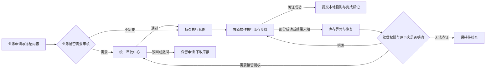

# 下一阶段任务清单与方案：库存一致性、异常恢复及处置审批

> 状态：方案草案，待评审；本轮只整理清单与方案，未实施新迁移或修改业务代码。
> 延续原DEV／DB编号；本文件N01—N10仅为本阶段工作包编号，不替代原40项任务。
> 后续实现使用executing-plans，逐项按失败用例→最小实现→回归→独立复核推进。

> 2026-10-30 后续约束更新：[设备全生命周期 Web 与服务对接明细](../../technical/设备全生命周期-Web与服务对接明细.md)细化了用户确认的边界：库存默认 SERVICE、无需人工业务设备注册、库存权威在独立服务。本文本地表与服务提议仅可承接申请/业务关联/调用恢复，不可扩展为另一套仓内库存引擎；N01 必须先按明细核对真实远端能力，尚未实施的落点需同步调整。

**Goal:** 让设备入库、商家出库及交接、仓间调拨、处置出库在超时、部分成功和重启后能查明事实并受控恢复；需要审核的业务统一进入OpsKit。

**Architecture:** 复用InventoryPort、现有操作／步骤日志及Outbox；独立库存服务持有SERVICE余额，宿主持有业务单据、设备投影和执行证据。OpsKit持有审核人、步骤、决定及历史；业务侧只保存申请、冻结内容、审批关联与执行恢复信息。

**Tech Stack:** Java21、Spring、MyBatis、Flyway、Next.js、Vitest及真实数据库／HTTP边界测试。

**Spec:** [总执行顺序](2026-10-30-ops-execution-order.md)、[原开发任务](2026-10-30-ops-matrix-development-backlog.md)、[执行记录](2026-10-30-ops-execution-progress.md)、[盘点统一审批](2026-10-30-inventory-unified-approval.md)及用户“需要审核就统一依赖审核模块”的约束。

## 一、阶段选择与当前依据

推荐先完成S02／S03的库存基础剩余项，再进入S04采购与收货。将DEV-17中“现有处置出库接统一审批”的最小子项提前，避免为新的恢复入口保留未经审核的破坏性执行旁路；DEV-17的价值核销、完整遗失处置等不在本阶段完成。

| 已核查事实 | 对下一阶段的影响 |
|---|---|
| 盘点已统一送审；V220、冻结版本、自审限制及执行恢复已有回归 | 复用既有审批事件、验签回调及审核归因；不重新开发盘点审批 |
| InventoryOperationJournal目前在物料子链路使用，校验原创建人和原请求摘要 | 不能仅新增一个retry按钮就开放他人接管；先补业务范围、冻结资源及受控委托 |
| InventoryPort覆盖入库、商家出库／签收／调整／退仓和调拨；多个外层业务仍用事务直接调用远端 | 逐动作接稳定意图与步骤恢复，保留外部已发生事实 |
| 当前InventoryApi有创建／过账、序列号出库状态、流水等能力，未声明通用“按幂等键查询原结果”接口 | N01先验证外部协议；不能把余额相等当成原操作成功，也不能臆造查证接口 |
| inv_disposal及DisposalReq明确“建单即过账”，没有申请状态 | 新增轻量处置申请层，保留既有处置表作为实际过账记录，避免误改历史 |
| V213／V214已有采购、采购行、来源实收和期初字段，但尚无完整采购业务API／页面 | 采购收货作为下一阶段S04入口，不将建表等同于已交付 |

推进方式比较：直接开发采购可更早展示新页面，但DEV-09依赖DEV-04，仍会带入收货重复和远程未知结果问题；先收口一致性与受控恢复，符合原执行顺序，也为后续采购、交付和维修提供同一套执行基础。本方案推荐后者。

## 二、本阶段范围与交付

包括：设备待检放行入库、商家出库／签收／交付调整／退仓、调拨发货／签收、处置申请及过账、库存操作查询与恢复、统一审批和相关范围校验。

继续保留LOCAL／SERVICE两种引擎，不将SERVICE余额复制成另一份可写宿主库存账。原盘点恢复元数据继续由CountReviewService管理，本阶段只统一查询呈现和接入约束，不强行搬表重写已通过链路。

不在本阶段整体交付：采购及分批收货、交付凭证全闭环、供应商返修、遗失价值核销、全部财务调整、任意手工补账或反向单据、指定单仓授权、全部DEV-02／DEV-32及生产发布验收。

### 统一审批规则

| 情形 | 处理方式 |
|---|---|
| 原授权人对同一操作、同一载荷续做已允许的步骤 | 技术重试；保持原审批、原意图及操作号，不为每次网络重试重新送审 |
| 已获审批但库存执行失败 | 保留审批结论，查证后恢复原执行，不能自动换键重做 |
| 报废／退供应商处置 | 本方案建议统一“申请→OpsKit审核→库存执行”；建申请不减少库存，驳回／撤回不产生出库 |
| 非原操作者申请接管未完成操作 | 统一送审；冻结操作号、摘要、版本及接管人，批准后仍须满足原业务权限和当前仓库范围 |
| 结果未知、缺证据、幂等键已超外部保留期 | 先查证；无法证明时保持待核查，不能用批准按钮把未知结果改成成功 |
| 改数量、改商家／仓库、另做补偿或核销 | 不属于原操作重试；须走相应新业务单据及统一审批，不能借恢复接口改账 |

操作日志现有技术状态NEEDS_REVIEW在界面应显示“待核查”，不等同于OpsKit“待审批”；不能因为技术失败就凭空生成一笔业务批准。

实际审核步骤、候选权限和模板在N01冻结。默认仓管负责申请／执行；库存审核候选沿用device:inventory:audit及统一模块的决定权限，禁止申请人自审；财务核价值不在本阶段自动完成。新增专用恢复权限先登记权限真源，默认不批量授予仓管。

图中接管审核通过后仍沿用原操作和冻结内容，不新建一轮出入库；新业务申请的批准也不代替执行时的资产／范围校验。

## 三、任务清单与执行顺序

| 顺序 | 工作包 | 原任务关联 | 核心交付 | 依赖 |
|---|---|---|---|---|
| N01 | 契约、风险与角色范围核查 | DEV-02／04／32 | 每个写动作的步骤、事实来源、幂等期限、身份、权限和审批规则 | 当前验证基线 |
| N02 | 兼容数据库调整 | DB-02／10，DEV-04／17 | 操作资源索引、控制版本、冻结快照、申请关联及必要索引／约束 | N01 |
| N03 | 通用恢复编排与资源保护 | DEV-04 | 稳定键、持久意图／步骤、原引擎及绑定核对、活动资源保护、统一结果视图 | N02 |
| N04 | 待检放行入库接入 | DEV-04／11 | 逐件步骤恢复，质检凭证与本地入库只消费一次 | N03 |
| N05 | 商家出库及交接动作接入 | DEV-04；DEV-05基础子项 | 出库、签收、调整、退仓分别留稳定操作，禁止失败后形成新一轮误交付 | N03 |
| N06 | 调拨发货与签收接入 | DEV-03／04 | 发货与签收独立操作号，收发各自授权，保留缺件及当前流转关联 | N03 |
| N07 | 处置申请、统一审批与执行 | DEV-17子项／32／04 | 轻量处置申请、冻结明细、统一审批回写、处置出库恢复，封堵直接过账旁路 | N03 |
| N08 | 操作查询、原人重试及接管审批 | DEV-04／32；DEV-34子项 | 操作列表／详情／查证、受控重试、跨人员接管申请及回写 | N04—N07 |
| N09 | Web菜单、类型与接口对齐 | DEV-04／17／37子项 | 库存异常与恢复、处置申请／过账记录、审批链接；http／mock／契约一致 | 随N04—N08逐模块完成 |
| N10 | 故障、权限与外部验收 | DEV-38／40子项 | 全链路失败恢复、角色正反、真实依赖验证和评审证据 | N04—N09 |

N09不集中留到最后：每完成一个业务工作包，同时交付其Web入口、状态展示和相关测试。

## 四、数据库方案

已存在的V212—V220不改写。新迁移号在实现前核对当前最大版本再确定，不预占V221。

| 对象 | 计划调整 | 约束／兼容要求 |
|---|---|---|
| inv_operation | 在核查后补业务范围、冻结执行身份、服务绑定标识、恢复控制版本及结果引用 | 明确所有更新如何递增控制版本；不能以当前未使用的version列假定已有并发保护 |
| inv_operation_step | 复用步骤号、稳定键、远程单号、结果快照；必要时补查证时间／错误分类 | 步骤键含完整操作、动作和资源，传到远端前不超过64字符；同键同体 |
| 拟inv_operation_resource | 操作与设备／物料资源的关联、原位置／流转证据、活动占用关系 | 未完成或结果未知时，相关资源不能被另一单重新出库／绑定；已完成释放，历史关联保留；唯一活动占用方案在N02验证 |
| 拟inv_disposal_request及明细 | 处置申请、设备快照、仓库／供应商／原因、审批关联、实际处置单引用 | 业务申请及执行元数据；审批步骤／审核历史仍在OpsKit；无库存余额 |
| inv_disposal | 兼容补申请来源及操作引用，保证一份批准申请只生成一张实际处置单 | 现有历史单据只读，不回填“待审批”或“草稿”，不伪造批准人或审批号 |
| 拟恢复接管申请关联 | 原操作号、载荷摘要、控制版本、请求人／接管人、审批单及执行状态 | 先核是否可复用已有业务申请载体；确有差距才建表，不能复用资金ApprovalGate另建审核列表 |

迁移先可空、先验证旧代码读取与写入兼容；新表可立即加唯一／CHECK约束。有历史数据的强唯一、非空及回填须先检测。接口不返回原始payload、凭证或密钥。

## 五、服务端执行方案

### N01—N03：先明确执行协议

- 每个动作固定规范化请求、操作号、原引擎、原业务引用、执行人、仓库及资产范围；同键异体409。
- 首次远端写前，独立提交操作意图与原始校验快照；每一步调用前持久记录UNKNOWN，收到确证再记录COMPLETED。
- 原意图与新业务资格分开：已过账步骤保留历史事实；新写步骤仍须校验其前提。主数据停用、归档或变更不能抹掉已发生事实，也不能授权转向新商家／新仓库。
- 保持当前物料串行入口与数据库锁保护，先保证连接池与事务边界正确。本阶段不以移除写门禁换吞吐；任何新的租约／锁优化需单独证明并发安全。
- 失败后持久保护活动资源；当前生命周期证据与冻结快照不符时阻断，不能让旧操作抢占新一轮交付的设备。
- 原引擎固定还不等于原外部账户固定：增加非秘密的绑定标识／指纹核对；服务地址或账户配置变更后，无法确认原服务时停止恢复，不到新服务补账。密钥不写入操作载荷。
- 外部查证以原单号、原业务引用或确认支持的幂等结果为证据；不能单凭当前余额、单个设备状态或本地事务回滚断言原步骤成功／失败。
- 保留现有成功出参；新增Web发送稳定requestKey，原有入参按动作兼容扩展。旧调用是否可由现有业务单号推导稳定身份在N01逐项记录；无可靠身份的调用不得承诺请求级安全重放，也不得自动生成新键重做未知结果。

### N04：待检放行入库

冻结入库单、设备／物料明细、实际仓库、本次质检凭证和原状态。逐件记录远端建单／过账与本地凭证消费；部分件成功后只续未完成件。本地投影与凭证消费、操作完成标记同事务，回滚后仍能查到远端已完成步骤。旧质检不能用于新一轮入库。

### N05：商家出库及交接

出库、签收、出库调整和退仓各自作为业务动作记录，不把相同设备在不同交付周期的操作合并。出库冻结商家、站点限制、接收人和来源仓；恢复不允许改目标。交付／签收失败后沿用原远端单号及原执行身份。完整商家交付凭证仍由DEV-05后续闭环。

### N06：调拨

发货与签收是两个独立操作，关联同一调拨单。发货重试校验来源方权限，签收重试校验目的方权限；读取可按业务单收发任一方授权，不能让只具有目的仓权限的人重试源仓发货。收发步骤分别幂等；短收不冒充全收，缺件保留资产差异及在途证据；旧调拨不得操作后续新出运。沿用当前充电宝仅仓间调拨的限制。

### N07：处置统一审批

新增“处置申请”承载草稿和冻结明细，inv_disposal继续表示实际过账结果。报废与退供应商在本方案中都先统一送审，供应商、设备、数量、原因和证据变更须重新申请／送审，审批单号绑定当前申请轮次。

批准后再检查实际资产及原仓库、冻结版本、既有活动占用；冲突则显示“已批准但执行失败”，不处置后来重新交付的设备。执行步骤复用N03，重试不重新审批、不重复出库。驳回／撤回无库存动作。原POST /inventory/disposals直接过账入口在新版本中明确阻断，并提示使用申请；不让旧客户端把“草稿已建”误认为“出库成功”。

### N08：查询与受控恢复

同一意图的原人重试，只需恢复动作权限、原业务动作权限及当前范围，不重新获得一次业务批准。跨人员接管单独申请到统一审批中心；冻结原操作、载荷摘要、控制版本与接管人，批准时不能替换任一字段。审核不扩大数据范围，不把代理请求人设置成系统全权主体。

本阶段只允许查证和续做原操作。新增补偿、库存调整、人工核销、跳过步骤、直接修改完成状态不通过此入口开放；需另有对应业务单据和后续方案。操作摘要与步骤可视化不等于拥有重试权限。

## 六、拟定API与Web清单

以下是设计路径，尚未实现。N01核对原API-N01／02和现有路由后冻结，继续使用现有响应信封、PageResult、403／409等约定。

| API／界面 | 主要字段／能力 | 授权与边界 |
|---|---|---|
| GET /api/ops/inventory/operations | page、size、phase、kind、bizRef、warehouseNo | 分页前按相关业务／仓库范围过滤；不返回敏感载荷 |
| GET /api/ops/inventory/operations/{operationNo} | 业务引用、原引擎、当前步骤、原远端单号、错误码、版本、可执行动作 | 详情同范围；不靠前端隐藏数据 |
| POST /api/ops/inventory/operations/{operationNo}/reconcile | requestKey、reason、expectedVersion | 只查证并记录证据；外部无安全查证能力时返回待核查，不补写余额 |
| POST /api/ops/inventory/operations/{operationNo}/retry | requestKey、reason、expectedVersion | 幂等恢复请求键与原业务请求键区分；不收可编辑的原业务payload、目标或引擎 |
| POST /api/ops/inventory/operations/{operationNo}/recovery-requests | requestKey、expectedVersion、reason | 申请由当前人接管；原摘要、接管人由服务端固定；进入统一审批列表 |
| GET/POST /api/ops/inventory/disposal-requests | 分页查询／建申请：requestKey、kind、warehouseNo、supplierNo、reasonCode、items、note、evidenceRefs | 创建不出库；冻结和校验动作分权 |
| GET/POST /api/ops/inventory/disposal-requests/{requestNo} | 查详情／按expectedVersion编辑允许的草稿 | 审批中不能改关键字段 |
| POST /api/ops/inventory/disposal-requests/{requestNo}/submit | requestKey、expectedVersion | 只送审；审核／撤回在统一模块；已通过后的重试复用原操作 |
| 既有入库／出库／签收／调整／退仓／调拨端点 | 兼容增加稳定requestKey和必要expectedVersion | 不开放直接客户端设置status或审批结论 |
| /inventory?tab=operations（拟） | 菜单“库存管理→库内作业→库存异常与恢复” | 范围内列表、步骤、查证、原人重试／接管申请，按钮按服务端动作集 |
| /inventory?tab=disposals | 处置申请与实际处置记录，显示审批／执行状态及原单链接 | 不再“点保存就出库”，不新建库存审核列表 |
| /flow/todo、/flow/approvals | 本阶段处置与接管审核 | 复用统一模块权限、范围、自审限制和回写；不复制流程历史 |

拟新增权限分别覆盖操作查询、查证、恢复执行与接管申请；具体码在N01登记真源后冻结。审核候选可复用既有device:inventory:audit；不因通用flow决定权就允许任何库存核查。

## 七、代码清单与职责

下表“修改”路径已核实存在；“拟新增”是计划名，实施时先核查同义对象，避免重复建设。简写inv／dev均位于backend/sharehub-svc-core/src/main/java/ai/neargo/sharehub/；app/...指backend/sharehub-app/src/main/java/ai/neargo/sharehub/。

| 类型 | 文件／范围 | 职责 |
|---|---|---|
| 修改 | backend/sharehub-svc-core/src/main/java/ai/neargo/sharehub/inv/service/InventoryOperationJournal.java | 通用意图／步骤、身份与摘要、版本和完成原子性，保留物料回归 |
| 修改 | inv/port/InventoryPort.java、InventoryEngineRouter.java；inv/remote/RemoteInventoryPort.java、InventoryApi.java、HttpInventoryApi.java、InventoryLinks.java、InventoryActor.java | 原引擎、原目标查证及稳定执行归因；外部能力不足先明确阻塞 |
| 修改 | inv/service/impl/IntakeServiceImpl.java、TransferOpsServiceImpl.java、DisposalServiceImpl.java | 分步接入与本地最终提交；处置拆申请与执行 |
| 修改 | dev/service/impl/CabinetPoolServiceImpl.java、CabinetLifecycleServiceImpl.java、CabinetBindServiceImpl.java | 原交付周期校验与活动资源保护，不让未确认操作中的设备被新业务复用 |
| 修改 | app/.../portal/core/InventoryController.java、DevicePoolController.java | 保持既有出参，新增稳定键和受控动作，封堵直接处置旁路 |
| 拟新增 | inv/service/InventoryOperationService.java、inv/dto/InventoryOperationDtos.java、inv/entity/InvOperation.java／InvOperationStep.java／资源关联Entity与Mapper | 查询／查证／续做，领域动作处理器白名单，禁止客户端指定执行类／步骤 |
| 拟新增 | app/.../portal/core/InventoryOperationController.java | 统一操作查询及恢复API |
| 拟新增 | inv/service/DisposalRequestService.java、对应DTO／Entity／Mapper、DisposalApprovalOutcome.java、恢复接管回写实现 | 业务申请及OpsKit关联，复用ApprovalRequestedEvent／ApprovalOutcomeHandler |
| 新增／修改 | deploy/opskit/definitions.example/processes/ | 处置与恢复接管模板；发布前验证候选权限和禁止自审 |
| 拟新增／修改 | ops-web/components/inventory/inventory-operations.tsx、disposals.tsx、相关入出库／调拨组件 | 操作追踪、申请及受控重试，原表单保留同一意图的稳定键 |
| 修改 | ops-web/lib/api/contracts、https、mocks；lib/types、inventory-routes.ts、nav.ts；docs/api | 类型、真实API、mock、菜单和生成契约同步 |

## 八、验收矩阵与完成条件

| 场景 | 必须证明的结果 |
|---|---|
| 同键同体重复／并发提交 | 返回同一操作，库存及本地凭证只变化一次 |
| 同键不同数量、商家、仓库或设备 | 409，不新增远端动作 |
| 远端已成功但响应丢失 | 查证／原键恢复，不生成第二张出入库单 |
| 远端成功后本地提交失败／进程重启 | 操作证据仍在；重启后续做本地投影与原凭证，不重复扣增库 |
| 一批多件部分成功 | 已完成件保持，未完成件可续做，不整体重开新单 |
| 未完成操作的设备被另一业务使用 | 活动资源保护或周期版本拒绝，不能借新单覆盖旧未知结果 |
| 调拨发货成功、签收失败／缺件 | 两端操作和授权各自正确；缺件不进目的仓，状态／履历可追溯 |
| 冷映射、档案停用、配置／引擎变化 | 映射和原引用可恢复；无法证明原绑定则阻断，不到新服务补账 |
| 原请求人、同区域另一人、外区域、只读角色 | 查询／查证／重试／接管权限分别验证；空范围拒绝，分批混仓整体检查 |
| 接管／处置自审、错误审批号、旧轮次／重复回调 | 无未经授权的库存写入；审核结论只作用于绑定的原申请 |
| 审核通过后内容、资产版本或责任人变化 | 执行失败可见，原审批不能套用于新业务对象 |
| 旧处置接口／历史处置单 | 旧直写不绕审批，历史不改成草稿，不反复执行 |
| 幂等键接近最大长度／身份恢复 | 各动作及轮次实际传输键不同且≤64字符；重试归因固定，异常后线程身份恢复 |
| 审批／库存服务不可用或幂等保留期不明 | 清楚显示未接通／待核查，不自动成功，不无依据重试 |
| Web刷新／重复点击／重新登录 | 继续追踪原操作；不因关闭抽屉自动换键重做未知结果 |

每个工作包先写可复现失败用例，再实现；后端全量、Web全量、TypeScript和相应契约／词表／权限检查须通过。当前1066项后端、1509项Web仅作为历史基线，实施开始时重新验证；不预填未来测试数量。

仅模拟HTTP／Fake通过不能替代真实服务验收。真实库存幂等期限、单据查证和OpsKit模板／目录／验签回写须留证；无法完成时明确阻塞对应能力。现有全局check:drift历史问题另列，不放宽门禁，不据本阶段代码完成宣布G0／G1或整体发布通过。业务库迁移和发布另按部署验收执行。

## 九、完成后进入采购与收货（S04）

本阶段新写链路、权限和恢复验收通过后，依次推进：

1. DEV-08：复用V213采购头／行，供应商、型号、数量、单价、VAT、币种和附件；订购不增加实物库存，需审核时统一送审。
2. DEV-09：复用V214来源实收与防重；按采购行校验剩余数量并支持分批到货，接入本阶段稳定操作。
3. DEV-10：期初来源、缺票原因与价值依据；需要价值审核时进入统一模块，不猜测补历史凭证。
4. DEV-11：实收、待检和可用分别统计；本次质检凭证一次性消费及复检。

S04核心验收例：订购100、实收80、合格70、待检10、待收20；合格入库不能把实收再加一次，后续补收20后实收100、待收0。供应商拒收／采购退货另按真实单据扣减，不能通过覆盖原实收数实现。

## 十、方案复核记录

独立只读方案复核结论：没有仍需先回答的重大问题。原业务键与恢复请求键、冻结执行身份与接管授权、调拨收发两端权限、活动资源保护、统一审批、旧处置旁路封堵及历史兼容已明确；实现细节和外部协议验证留给N01—N03。此为方案可细化的结论，不代表真实远端恢复能力或本阶段实现已验收。

实施首个交付：N01的动作／远端步骤／权限／证据／审批规则对照表及接口差异清单；未完成该核查前不执行新DDL或开放恢复写入口。
