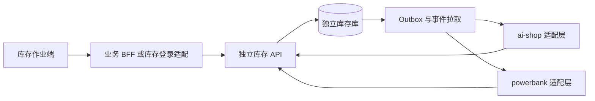

# 独立进销存：服务架构与数据模型

> 状态：开发设计草案（未实施） · 2026-10-29
> 已确认边界：仓内库存、进出库、盘点；出库后不跟踪业务库存；通过出库池交接；独立部署并提供 API。其余具体规则为本轮建议设计。

## 1. 部署与模块

建议新增 ai-shop `backend/inventory/`，下设 `inventory-api`（契约）、`inventory-core`（领域）、`inventory-infra`（存储/鉴权/任务）、`inventory-server`（可执行启动）、`inventory-client`（可选 Java SDK）。统一包前缀 `ai.neargo.inventory`。库存作业前端 `inventory-web/` 为 ai-shop 根目录下独立应用。

一个服务产物、一个独立库存库、一个独立迁移历史；不引用商城业务表、BizContext、ShareHub 设备 Mapper 或宿主登录会话。框架复用现有 neargo 构件，版本从两个仓库实际父 POM 核对并固定，不在本设计中猜测版本。采用现有 Java/Spring/MyBatis/Flyway 技术栈，无需为提取引入新 ORM。

## 2. 持久化对象

以下是逻辑结构，正式迁移在基线审计后编写。保留旧表时执行增量迁移，不预先占用已存在的迁移号。业务 ID 用字符串，时间 API 用带 UTC 偏移的 ISO-8601；数量沿用现有整数基本单位，金额最小币种整数并显式关联业主币种。

| 表/对象 | 核心字段 | 约束 |
|---|---|---|
| `inv_item` | ownerId,itemId,trackingMode(QUANTITY/SERIAL),baseUom | 有流水后禁止更改跟踪方式和单位 |
| `inv_location` | ownerId,locationId,kind,status | 仓停用前余额/预留/待检/未完成单清零或迁走；历史可查 |
| `inv_serial` | serialId,ownerId,itemId,serialNo | UK(ownerId,serialNo)，映射物料不可静默更改；只保留身份历史，不追踪仓外运行位置 |
| `inv_stock_episode` | episodeId,serialId,inboundNo,locationId,state,qcStatus,qcRevision,outboundNo,version | 每 SN 最多一个 OPEN 周期，关闭后不可复用 |
| `inv_stock_balance` | ownerId,itemId,locationId,onHand,reserved,unavailable,version | UK(ownerId,itemId,locationId)，计数非负；SN 余额与开放周期一致 |
| 入/出库单与行 | 旧字段＋purpose,target/source,qcPolicyRef,version | 单号/行号唯一，单头状态条件更新 |
| `inv_document_serial` | docNo,lineNo,serialId,episodeId | 同单 SN 唯一，SN 行数量等于 SN 数 |
| `inv_target_ref` | ownerId,systemCode,objectType,objectRef,name,status,sourceVersion | UK(ownerId,systemCode,objectType,objectRef) |
| `inv_stock_hold` | holdId,episodeId,reasonCode,sourceSystem,sourceRef,status,version | 多原因独立持有，全部解除才可用，QC 通过不能清掉业务退仓冻结 |
| `inv_dispatch_item` | dispatchItemId,episodeId,outboundNo,serialId,targetSystem,targetType,targetRef,receiverRef,state,version | UK(episodeId)，仅 ISSUE 创建；池中的接收对象是出库快照 |
| `inv_dispatch_claim` | claimNo,dispatchItemId,businessSystem,businessType,businessRef,requestId,status | 每池记录最多一个有效关联，释放也保留历史 |
| 盘点单/行/实扫 | countNo,scope,bookQty,expectedSerialIds,scannedSerialIds,diff,reviewer,contentVersion,approvedVersion | 账面快照不可编辑，原始扫描与纠错保留 |
| 质检对象 | 见 02 | 所有结果绑定 episodeId/taskNo/templateVersion |
| `inv_command` | clientId,ownerId,requestId,payloadHash,status,response,actor | UK(clientId,ownerId,requestId)，与业务提交同事务 |
| `inv_outbox` | eventId,ownerId,resourceVersion,payload,status | 同事务写事件，不直接远程回调 |
| `inv_event_delivery` | subscriptionId,sequence,eventId | UK(subscriptionId,sequence)，提交后分配可投递序列 |
| `inv_audit` | actor,client,action,resource,before/after,reason,traceId | 追加，业务 API 不可修改 |

OPEN 周期唯一约束不能只靠先查再插：可用生成列 `openSerialId=CASE WHEN state='OPEN' THEN serial_id ELSE NULL END` 配唯一索引（限定数据库能力）；或稳定 SN 行 `activeEpisodeId` 的锁定更新＋约束。实施时选一种并用并发测试证明。池唯一有效关联同理使用条件更新＋唯一约束，不用无效的“查询过没有”。

## 3. 状态与操作

| 对象 | 状态/动作 |
|---|---|
| 入/出库单 | DRAFT→POSTED；DRAFT→CANCELLED；已过账用纠正单，不能改回草稿 |
| 库存周期 | 入库建 OPEN，出库关 CLOSED；仓外只留历史，不更新实际位置 |
| 质检状态 | PENDING/PASSED/FAILED/EXEMPT，详细规则见 02 |
| 出库池 | AVAILABLE→CLAIMED；受控释放 CLAIMED→AVAILABLE；实物回仓→RETURNED；出库纠正→REVOKED |
| 盘点单 | COUNTING→REVIEW→POSTED；COUNTING/REVIEW→CANCELLED；驳回复盘 REVIEW→COUNTING |

池终态不能重新领取。SN 回仓新建 episode，再出库创建新池。接收人后续离职不抹掉历史，池重定向必须有审计和权限，已领取记录的业务换人由业务系统办理。

## 4. 库存数量口径

`available = onHand - reserved - unavailable`。reserved 与 unavailable 必须互斥，且和不超过 onHand。待检/失败/冻结计 unavailable；豁免或通过且未冻结才可用。已有 quantity 物料默认无需质检，unavailable=0；首版质检逐件面向 SERIAL，数量批次质检是扩展，不以留位字段冒充已支持。

扣减接口区分“消费自己预留”与“扣自由库存”。普通出库不可侵占其它预留；质检转为不可用前必须释放/拒绝冲突预留。改 onHand 不能只验证结果>=0。汇总与 SN 状态变更使用同一事务。

## 5. 事务与并发边界

出库事务：锁定/条件更新 DRAFT 单→按固定 serialId 顺序锁定 SN 及 OPEN 周期→验证仓/状态/当前 QC revision/冻结范围/预留归属→扣余额→关闭周期→写流水→生成 ISSUE 池→事件、审计及幂等结果→提交。任何一步失败全部回滚。

入库事务：锁定稳定 SN 身份→验证无 OPEN 周期→核对 RETURN 来源并结束原池可领取资格→创建新周期与待检任务→加实存及不可用量→流水/事件/幂等→提交。RETURN 可引用已领取或未领取池；跨业主 SN 处理须人工核实，不自动创建新身份逃避冲突。

领取事务：校验授权和目标归属→按固定 ID 顺序 CAS AVAILABLE→CLAIMED→插关联、事件及幂等结果→提交。批量任一冲突整批回滚。实物退仓与领取必须竞争同一池/SN 锁，只有一个事务先成功；后执行的操作按新状态拒绝或走明确退仓流程。

## 6. 盘点

首版按 `(owner,location,item)` 冻结；开盘先获得互斥范围锁，再抓数量与 SN 快照。所有库存改变入口（过账、预留、释放、提交预留、质检可用性变更、旧接口和批处理）都必须识别冻结。**范围内已有 HELD 预留、待执行库存命令或仓间在途未结时拒绝开盘**，先清理后再开，避免阻塞商城支付提交。业务流程不得绕过冻结。

REVIEW 的批准写 approvedVersion=contentVersion；post 必须核对批准版本且复核人非录入者，并校验 count:post 权限。REVIEW 不能直接编辑实盘；驳回后修改使旧批准失效。冻结只允许该盘点单自身的授权调整，不得把盘点过账也拒绝。

实扫去重：同一 SN 重扫只提示，不多计；未知 SN 作为候选异常，不自动新增。错仓转独立纠正/搬仓操作；已出库 SN 作为疑似未登记退仓处理，不能直接当新采购盘盈。复核通过后系统生成有来源的盈亏/纠正单；SN 明细、余额、池状态及流水按相应业务规则同事务落地。取消与过账后释放冻结；异常重启后冻结持久化可恢复，不用内存锁。

## 7. 纠正与成本

已过账 ISSUE 不开放旧的通用 void 反冲接口。未交实物的误过账可走审批纠正，锁定 AVAILABLE 池并标 REVOKED，通过引用 correctionNo 的纠正入库新建 OPEN 周期并恢复库存；旧 CLOSED 周期始终不重开。新周期关联原周期和纠正单，默认 PENDING；原质检只能作为证据，需授权重检或豁免才能放行。已领取先解除业务关联并证明确无业务占用，实物已交出必须退仓，不能仅靠取消单据把设备“变回仓里”。RETURN 后不允许再次冲销原 ISSUE 加库存。

普通 ai-shop 单据原有反向流水语义保留在其支持的用途内，受已消费数量/预留/财务限制检查。库存成本是数量账成本快照；ISSUE 不是销售，不触发 SALE 成本收入报表。设备折旧、租金、资产处置在业务/财务系统。

## 8. 多原因冻结与退仓业务确认

同一 SN 的 unavailable 最多计 1，不因“待检＋业务冻结＋人工冻结”重复累计；按是否存在任一阻塞条件维护汇总。质检通过只解除质检原因，不释放其它 hold。

来自业务池的 RETURN 实收默认创建 BUSINESS_RETURN_CLEARANCE hold，引用 returnInboundNo 和原 businessSystem。原业务系统完成本地停止使用/解除关联事务后，以固定请求号调用 business-clearance，只解除该原因；初检通过、业务超时均不能自动清掉它。未领取设备退仓由库存锁定池、确认无有效 claim 后同事务免除此业务确认要求，仍需仓内质检。确认失败进入持久化重试和人工异常，不永久隐匿冻结。
