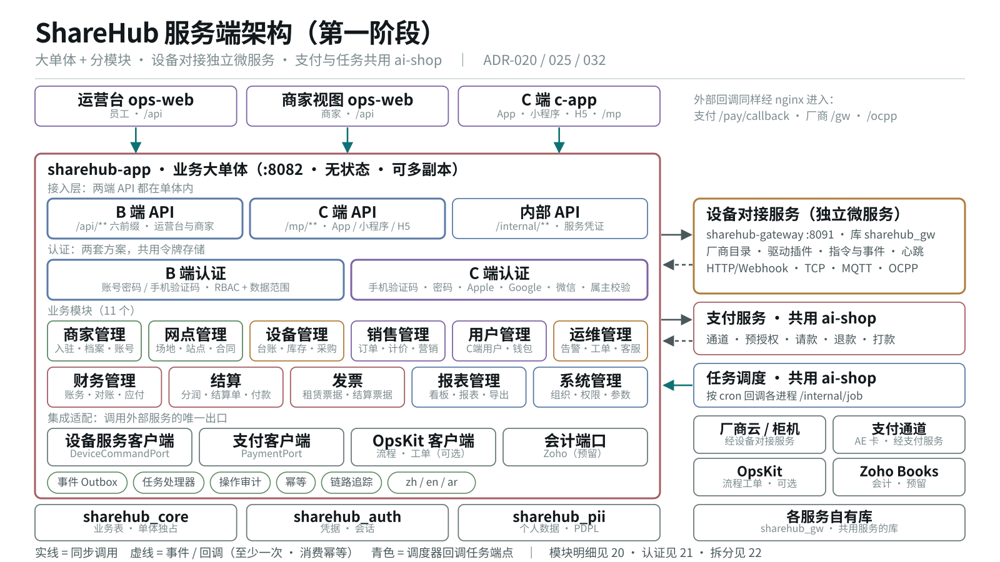
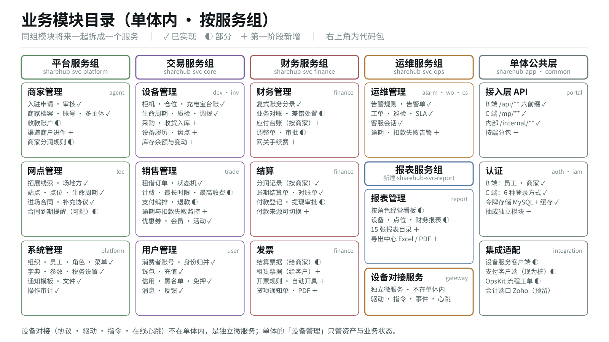
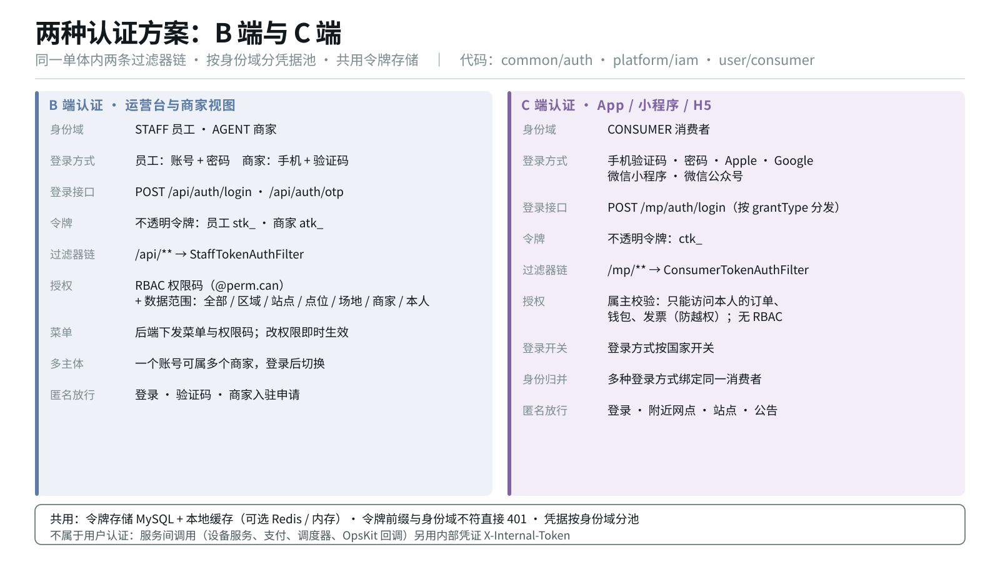
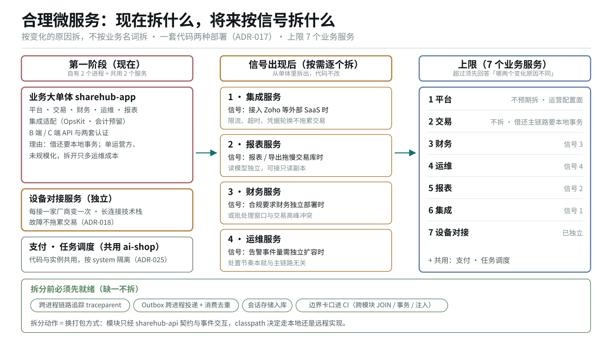

# ShareHub 服务端架构 · 模块与服务

> 状态：**待确认**（2026-10-28 起草）· 本文是**服务端结构的入口**：有哪些服务、单体里有哪些模块、两端接口与两套认证怎么放。
> 依据：用户 2026-10-28 定的五条原则（§一）· 现有代码（逐包、逐控制器核对）· [运营方原始需求-整理稿](../requirements/运营方原始需求-整理稿.md) · [ADR-032](./ADR/ADR-032-第一阶段以商家为结算单元-会计系统架构预留.md)
> 关系：
> - [架构设计-第一阶段-运营方需求](./架构设计-第一阶段-运营方需求.md) 讲第一阶段做什么、关键链路；**服务与模块划分以本文为准**；
> - [技术架构方案-v4](./技术架构方案-v4.md) 的部署拓扑、支付共享、网关内部分层、认证底座继续有效，本文不重复。
>
> 架构图（1600×900 矢量，可直接插 PPT，源在 [`diagrams/build.py`](./diagrams/build.py)）：
> [`19` 服务端总架构](./diagrams/19-server-architecture.svg) ·
> [`20` 业务模块目录](./diagrams/20-business-modules.svg) ·
> [`21` 两种认证方案](./diagrams/21-auth-schemes.svg) ·
> [`22` 微服务拆分](./diagrams/22-microservice-split.svg)

---

## 〇、一页结论



| 问题 | 答案 |
|---|---|
| 有几个服务 | **自有 2 个**：业务大单体 `sharehub-app`、设备对接服务 `sharehub-gateway`；**共用 2 个**：ai-shop 的支付服务与任务调度 |
| 单体里有什么 | 接入层（B 端 API、C 端 API、内部 API）· 两套认证 · **11 个业务模块** · 集成适配 · 公共能力 |
| 11 个业务模块 | 商家管理 · 网点管理 · 设备管理 · 销售管理 · 用户管理 · 运维管理 · 财务管理 · 结算 · 发票 · 报表管理 · 系统管理 |
| 两种认证 | **B 端**：员工账号密码、商家手机验证码，RBAC 权限码加数据范围；**C 端**：六种登录方式，属主校验 |
| 设备对接 | 唯一自有的独立微服务；单体内的「设备管理」只管资产与业务状态，协议、驱动、指令、心跳都在设备对接服务 |
| 将来怎么拆 | 模块按服务组归类，同组一起拆；信号出现才拆，顺序为集成、报表、财务、运维；上限 7 个业务服务 |

---

## 一、设计原则

| # | 原则（用户 2026-10-28） | 落成 |
|---|---|---|
| 1 | **大单体** | 业务规则全部在 `sharehub-app` 一个进程里；模块间是方法调用与本地事务 |
| 2 | **分模块** | 每个业务模块是一组包，边界按跨进程标准守：只经 `sharehub-api` 契约调用、不跨模块 JOIN、不跨模块事务；由 `backend/scripts/` 的卡口脚本校验 |
| 3 | **合理微服务** | 按「变化的原因」拆，不按业务名词拆；只有变化原因确实不同的才独立部署 |
| 4 | **设备对接独立** | `sharehub-gateway` 独立进程、自有库；每接一家厂商变一次、需要长连接、故障不能拖累交易 |
| 5 | **单体集成两端 API、两种认证** | B 端 `/api/**` 与 C 端 `/mp/**` 都在单体接入层，不建独立 BFF 进程；两条过滤器链、两个凭据池 |

---

## 二、服务清单

| 服务 | 进程 / 启动模块 | 端口 | 库 | 职责 | 现状 |
|---|---|---|---|---|---|
| **业务大单体** | `sharehub-app` | 8082 | `sharehub_core` · `sharehub_auth` · `sharehub_pii` | 两端 API、两套认证、11 个业务模块、集成适配 | ✅ 已上线（单副本） |
| **设备对接服务** | `sharehub-app-gateway`（内核 `sharehub-svc-gateway`） | 8091 | `sharehub_gw` | 厂商目录、驱动插件、指令下发与回执、事件归一化、心跳与在线态、报文留痕、OTA | 🟡 可启动；只有 Demo 驱动；未部署 |
| 支付服务（共用） | ai-shop `pay-svc` | 8083 | 服务自有库，按 `system` 隔离 | 通道、预授权、请款、退款、打款、通道对账 | ⬜ 待多系统改造；本项目当前用桩 `StubPaymentPort` |
| 任务调度（共用） | ai-shop `shop-job` | 无 | 服务自有库 | 按 cron 回调各进程的 `/internal/job/{name}` | ⬜ 待接入；任务已按 `JobHandler` 写好 |
| 流程与工单引擎（可选） | OpsKit（本仓 `opskit/`，孵化中） | — | 自有库 | 审批流、工单；单体经 `integration/opskit` 调用，经 `/internal/opskit/*` 回调 | ◐ 客户端已有，未配地址时不启用 |
| 会计系统（预留） | Zoho Books | — | — | 会计分录、付款读回 | 第一阶段不连（ADR-032） |

**调用方向**只有三种：单体 → 设备对接服务（指令，同步受理）；设备对接服务 → 单体（设备事件，Outbox 推送）；单体 ↔ 支付服务（同步调用 + 支付事件回推）。调度器只回调，不被调用。

---

## 三、业务模块



### 3.1 模块目录

「代码包」指 `backend/<Maven 模块>/src/main/java/ai/neargo/sharehub/` 下的一级包。状态：✓ 已实现 · ◐ 部分 · ＋ 第一阶段新增。

| 模块 | 职责 | 代码包（现） | 主要表 | 状态 |
|---|---|---|---|---|
| **商家管理** | 商家入驻申请与审核、商家档案、账号与多主体切换、收款账户、渠道商户进件、商家分润规则 | `svc-platform/agent` | `agt_*` | ◐ 进件 ＋ |
| **网点管理** | 拓展线索、场地方、站点、点位、站点生命周期、进场合同、合同到期提醒 | `svc-platform/loc` | `loc_*` | ✓ |
| **设备管理** | 柜机、仓位、充电宝台账；生命周期、质检、调拨、库存；采购收货、设备履历、盘点 | `svc-core/dev` · `svc-core/inv` | `dev_*` · `inv_*` | ◐ 采购 ＋ |
| **销售管理** | 租借订单与状态机、计费方案与取价、最长时限与最高收费、支付编排、退款、逾期监控、优惠券、会员、营销活动 | `svc-core/trade` · `svc-core/user/{marketing,member,ad}` | `ord_*` · `price_*` · `mkt_*` · `mbr_*` | ◐ |
| **用户管理** | C 端消费者账号与身份归并、钱包与充值、信用、黑名单、免押白名单、消息、反馈 | `svc-core/user/{consumer,core,asset}` | `usr_*` | ✓ |
| **运维管理** | 告警规则与告警单、工单、巡检、SLA、客服会话 | `svc-ops/{alarm,wo,cs}` | `dev_alarm*` · `wo_*` · `cs_*` | ✓ |
| **财务管理** | 复式账务分录、业务对账与差错处置、调整单审批、应付台账、网关手续费 | `svc-finance/finance`（acct · recon） | `acct_*` · `recon_*` | ◐ 应付 ＋ |
| **结算** | 分润记录（按商家）、账期结算单与对账单、付款登记与提现审批 | `svc-finance/finance`（share · stl） | `share_*` · `stl_*` | ◐ |
| **发票** | 结算票据（给商家）、租赁票据（给客户）、开票规则与自动开具、贷项通知单、PDF | `svc-finance/finance`（invoice） | `fin_invoice*` | ◐ 租赁票据 ＋ |
| **报表管理** | 按角色的经营看板、15 张报表目录、导出中心（Excel / PDF） | `sharehub-app/{report,operation}` | 读模型 `rpt_*`（新） | ◐ 导出 ＋ |
| **系统管理** | 组织、员工、角色、权限、菜单、数据范围；字典、参数、税务设置、市场；通知模板、文件、操作审计、开放平台 | `svc-platform/platform/{iam,org,sys,md,notify,file,cred}` | `iam_*` · `sys_*` · `md_*` · `notify_*` | ✓ |

**「销售管理」的口径**（✅ 2026-10-28 用户确认）：「租借交易与营收」一组能力，即订单、计价、支付编排、营销。
运营方原文所说的「销售团队」关注的拓展与签约（线索、场地、合同）归**网点管理**，商家签约归**商家管理**。
BD 拓展与签约（线索、合同）不在销售管理，留在网点管理。

### 3.2 服务组：同组的模块将来一起拆

| 服务组 | 模块 | Maven 模块 | 变化的原因 |
|---|---|---|---|
| 平台 | 商家管理 · 网点管理 · 系统管理 | `sharehub-svc-platform` | 运营配置面，按运营节奏变 |
| 交易 | 设备管理 · 销售管理 · 用户管理 | `sharehub-svc-core` | 借还主链路：一笔借出要在一个本地事务里动订单、设备占用、预授权、优惠券 |
| 财务 | 财务管理 · 结算 · 发票 | `sharehub-svc-finance` | 批处理与记账一致性；合规可能要求独立 |
| 运维 | 运维管理 | `sharehub-svc-ops` | 异步处置，节奏与主链路无关 |
| 报表 | 报表管理 | 现在 `sharehub-app/report`，目标新建 `sharehub-svc-report` | 读多、跨域、查询重 |

**设备管理与设备对接的边界**：

| | 设备管理（单体，交易组） | 设备对接服务（独立微服务） |
|---|---|---|
| 管什么 | 资产：台账、归属、业务状态、库存、采购、履历 | 连接：协议、驱动、指令、事件、心跳、在线态、OTA |
| 知道订单吗 | 知道（设备占用、归还判定在交易组） | **不知道**；只报物理事实，如「仓门弹出」「有宝插回」 |
| 知道消费者吗 | 不需要 | **不许知道**；指令与报文不带个人信息（PDPL） |
| 变化的原因 | 运营流程变化 | 接一家新厂商、换一种协议 |

### 3.3 模块与需求清单的对应

| 需求域（整理稿编号） | 主模块 | 协作模块 |
|---|---|---|
| APP 用户 App | 销售管理 | 用户管理 · 发票 · 系统管理（协议、通知） |
| RNT 租赁记录 · BIL 计费扣款 · MON 逾期监控 | 销售管理 | 报表管理 · 运维管理 |
| PAY 支付退款 | 销售管理（编排） | 财务管理（对账）· 支付服务 |
| INV 发票 | 发票 | 报表管理（批量导出） |
| MER 商户与合同（读作商家） | 商家管理 · 网点管理 | 运维管理（到期告警） |
| SHR 分成与应付 | 结算 · 财务管理 | — |
| ZOH 会计集成 | 集成适配（预留） | 财务管理 |
| AST 资产库存 | 设备管理 | 设备对接服务（在线态） |
| RPT 看板报表 | 报表管理 | 全部 |
| SEC 权限审计 | 系统管理 · 认证 | 全部 |

---

## 四、接入层：B 端 API 与 C 端 API

两端的 API 都在单体内，由同一个进程提供，按前缀分开。契约统一为 `Result{code,message,data}` 与 `PageResult{list,total}`。

| | B 端 API | C 端 API | 内部 API |
|---|---|---|---|
| 前缀 | `/api/{auth,ops,trade,user,agent,platform}/**`，**只用这 6 个，不得新增** | `/mp/**` | `/internal/**` |
| 调用方 | ops-web：平台运营台、商家视图 | c-app：App、小程序、H5 | 设备对接服务、支付服务、调度器、OpsKit |
| 端点数（现） | 465 | 49 | 20 |
| 认证 | B 端认证（§五） | C 端认证（§五） | 内部凭证 `X-Internal-Token`；nginx 外网封死 |
| 数据边界 | 权限码 + 数据范围；商家视图强制只看本商家 | 属主校验：只看本人数据 | 只传业务键 |

端点数来自 [`api/contract.json`](../api/contract.json)（脚本生成的端点真值）。

### 4.1 模块到前缀

| 模块 | B 端前缀（现） | C 端前缀（现） |
|---|---|---|
| 商家管理 | `/api/agent/**`（入驻、档案、账号、划拨、佣金、退出） | — |
| 网点管理 | `/api/ops/{leads,venues,sites,locations,contracts}` | `/mp/nearby` · `/mp/sites` |
| 设备管理 | `/api/ops/{cabinets,powerbanks,devices,inventory-transfers,asset-diffs,qc-records}` | — |
| 销售管理 | `/api/trade/{orders,price-plans,refunds,deposits,…}` · `/api/user/{coupons,campaigns,members,…}` | `/mp/trade/**` · `/mp/user/{coupons,membership}` |
| 用户管理 | `/api/user/{users,wallets,blacklist,…}` | `/mp/user/{profile,wallet,recharge,messages,…}` · `/mp/auth/**` |
| 运维管理 | `/api/ops/{alarms,work-orders,inspection-plans,cs,…}` | `/mp/user/cs-*` · `/mp/notice` |
| 财务管理 | `/api/trade/{ledger,reconciles,payout-accounts}` · `/api/ops/settlement-adjustments` | — |
| 结算 | `/api/trade/{share-rules,share-records,settlements,withdrawals}` | — |
| 发票 | `/api/trade/invoices` · `/api/user/cuser-invoices` | `/mp/user/{invoices,invoice-titles}` |
| 报表管理 | `/api/ops/{reports,dashboard,operation}` | — |
| 系统管理 | `/api/platform/**` · `/api/auth/**` | `/mp/app` · `/mp/faq` · `/mp/files` |

### 4.2 控制器的组织：现状与目标

**现状**：控制器集中在 `sharehub-app/portal/{core,finance,ops,platform,shared}`，按旧的服务分组分包，同一个包里混着 B 端与 C 端控制器（例如 `portal/core` 里既有 `/api/trade` 的 `TradeController`，也有 `/mp/trade` 的 `RentController`）。

**目标**：按「端 → 模块」两级分包，一眼能看出某个控制器服务哪一端、属于哪个模块。

```
sharehub-app/portal/
├── b/                    B 端 API（/api/**）
│   ├── merchant/   site/   device/   sales/   user/   ops/
│   └── finance/    settlement/   invoice/   report/   system/
├── c/                    C 端 API（/mp/**）
│   └── auth/   rent/   user/   wallet/   invoice/   support/   meta/
└── internal/             内部 API（/internal/**）
    └── events/   gw/   job/   opskit/   trade/
```

规则：控制器只做鉴权、参数校验与形状裁剪，业务逻辑在模块的 `service` 里；**URL 不变**，重组只动 Java 包。

---

## 五、两种认证方案



两套认证都在单体内，代码在 `sharehub-common/auth`（过滤器、令牌存储、身份域）、`svc-platform/platform/iam`（B 端登录）、`svc-core/user/consumer`（C 端登录）。

| | B 端认证 | C 端认证 |
|---|---|---|
| 服务谁 | 平台运营台的员工；商家视图的商家 | App、小程序、H5 的消费者 |
| 身份域 `Realm` | `STAFF` · `AGENT` | `CONSUMER` |
| 登录方式 | 员工：账号 + 密码；商家：手机 + 验证码 | 手机验证码 · 密码 · Apple · Google · 微信小程序 · 微信公众号 |
| 登录接口 | `POST /api/auth/login` · `POST /api/auth/otp` | `POST /mp/auth/login`，按 `grantType` 分发到对应策略 |
| 令牌 | 不透明令牌，员工前缀 `stk_`、商家前缀 `atk_` | 不透明令牌，前缀 `ctk_` |
| 过滤器链 | `/api/**` → `StaffTokenAuthFilter` | `/mp/**` → `ConsumerTokenAuthFilter` |
| 授权 | **RBAC 权限码**（`@PreAuthorize("@perm.can('码')")`）+ **数据范围**（全部 / 区域 / 站点 / 点位 / 场地 / 商家 / 本人） | **属主校验**：只能访问本人的订单、钱包、发票；不用 RBAC |
| 菜单 | 后端下发 `/api/auth/menus`；权限版本戳使改权限即时生效 | 无 |
| 特有能力 | 一个账号属多个商家，`/api/auth/operators/{no}/switch` 切换 | 登录方式按国家开关；多种登录方式归并到同一消费者 |
| 匿名放行 | 登录、验证码、商家入驻申请 | 登录、附近网点、站点、公告 |

**两套共用的部分**：

- **令牌存储** `TokenStore`：默认 MySQL + 本地缓存，可选 Redis 或内存（`sharehub.auth.token-store`）；
- **前缀校验**：令牌前缀与身份域不符直接 401，不查库；
- **凭据池**按身份域分开，员工、商家、消费者的凭据互不相通。

**不属于用户认证**：服务之间的调用（设备对接服务回推事件、支付回推、调度器回调、OpsKit 回调）用内部凭证 `X-Internal-Token`，只在 `/internal/**` 生效。

**目标**：把散在三处的认证代码抽成独立 Maven 模块 `sharehub-auth`（纯搬迁，行为不变，v4 §十三 已规划）。

---

## 六、设备对接服务

设备对接服务的内部分层（传输 → 内核 → 驱动插件）见 [技术架构方案-v4 §四](./技术架构方案-v4.md) 与图 [`11`](./diagrams/11-gateway-service.svg)。本节只定它与单体之间的契约。

| 契约 | 方向 | 形态 | 端点 |
|---|---|---|---|
| `DeviceCommandPort` 指令 | 单体 → 设备服务 | 同步受理、异步结果；带 `commandId` 幂等 | `/internal/gw/commands`（规划） |
| `DeviceEvent` 设备事件 | 设备服务 → 单体 | Outbox 推送，至少一次；单体按 `eventId` 去重 | `/internal/events/device`（✅ 已有） |
| `TelemetryQueryPort` 在线与心跳 | 单体 → 设备服务 | 只读查询，可降级 | `/internal/gw/heartbeats`（✅ 已有） |
| 厂商目录 | 单体（运营台）→ 设备服务 | 读写 | 今天由单体提供 `/internal/gw/vendors`，目标迁入设备服务 |

对外入口：厂商 Webhook `/gw/**`、充电桩 `/ocpp/**`、TCP 私有协议端口、MQTT（经 EMQX）。

**红线**：只报物理事实，不判定业务语义；不碰订单与资金；指令与报文不带消费者个人信息。

---

## 七、模块之间、服务之间怎么交互

| 场景 | 方式 | 约束 |
|---|---|---|
| 单体内模块 A 调模块 B | 经 `sharehub-api` 的 Port 接口（现有 29 个，如 `OrderQueryPort`、`SiteQueryPort`） | 不许注入对方的 `ServiceImpl`；不许跨模块 JOIN（唯一例外 `ReportMappers`）；不许跨模块事务 |
| 模块 A 通知模块 B | 领域事件，经 `sys_outbox` | 事件自带消费方需要的全部字段，消费方不回查 |
| 单体调外部服务 | 只经集成适配层的客户端 | 设备 `DeviceCommandPort`、支付 `PaymentPort`、OpsKit 客户端、会计 `AccountingPort`（预留） |
| 外部服务回调单体 | `/internal/**` + 内部凭证 | 消费幂等，按 `eventId` 或业务键去重 |
| 定时任务 | 写成 `JobHandler`，由共用调度器回调 | 禁止 `@Scheduled`；过渡期的进程内调度登记在 `backend/known-inprocess-schedules.txt`，只许变短 |

这些约束由 `backend/scripts/` 下的 `arch-guard.py`、`module-graph.py` 等卡口校验，模块边界才不是纸面上的。

---

## 八、合理微服务



### 8.1 现在为什么只拆设备对接

| 服务组 | 第一阶段 | 理由 |
|---|---|---|
| 设备对接 | **独立** | 每接一家厂商变一次；长连接技术栈；某厂商出故障不能拖累借还 |
| 支付 · 任务调度 | **共用 ai-shop** | 代码与实例共用，按 `system` 隔离（ADR-025） |
| 平台 · 交易 · 财务 · 运维 · 报表 | **单体内** | 单运营方、未规模化；交易要本地事务；拆开只多运维成本 |

### 8.2 将来按信号拆

| 顺序 | 服务 | 信号 |
|---|---|---|
| 1 | 集成服务 | 接入 Zoho 等外部 SaaS 时；限流、超时、凭据轮换不应拖累交易 |
| 2 | 报表服务 | 报表或导出查询拖慢交易库时；读模型独立、可接只读副本 |
| 3 | 财务服务 | 合规要求财务独立部署时；或批处理窗口与交易高峰冲突 |
| 4 | 运维服务 | 告警事件量需要独立扩容时 |
| 不拆 | 平台 · 交易 | 平台是配置面；交易拆开就要分布式事务 |

上限 **7 个业务服务**：平台、交易、财务、运维、报表、集成、设备对接。再加须先回答「哪两个变化原因真的不同」。

### 8.3 拆分是换打包方式，不是改代码

模块之间只经 `sharehub-api` 契约与事件交互，所以拆一个服务组只需要：新建启动模块、把该组的 `svc-*` 放进去、classpath 上换成远程实现、分出该组的库 schema。
拆分前必须先就绪：跨进程链路追踪、Outbox 跨进程投递与消费去重、会话存储入库、边界卡口进 CI。

---

## 九、Maven 工程结构

```
backend/
├── sharehub-common          公共：异常 · 事件 Outbox · 任务 JobHandler · 审计 · 追踪 · 认证过滤器与令牌存储
├── sharehub-api             契约：模块间 Port（29 个）· 跨进程契约 · 事件类
├── sharehub-svc-platform    平台组：商家管理 · 网点管理 · 系统管理
├── sharehub-svc-core        交易组：设备管理 · 销售管理 · 用户管理
├── sharehub-svc-finance     财务组：财务管理 · 结算 · 发票
├── sharehub-svc-ops         运维组：运维管理
├── sharehub-svc-report      🆕 报表组：报表管理（现在在 sharehub-app/report）
├── sharehub-auth            🆕 两套认证（现在散在 common/auth · platform/iam · user/consumer）
├── sharehub-app             业务大单体启动器：接入层 portal（b · c · internal）· 集成适配 · 配置
├── sharehub-svc-gateway     设备对接内核：驱动 SPI · 驱动注册 · 心跳
└── sharehub-app-gateway     设备对接服务启动器（:8091）
```

依赖方向：`svc-*` 只依赖 `common` + `api`（+ `auth`），互不依赖；`sharehub-app` 聚合全部 `svc-*`；设备对接只依赖 `common` + `api`。
标 🆕 的两个模块是纯搬迁，不改行为，可以在任意一次迭代里单独做。

---

## 十、与现状的差距

| 项 | 现状 | 目标 | 改动性质 |
|---|---|---|---|
| 接入层分包 | 按旧服务组分包，B / C 端混在一起 | `portal/{b,c,internal}/<模块>` | 纯搬迁，URL 不变 |
| 认证模块 | 散在三处 | `sharehub-auth` | 纯搬迁 |
| 报表模块 | `sharehub-app/report` | `sharehub-svc-report` | 纯搬迁 |
| 设备对接服务 | 只有 Demo 驱动；未部署；指令端点未建 | 首家真实驱动 + `/internal/gw/commands` + 部署 | 新功能（v4 P1） |
| 支付 | 桩实现 | 接共用支付服务 | 跨仓（v4 P2） |
| 第一阶段新增能力 | 应付台账、租赁票据、采购收货、导出中心等未建 | 见 [第一阶段架构 §十](./架构设计-第一阶段-运营方需求.md) | 新功能 |

---

## 十一、待确认

1. ~~「销售管理」的口径~~ ✅ 2026-10-28 已确认：租借交易与营收（§3.1）；
2. 新增 `sharehub-svc-report` 与 `sharehub-auth` 两个 Maven 模块是否接受；
3. 接入层按端重新分包的时机：建议与第一阶段第一批新功能同一迭代，避免新控制器继续按旧方式放；
4. OpsKit 在第一阶段是否启用（审批、工单是否走它）。
