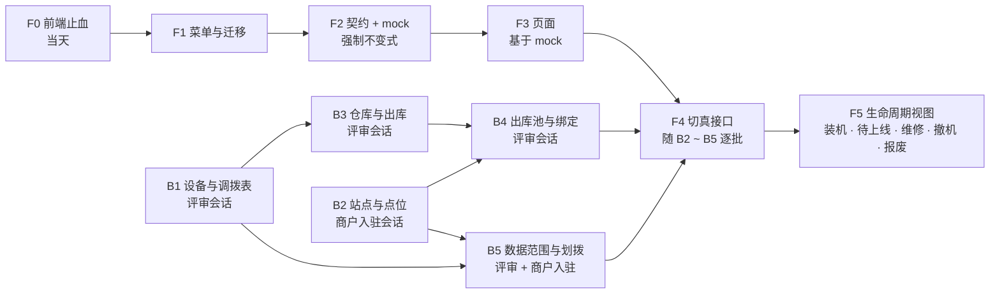

# 设备出库与绑定 · 开发计划

> 2026-10-28 · 依据：[技术设计](./设备出库与绑定-技术设计.md)（数据库 · API · 菜单）· [业务口径](./设备绑定与商家归属-现状分析.md) §五 · [设备生命周期](../requirements/设备生命周期管理-运营端设计.md)
> 本仓三个会话并行：**运营端菜单会话**（本计划作者，前端与菜单）· **商户入驻会话**（商家、站点）· **评审会话**（S5 / S10 设备与库存）。批次按「谁改哪些表」划分，避免两个会话改同一张表。

---

## 〇、已定的口径

| # | 口径 | 来源 |
|---|---|---|
| U1 | 绑定商家先出库；出库必须选商家；绑定的设备只从该商家的出库池里选 | 用户 2026-10-28 |
| U2 | 默认绑到商家的默认站点、默认点位 | 用户 |
| U3 | 商家可以有多个站点、多个点位（推翻 D11） | 用户 |
| U4 | 站点就是门店；商家端叫「我的站点」，全系统不用「门店」一词 | 用户 |
| U5 | **一期站点与点位由运营代建**，商家端只读 | 用户 2026-10-28（技术设计 §六 #1） |
| U6 | **绑定在运营端进行**，商家端不提供绑定 | 用户 2026-10-28（§六 #3a） |
| 默认 | 技术设计 §六 其余 5 项按建议执行：出库运营代签（一步出库）· 宝随柜出库 · 直营站点不经出库池 · 出库池滞留提醒 · 不新增权限码 | 用户「按照建议执行」 |

**不变的规则**：商家归属只挂在站点上，点位、机柜、订单的 `agent_no` 都从站点派生；站点的商家 = `OPERATE` 责任方，两者同事务写。

---

## 一、批次总览

| 批 | 内容 | 负责 | 规模 | 依赖 | 可并行 |
|---|---|---|---|---|---|
| **F0** | 前端止血：删划拨界面两句不符的提示；设备详情显示归属链与分钱对象（不一致标红） | 运营端菜单会话 | S | — | 立即 |
| **F1** | 菜单结构与一条菜单迁移 | 运营端菜单会话 | M | — | 与 B1、B2 并行 |
| **F2** | 前端契约、类型、mock（mock 层强制不变式 I1 ~ I5） | 运营端菜单会话 | M | — | 与后端并行 |
| **F3** | 页面：出库 · 出库池 · 商家详情两个页签 · 站点 / 点位改造 · 我的站点 · 整站换商家 · 设备编辑去掉点位 | 运营端菜单会话 | L | F2 | 与后端并行 |
| **B1** | 设备与调拨表：`dev_cabinet`、`dev_powerbank` 出库池列与数据范围锚点；`inv_transfer` 原因码、终点 `AGENT`、CHECK；明细唯一键；存量回填 | 评审会话 | M | — | 与 B2 并行 |
| **B2** | 站点与点位：`loc_location` 默认点位列与唯一键；建站同事务三件事；`savePoint` 改造（校验站点、派生归属、取号器）；存量回填 | 商户入驻会话 | M | — | 与 B1 并行 |
| **B3** | 仓库只读端点；出库到商家（签收写出库池）；`issue` 一步出库；`cancel`；保存带 `status` 返回 400 | 评审会话 | M | B1 | — |
| **B4** | 出库池筛选与汇总；绑定 / 批量绑定 / 解绑；撤机两种去向；机柜编辑停收 `locationNo`；装机完工改绑同一校验 | 评审会话 | L | B2、B3 | — |
| **B5** | 数据范围登记（`dev_cabinet` 改锚点、`dev_powerbank`、`inv_transfer`）；划拨只留整站换商家（同事务改责任行）+ 批量 | 评审会话（数据范围）· 商户入驻会话（划拨，`agent` 包） | M | B1、B2 | — |
| **F4** | 前端逐批切真接口、浏览器验证 | 运营端菜单会话 | M | 对应后端批 | 随后端 |
| **F5** | 生命周期第一期的五个设备视图（部署与装机、待上线、故障与维修、撤机与回仓、报废与遗失） | 运营端菜单会话 | M | F1 | F3 之后 |

> **认领状态（2026-10-28，第二次调整）**：用户在商户入驻会话里给的指令（该会话转述原话）——「设备的库存管理可能用额外的服务实现，暂时不在这里处理。先从出库池开始按照顺序进行实现。每一步实现前先重新 review 代码再执行。」据此：
>
> | 顺序 | 内容 | 负责 |
> |---|---|---|
> | 1 | **出库池**：`dev_cabinet`（及 `dev_powerbank`）出库池列；「出库给商家 / 退回」**直接动作**（不经调拨单，将来库存服务调同一入口）；列表筛选与汇总 | 商户入驻会话 |
> | 2 | **站点与点位**（原 B2） | 商户入驻会话 |
> | 3 | **绑定 / 批量绑定 / 解绑 / 撤机去向**（原 B4） | 商户入驻会话 |
> | 4 | **整站换商家 + 数据范围**（原 B5 两半） | 商户入驻会话 |
> | — | **库存**：仓库端点、调拨单 `AGENT` 终点、`issue / cancel`（原 B3 与 B1 的 `inv_transfer` 部分） | **暂不做**（将来库存服务） |
>
> 评审会话不再承担本链条；`dev_cabinet / dev_powerbank` 出库池列、绑定端点、`DataScopeRegistration` 的 `dev_cabinet` 锚点只由商户入驻会话改。下表 B1 ~ B5 的分工以本表为准。
>
> **前端影响**：「出库」不再是调拨单的一种，而是设备上的直接动作「出库给商家 / 退回」（出库池页与设备台账的批量动作）；「设备管理 › 出库」叶暂不改造，原「库存调拨」保持现状。契约按技术设计 §三 的路径与字段，出库动作的路径以商户入驻会话落地为准。

迁移编号：**不预分配**。每个会话写迁移前先 `ls` 取最新号，写完立刻提交并告知另两个会话（今天已撞过一次 V155）。

---

## 二、逐批明细

### F0 前端止血（当天，不依赖后端）

| 项 | 改什么 | 验收 |
|---|---|---|
| F0-1 | 商家管理 › 设备/点位划拨：删「站点划拨只改站点归属，站内机柜的归属需另行选择」（`app/agents/page.tsx:561`）；回收确认框不再写「不再有收益」，改为如实说明「数据权限立即收回；分成按站点责任行，见站点详情 › 分成」 | 文案与后端行为一致 |
| F0-2 | 设备详情顶部显示归属链「商家 › 站点 › 点位」与「分钱给谁」（读站点责任行 `listSiteAgents`）；两者商家不一致时标红并给「去站点详情 › 分成」链接 | 在 mock 里造一台不一致的柜子能看到红标 |

### F1 菜单（一条迁移）

| 段 | 变化 |
|---|---|
| 设备管理 | 「库存调拨」改名「出库」；新增「出库池」（`/devices?tab=issued`，`device:inventory:read`）；分组按生命周期（技术设计 §4.1，只建可用的叶） |
| 商家管理 | 「设备/点位划拨」改名「整站换商家」（路径与权限码不变） |
| 网点管理 | 不加叶；站点 / 点位页内加列 |
| 商家门户 | 「我的资产」加「我的站点」（`/operation/sites`，`location:poi:read`） |

交付：`nav.ts` + `nav.test.ts` + 可见性快照 + `nav-seed.test.ts` 补丁 + i18n 三语 + 后端 `MenuTreeTest` 计数 + 迁移一条。

### F2 契约与 mock

| 项 | 内容 |
|---|---|
| 类型 | `Cabinet` / `Powerbank` 加 `issuedAgentNo · issuedAgentName · issuedAt · issuedTransferNo · assetStatus`；`TransferEndpointType` 加 `AGENT`；`InventoryTransfer` 加 `reasonCode · reasonNote · toAgentName`；`Site` 加 `isDefault · defaultLocationNo`；`Location` 加 `isDefault`；`BindReq / BindResult` |
| 契约方法 | `listWarehouses` · `issueTransfer` · `cancelTransfer` · `issuedSummary` · `bindDevice` · `bindDevices` · `unbindDevice`；`listCabinets / listPowerbanks / listSites / listLocations` 加筛选参数 |
| mock | 按技术设计实现并**强制不变式**：I1 在仓与出库池互斥 · I2 绑定点位的商家 = 出库池商家（否则抛 409）· I3 `agent_no` 只由点位派生 · I4 一台设备只在一张未完结出库单上 · I5 直营站点不经出库池；建站同事务建默认点位与责任行；种子数据含：两个商家（各有默认站点 + 第二个站点）、一个仓、若干在库 / 出库池 / 已绑定 / 已上线的柜子 |
| 测试 | mock 单测覆盖 I1 ~ I5 与「出库 → 绑定 → 撤机回池 → 再绑定 → 撤机回仓」全链；`contract.test.ts` 锚列表补新方法 |

### F3 页面（基于 mock）

| 页 | 内容 | 验收 |
|---|---|---|
| 设备管理 › 出库 | 新建默认「出库给商家」：选仓 → 选商家（只列已补齐资料的商家）→ 选设备（只列该仓在库、质检放行）→ 出库（一步完成）；另有「退回仓库」「仓间调拨」；列表加原因列、商家列 | 选未补齐资料的商家被拦并提示缺什么 |
| 设备管理 › 出库池 | 左：商家汇总（未绑定 / 已绑定 / 已上线）；右：设备列表；**绑定**抽屉默认选中默认站点、默认点位，可改选该商家的其它站点与点位，勾选「同时建装机工单」；批量绑定；解绑；退回仓库 | 绑定到别的商家的点位被拒（409 文案）；绑定后设备出现在「部署与装机」 |
| 商家管理 › 商家详情 | 新页签「站点与点位」：默认站点置顶，新建站点（带商家）、新建点位；新页签「设备」：出库池 · 已绑定 · 已上线 | 新建站点后自动出现默认点位 |
| 网点管理 › 站点管理 / 点位管理 | 加「商家」列与筛选、「默认」标记；新建站点可选商家（商家站点不强制场地方） | — |
| 商家门户 › 我的站点 | 复用站点页，按 realm 隐藏「商家」列与新建按钮；点进去看点位与设备 | AGENT 登录只看到自己的站点 |
| 商家门户 › 我的设备 | 出库池里未绑定的设备显示「待安装」 | — |
| 商家管理 › 整站换商家 | 只剩站点；确认框写明责任行与设备归属一并变更、生效日前的订单归原商家 | — |
| 设备台账 › 编辑 | 去掉「点位」字段，改为「去出库池绑定」链接 | — |

### B1 ~ B5 后端

见技术设计 §二、§三；**分批归属调整**：`loc_location` 的列（技术设计 §2.3）归 **B2**（商户入驻会话，与建站逻辑同一处），B1 只动设备与调拨表。每批的完成定义：迁移 + 端点 + 场景测试（不变式与状态迁移各一条以上）+ `docs/api/contract.json` 更新 + `api-align` / `check-form-fields` 卡口通过。

### F4 切真接口

每个后端批落地后：前端 `https/*.ts` 换绑定 → `contract.json` 对齐 → 浏览器走一遍对应流程 → 优化清单与矩阵状态更新。顺序 B2 → B3 → B4 → B5。

### F5 生命周期视图

部署与装机（装机工单按阶段）· 待上线（门禁逐项）· 故障与维修 · 撤机与回仓（显示去向）· 报废与遗失。全部读既有端点，不依赖本计划的后端批，排在 F3 之后。

---

## 三、端到端验收（全部批次完成后）

| # | 场景 | 期望 |
|---|---|---|
| AC1 | 给资料未补齐的商家出库 | 被拦，提示缺位置 / 行业 |
| AC2 | 出库 3 台柜给商家 A | 3 台离开仓库，进入 A 的出库池；A 的「我的设备」显示 3 台待安装；营收为 0 |
| AC3 | 从 A 的出库池绑定 1 台，不选点位 | 绑到 A 的默认站点默认点位；生成装机工单 |
| AC4 | 把 A 出库池里的柜子绑到商家 B 的点位 | 409，界面说明「设备出库给了 A」 |
| AC5 | 运营为 A 新建第二个站点 | 同时有默认点位；A 的「我的站点」出现两个站点 |
| AC6 | 装机完工 → 试借还 → 上线 → 产生订单 | 订单归 A、在 A 的站点；分成给 A（`OPERATE` 责任行） |
| AC7 | 撤机，去向「回出库池」 | 柜子回到 A 的出库池，不回仓；可再绑定到 A 的第二个站点 |
| AC8 | 撤机，去向「回仓」 | 回仓单签收后离开 A 的出库池 |
| AC9 | 整站换商家 A → C | 站点、点位、柜子、责任行同时变为 C；生效日前的订单仍归 A；C 能看到、也分得到 |
| AC10 | AGENT 登录 | 只看到自己的站点、点位、设备（含出库池）、充电宝与出库单 |

---

## 四、风险与对策

| 风险 | 对策 |
|---|---|
| 三个会话并行占迁移号 | 写前 `ls`、写完即提交并通知；不预分配 |
| 生成列做数据范围锚点，MariaDB / MySQL 行为差异 | B1 用两种库各跑一次迁移与 `DataScopeRegistration` 场景测试；商户入驻会话的 V157 已示范「不用 MariaDB 专有语法」 |
| 存量已绑定设备没有 `issued_agent_no` | B1 回填 `issued_agent_no = agent_no`；直营站点的设备保持为空（I5） |
| 存量站点没有默认点位、点位没有 `agent_no` | B2 回填；回填后 AGENT 才看得到自己的点位 |
| 前端先于后端落地，契约漂移 | F2 严格按技术设计 §三写契约；后端批改契约时同步改技术设计并通知 |
| 本地无 MySQL，后端场景测试只能在有库的环境跑 | 每批提交说明里写明「未在本地跑」，由有库的会话或 CI 补跑 |

---

## 五、下一步

运营端菜单会话立即可做：**F0 → F1 → F2 → F3**（不等后端）。后端批次待两个会话确认认领后开工。
