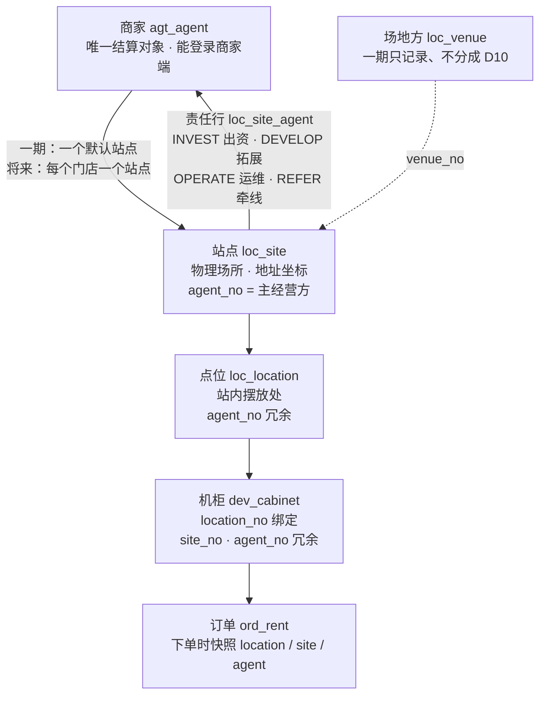
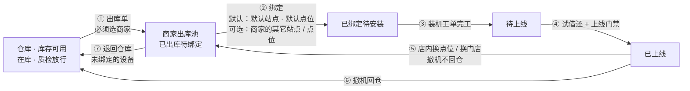

# 设备绑定与商家归属 · 现状分析

> 2026-10-28 · 只分析、不改代码。承接 [设备生命周期管理-运营端设计](../requirements/设备生命周期管理-运营端设计.md) 的「⑤ 绑定上线」。
> 依据：[商家入驻与结算一期方案](../requirements/商家入驻流程-需求整理.md)（D10、D11、G7、G9）· [ADR-032](./ADR/ADR-032-第一阶段以商家为结算单元-会计系统架构预留.md) · 服务端评审 [S3 §2.2](./功能评审/S3-建站点与点位.md)、[S5 §2.4 与 SF-OPR-05](./功能评审/S5-设备上线与归属.md) · 当前代码（`文件:行`，后端路径省略 `backend/…/ai/neargo/sharehub/`）。

---

## 〇、结论

1. **一期的绑定链**：商家 → 站点（= 门店）→ 点位 → 机柜。商家入驻方案原定「一期不做门店」（D11），**2026-10-28 用户改为一期就允许多站点、多点位**（§五 U3）。默认站点已实现（8271deaa），默认点位还没有。
2. **「商家」在库里有四处、被三种用途读**，三种用途读的不是同一处：
   - 商家**看得到**哪些设备与订单 → 读机柜上的冗余列 `dev_cabinet.agent_no`（订单下单时快照它）；
   - 商家**分得到**多少钱 → 读站点上的责任行 `loc_site_agent`，没配责任行才回落到订单快照的 `agent_no`；
   - 工单**派给谁** → 读站点的 `loc_site.agent_no`。
3. 三处由**两个互不同步的界面**维护：商家管理 › 设备/点位划拨（写 `agent_no`）与网点管理 › 站点详情 › 分成（写责任行）。结果是**「看得到」与「分得到」可以是两个商家**，而且不报错。
4. 机柜的 `agent_no` 有**六个写入方、没有统一定义**（撤机保留它，解绑清空它，改绑又用站点的值覆盖之前的机柜级划拨）。
5. **2026-10-28 用户口径**（§五）：绑定商家**先出库**，出库必须选商家；绑定的设备一律从该商家的**出库池**里选，默认绑到商家的默认站点、默认点位；商家可以有**多个站点（= 门店）、多个点位**。归属仍只挂在站点上，设备未绑定前以「出库给了哪个商家」表达。

---

## 一、概念与模型

| 概念 | 一期含义 | 表 | 归属字段 |
|---|---|---|---|
| 商家 | 与平台结算的经营方（一家酒店、一家咖啡店）；**唯一的结算对象** | `agt_agent` | — |
| 门店 | **就是站点**（U4）；商家端与 C 端叫「门店」。一个商家可有多个（U3，取代 D11） | `loc_site` | 同站点 |
| 站点 | 设备摆放的物理场所；一期每个商家一个**系统自动建的默认站点**，商家看不到「站点」这个词 | `loc_site` | `agent_no`（主经营方，V52 起语义收窄为 OPERATE 那一方）· `venue_no` |
| 站点责任 | 站点上「谁出钱、谁找来、谁维护、谁牵线」各一行，分钱按它 | `loc_site_agent`（V52） | `agent_no` + `role` + `rule_no` + 生效期 |
| 点位 | 站内具体摆放处 | `loc_location` | `agent_no`（冗余，V9 加，随站点级联） |
| 机柜 | 设备 | `dev_cabinet` | `location_no`（**绑定本身**）· `site_no`、`agent_no`（冗余，V9 加，作数据范围锚点） |
| 场地方 | 商场、业主；一期只记录 | `loc_venue` | — |

一期三种典型摆放（一期方案 §1.1）：

| 场景 | 商家 | 站点 | 场地方 |
|---|---|---|---|
| 酒店自营，柜子在大堂 | 酒店 | 酒店的默认站点 | 可不建 |
| 咖啡店在商场里，柜子在店内 | 咖啡店 | 咖啡店的默认站点 | 商场（仅记录） |
| 平台直接与商场签约，放在公共区域 | **无**（平台直营） | 运营手建的站点，`agent_no` 为空 | 商场 |

---

## 二、绑定今天怎么发生

### 2.1 三个「绑定」动作

| 动作 | 入口 | 写什么 | 约束 | 证据 |
|---|---|---|---|---|
| **绑点位** | 设备台账 › 新增 / 编辑，填点位 | `location_no`；**站点、商家一律由点位反查**（入参里的 `siteNo / agentNo` 忽略）；`bound_at = now`（之前的试借还结果作废） | 只允许**在库**的柜子改点位，已布放 / 故障的要先撤机（409 `relocate_deployed`） | `core/dev/service/impl/CabinetServiceImpl.java:84-105` |
| **装机完工改绑** | 运维完工时扫码的点位与登记的不同 | 按扫码点位改绑，再尝试上线 | 柜子须在库 | `core/dev/port/InstallCompletedListener.java:50-63` |
| **划拨** | 商家管理 › 设备/点位划拨（`/agents?tab=assign`） | 见 §2.2 | 发布方检查对象可见；回写不保序 | `agent/ext/AgentOwnershipSync.java:95-150` |

反查商家时**以站点为准、不读点位上的冗余列**（`LocalLocationQuery.java:22-45`，注释：划拨中途失败留在点位上的脏值不能变成新柜的归属）—— 这一点是对的。

### 2.2 划拨：三种粒度，三条路径

| 粒度 | 平台侧（同事务） | 设备侧（事件，最终一致） |
|---|---|---|
| **站点** | `loc_site.agent_no` ← 商家；**站内全部点位** `agent_no` ← 商家（`AgentOwnershipSync.java:121-133`） | 站内全部点位上的机柜 `agent_no`、`site_no` ← 新值（`AssetAssignedListener.java:43-49` → `reassignByLocations`） |
| **点位** | 该点位 `agent_no` ← 商家（`:135-145`） | 该点位上的机柜 |
| **机柜** | 不写任何平台表（`:147-150`） | 只改这一台的 `agent_no` |

运营端界面只提供**机柜**与**站点**两种（`ops-web/app/agents/page.tsx:545-561`），点位粒度只有接口。

**两处都没碰**：`loc_site_agent`（责任行，分钱读它）与 `agt_agent` 的任何字段。

### 2.3 机柜 `agent_no` 的六个写入方（S5 §2.4）

| 写入方 | 写什么 |
|---|---|
| 编辑改绑点位 | 站点的 `agent_no` —— **会覆盖之前对这台柜子单独做的划拨** |
| 编辑解绑（点位清空） | 置空 |
| 撤机 | **保留**（注释说「agent_no 是划拨归属」，`CabinetLifecycleServiceImpl.java:226`） |
| 导入 | 不写（恒空），且直接收文件里的 `siteNo`、不校验从属（S5 P0-4） |
| 划拨回写 | 按事件设值，**不保序**（先后两次划拨，重投时旧事件可能后到） |
| `/internal/dev/ownership/*` | 任意值，**任何员工或商家令牌都能调**（S5 P0-1） |

同一列在撤机时被当作「划拨归属」保留，在解绑时被当作「点位派生值」清空 —— **这一列到底代表什么没有定义**。

---

## 三、谁在读归属

| 用途 | 读哪里 | 证据 |
|---|---|---|
| **商家看得到什么**（数据范围：设备、订单、工单） | `dev_cabinet.agent_no`；订单在**下单时**把机柜的 `location / site / agent` 快照到 `ord_rent` | `RentOrderServiceImpl.java:355-366` |
| **分钱给谁**（分润明细） | 站点上**结算日生效**的责任行，逐条按角色分（`REFER` 不逐单分）；**站点没配责任行**时回落到订单快照的 `agent_no` 按 `share_rule(AGENT)` 分 | `ShareGeneratorImpl.java`（`agentShares`） |
| **工单派给谁**、运维责任人 | `loc_site.agent_no`；运维责任人判定读责任行 `OPERATE` | S3 §2.2 |
| **上线门禁**（站点营业、合同、勘测） | `dev_cabinet.site_no` | `CabinetLifecycleServiceImpl.java:91-134` |
| **商家报表**（营收、我的设备） | 订单快照的 `agent_no`、机柜的 `agent_no` | 一期方案 §十 |

订单**快照**是对的：历史订单不随后来的划拨改归属（S10 已核），营收不会被事后改写。

---

## 四、问题与后果

### 4.1 「看得到」与「分得到」可以是两个商家（最重要）

两张表由两个界面维护、互不同步：

| 操作 | 改了 | 没改 | 后果 |
|---|---|---|---|
| 把机柜 C1 划给商家 B（C1 在商家 A 的站点上，站点已配 A 的 `OPERATE` 责任行） | C1 的 `agent_no` → B | 站点责任行仍是 A | **B 在商家端看到 C1 的设备与全部订单，钱全部分给 A** |
| 把站点 S1 从 A 划给 B | 站点、点位、机柜的 `agent_no` → B | 责任行仍是 A | 同上，整个站点 |
| 回收机柜到平台直营（确认框写着「商家将不再有这些资产的收益与数据权限」） | `agent_no` → 空 | 责任行 | **A 看不到了，但照样分钱**；确认框的话不成立 |
| 只在站点详情 › 分成 里把 `OPERATE` 从 A 换成 B | 责任行 | 所有 `agent_no` | **B 拿钱，但商家端一条订单都看不到**；工单仍派给 A |

只有「站点没配任何责任行」时两边才一致（分钱回落到订单快照的 `agent_no`）。一期方案只给商家分成（D10），新建站点多半不配责任行 —— 所以**一期大多数站点碰巧一致，一配责任行就开始分叉**。

### 4.2 运营端界面的说法与后端行为不符

- 划拨表单的站点字段写着「站点划拨只改站点归属，站内机柜的归属需另行选择」（`ops-web/app/agents/page.tsx:561`）—— **后端实际级联到站内全部点位和机柜**（§2.2）。运营照提示再把机柜逐台划一遍，是无害的重复；但如果他想「站点给 B、其中一台柜子留给 A」，后端会全部给 B。
- 回收确认框说「不再有收益」—— 见 4.1。

### 4.3 机柜级划拨让归属可以挂在三层，与 ADR-013 相悖

ADR-013 定的是「归属只挂站点，点位 / 机柜继承」（S3 §2.2 引）。机柜级、点位级划拨让同一站点内的柜子分属不同商家，于是：
- 改绑点位会用站点的值覆盖机柜级划拨（§2.3 第一行），**运营做的划拨被一次编辑静默撤销**；
- 分钱按站点的责任行，机柜级划拨对钱没有作用（4.1）—— 它只改了「谁看得到」。

### 4.4 划拨是最终一致，但不可观察

设备侧回写走事件：不保序、流水上没有同步状态，运营提交后看到「已划拨」，机柜侧可能还没改或改失败（S5 SF-OPR-05：`agt_assignment` 无 `sync_status`、`dev_cabinet` 无 `owner_assign_seq`；对账任务每日一次、只做一半）。

### 4.5 一期链条的入口缺失

- **默认站点不存在**（G7）：一期方案要求「补齐位置时系统自动建默认站点」，代码里没有任何相关实现。**2026-10-28 晚已实现**（商家入驻会话 8271deaa，`V157`）：补齐位置时自动建默认站点，**同事务写 `loc_site.agent_no` 与 `OPERATE` 责任行**，位置变更只同步地址坐标；同一提交补了划拨门禁（G9）。新建的默认站点不会落进 4.1 的分叉；存量站点与机柜级划拨仍会。今天给商家放设备，只能由运营手建站点、再划拨站点给商家，与「商家看不到站点」的一期设计不符。
- **划拨门禁不存在**（G9）：位置、行业未补齐的商家照样能接受划拨。

### 4.6 其余写入口的风险（已在评审中登记）

- 内部归属端点任何令牌都能改归属（S5 P0-1）。
- 导入不写商家、收未校验的站点号（S5 P0-4，S4 P0-1）—— 可能挂在 A 站点的点位上、按 B 站点的合同过门禁上线。
- 编辑整行回写，会把归属写回旧值（S5 P0-5）。

---

## 五、一期绑定流程（2026-10-28 用户口径）

### 5.0 用户裁决

| # | 裁决 | 影响 |
|---|---|---|
| U1 | **绑定商家先出库**：出库时必须选商家；所有要绑定的设备都从该商家的**出库池**里选 | 「划拨」不再是单独改归属的动作，归属随出库与绑定发生 |
| U2 | 设备默认绑到商家的**默认站点、默认点位** | 默认站点已有（8271deaa）；**默认点位还没有**，须随站点一起建 |
| U3 | **商家可以有多个站点、多个点位** | 取代商家一期方案 D11「一期不考虑门店」 |
| U4 | **站点就是门店** | 库里与运营端叫「站点」，商家端与 C 端叫「门店」；场地方（商场、业主）不是门店 |

### 5.1 一条规则（不变）

> **商家归属挂在站点上。** 点位、机柜、订单上的 `agent_no` 都从站点派生；站点的商家 = 站点上生效的 `OPERATE` 责任方，两者同事务写。
> 新增一条：**设备在被绑定之前，归属以「出库给了哪个商家」表达，不写 `agent_no`。**

### 5.2 全流程

| 步 | 谁做 | 入口 | 前置条件 | 结果 |
|---|---|---|---|---|
| ① 出库 | 仓管 / 运营 | 设备管理 › 出库 | 商家已开通、位置与行业已补齐（即已有默认站点，划拨门禁 G9 已做）；设备在库且质检放行 | 出库单 `草稿 → 已出库`（发货）→ `已签收`（到商家）。设备离开仓库，**进入该商家的出库池**；履历记 `TRANSFER_OUT` |
| ② 绑定 | 运营（一期）· 商家（可选，见 §5.5） | 设备管理 › 出库池；商家详情 › 设备 | 设备在**该商家**的出库池里；目标站点、点位属于该商家 | 写 `location_no`，站点与商家由点位反查；默认选中默认站点、默认点位；生成装机工单 |
| ③ 安装 | 运维 | 装机工单 | — | 现场扫码确认点位（可改到同一商家的其它点位） |
| ④ 上线 | 运维 / 运营 | 待上线 | 上线门禁 10 项 | 已上线；此后订单快照该点位的站点与商家 |
| ⑤ 店内搬动 | 运维 | 撤机工单（原因：换点位） | — | 撤机后**回到同一商家的出库池**，不回仓；再走 ② ~ ④ |
| ⑥ 撤机回仓 | 运维 · 仓管 | 撤机工单（原因：退出 / 维修 / 返厂） | — | 回仓调拨签收后离开出库池，回到仓库 |
| ⑦ 退回仓库 | 仓管 | 出库池 › 退回 | 设备未绑定 | 出库池 → 仓库（反向调拨） |

### 5.3 设备上记什么

| 字段 | 含义 | 何时写 | 何时清 |
|---|---|---|---|
| `issued_agent_no`（新） | **出库给了哪个商家**（出库池归属） | 出库单签收 | 退回仓库、撤机回仓签收 |
| `location_no` | 绑定的点位 | 绑定、装机扫码改绑 | 撤机 |
| `site_no` · `agent_no` | 从点位派生（数据范围与订单快照读它） | 随 `location_no` 同一个方法写 | 随 `location_no` 清 |

不变式（服务端强制）：
1. 绑定时目标点位所属站点的商家 **必须等于** `issued_agent_no`，否则 409 —— 出库给 A 的柜子不能绑到 B 的门店；
2. `agent_no` 只由点位派生，永远不由请求体或划拨直接写；
3. 一台设备同一时刻只在一个商家的出库池里。

在出库池里、尚未绑定的设备：**商家端能看到**（「我的设备 › 待安装」），**不产生营收**（没有点位就没有订单）；`agent_no` 为空，因此不进数据范围的营收统计。

### 5.4 站点（门店）与点位

- **默认站点**：商家补齐位置时自动建（已实现，8271deaa），同事务写 `loc_site.agent_no` 与 `OPERATE` 责任行。
- **默认点位（新）**：建站点时同事务建一个默认点位（名称如「默认点位」，坐标同站点）。**所有站点都建**，不只默认站点 —— 否则新门店建出来不能直接绑设备。
- **多站点、多点位（新，取代 D11）**：
  - 新站点 = 新门店，挂在商家下：建站同事务写 `agent_no` 与 `OPERATE` 责任行（与默认站点同一个方法）；
  - 新点位挂在站点下，`agent_no` 随站点派生；
  - 商家端菜单出现「我的门店」：门店列表、每个门店的点位与设备、按门店看营收（订单快照本来就带站点，按站点汇总即可）。
- **C 端「找附近」**按站点坐标排序，新门店有了已上线的设备才出现在地图上（避免空门店）。
- **场地方**仍只是站点上的一条记录（D10），与门店无关。

### 5.5 谁能建门店、谁能绑定

| 动作 | 运营端 | 商家端 | 建议 |
|---|---|---|---|
| 建门店（站点） | ✅ 代建 | ？ | **一期运营代建**；商家自助建门店放二期 —— 门店有地址坐标，直接上 C 端地图，乱建会污染「找附近」。若一期就开放，须运营审核后才在 C 端可见 |
| 建点位 | ✅ | ？ | 同上；点位不上地图，风险小，可以先开放给商家 |
| 出库给商家 | ✅ | ✗ | 只有运营与仓管 |
| 从出库池绑定 | ✅ | ？ | 一期运营；商家自助绑定需要商家端扫码，放二期 |
| 店内换点位、换门店 | ✅ 撤机工单 | 报修 / 申请 | 柜子物理移动必须有工单留痕 |

### 5.6 三类「换商家」（随 U1 调整）

| 现实中发生了什么 | 走哪条路 |
|---|---|
| 柜子在**同一商家**内换门店 / 换点位 | 撤机（不回仓）→ 回到该商家出库池 → 绑定新点位 → 装机 → 上线 |
| 柜子换到**另一个商家** | 撤机回仓 → 出库给新商家 → 绑定 → 装机 → 上线 |
| 门店还在、经营方换了 | 整站换商家：改站点的 `OPERATE` 责任行（带生效日），站点、点位、机柜 `agent_no` 同步派生；柜子不动，出库池归属一并改 |
| 商家退出 | 清退：收回全部站点；在用设备撤机回仓，出库池里的设备退回仓库 |

---

## 六、要改的地方

### 6.1 后端

| # | 改什么 | 对应 |
|---|---|---|
| B1 | ~~默认站点：补齐位置时自动建，同事务写 `OPERATE` 责任行~~ | ✅ 8271deaa |
| B2 | **默认点位**：每个站点建站时同事务建一个默认点位；存量站点补一个 | 新（U2） |
| B3 | **商家多站点**：运营为商家新建站点的端点，复用默认站点那个方法（同事务写 `agent_no` + `OPERATE` 责任行 + 默认点位）；站点列表按商家筛 | 新（U3） |
| B4 | **出库给商家**：调拨单终点类型加 `AGENT`（或单设「出库单」），发货必须选商家；签收写 `issued_agent_no`；明细只收在库且质检放行的设备 | 新（U1）；改 S10 §五 #2 的建议「调拨终点只到仓」 |
| B5 | **绑定端点**：`POST /api/ops/devices/{deviceNo}/bind {locationNo?}`，缺省取 `issued_agent_no` 商家的默认站点默认点位；校验点位商家 = `issued_agent_no`；同时生成装机工单（可选） | 新（U1、U2） |
| B6 | 撤机分两种去向：回出库池（换点位）/ 回仓（退出、维修、返厂）；回仓签收清 `issued_agent_no` | 新；S5 P0-6 一并修（原因不再写进 `fault_reason`） |
| B7 | 机柜 `agent_no` 只由点位派生（改绑、导入、站点换商家级联共用一个方法） | OPT-S5-11（选 A） |
| B8 | 下线机柜级、点位级划拨；站点级划拨保留为「整站换商家」并同事务改责任行 | OPT-S5-11 · 本文 4.1 |
| B9 | 划拨 / 出库流水加同步状态、回写保序 | OPT-S5-08、09 |
| B10 | 内部归属端点验服务凭证 | S5 P0-1 |
| B11 | 商家端：我的门店（列表、点位、设备、按门店营收）；出库池里的设备在「我的设备」显示为「待安装」 | 新（U3） |

### 6.2 运营端

| # | 改什么 | 依赖 |
|---|---|---|
| F1 | 设备管理 › **出库**：建出库单必须选商家；只列在库且质检放行的设备 | B4 |
| F2 | 设备管理 › **出库池**：按商家看已出库待绑定的设备；「绑定」默认选中默认站点、默认点位，可改选该商家的其它站点与点位；「退回仓库」 | B5 |
| F3 | 商家详情 › **门店与点位**：列出商家的站点（门店）与点位，新建门店、新建点位 | B2、B3 |
| F4 | 商家管理 › 「设备/点位划拨」改为「整站换商家」（只剩站点粒度）；删掉与后端不符的两句提示 | B8；提示可马上删 |
| F5 | 设备详情：归属链「商家 › 门店 › 点位」+ 出库池归属 + 分钱对象，不一致标红 | 可先做（读现有端点） |
| F6 | 设备生命周期设计 §五 的菜单相应调整：「② 仓储与出库」组加「出库池」；「③④ 部署与安装」的「部署与装机」由出库池的「绑定」生成装机工单 | 随 F1、F2 |

---

## 七、需要裁决

| # | 事项 | 建议 |
|---|---|---|
| 1 | 划拨粒度（OPT-S5-11） | **A：只留站点**（整站换商家）；设备层面的归属由出库与绑定表达 |
| 2 | 站点的商家与责任行谁是源头 | 责任行（`OPERATE`）是源头，`loc_site.agent_no` 派生 |
| 3 | 一个站点上能否有多个商家（出资方 A、运维方 B） | 一期不允许（只有商家分成、一个站点一个商家）；责任表保留多行能力给二期 |
| 4 | 商家能否自助建门店、建点位、自助绑定 | 一期运营代建门店；点位可开放给商家；自助绑定（扫码）放二期（§5.5） |
| 5 | 出库是「到商家」还是「到门店」 | **到商家**（U1）；具体门店在绑定时选 —— 一批货可以分给同一商家的几家门店 |
| 6 | 出库单要不要商家签收 | 一期运营代签（发货即入池）；商家端签收放二期 |
| 7 | 充电宝是否也进出库池 | 进：随柜出库，装机时装入；单独补货也走出库给商家 |
| 8 | 撤机后柜子的 `agent_no` | 清空（随点位清）；是否留在出库池看撤机原因（§5.6） |
