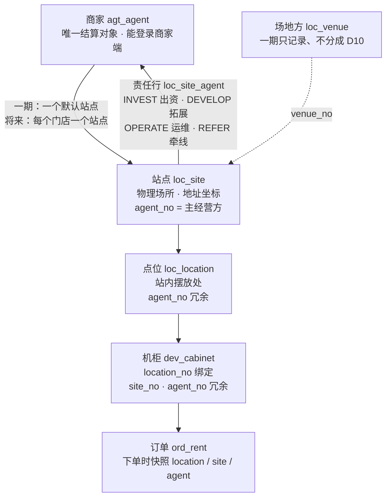
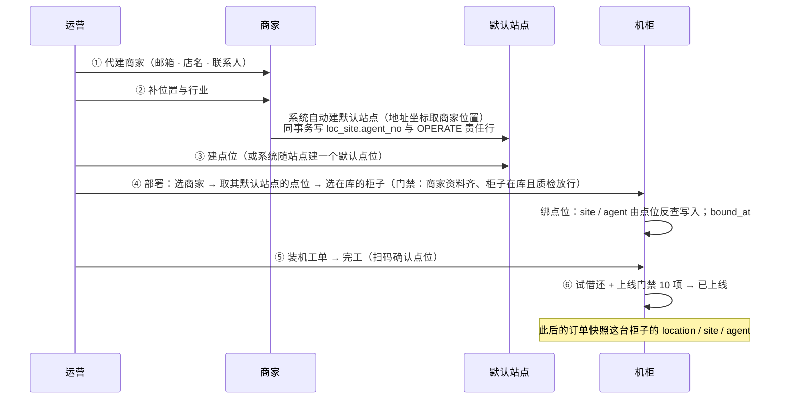

# 设备绑定与商家归属 · 现状分析

> 2026-10-28 · 只分析、不改代码。承接 [设备生命周期管理-运营端设计](../requirements/设备生命周期管理-运营端设计.md) 的「⑤ 绑定上线」。
> 依据：[商家入驻与结算一期方案](../requirements/商家入驻流程-需求整理.md)（D10、D11、G7、G9）· [ADR-032](./ADR/ADR-032-第一阶段以商家为结算单元-会计系统架构预留.md) · 服务端评审 [S3 §2.2](./功能评审/S3-建站点与点位.md)、[S5 §2.4 与 SF-OPR-05](./功能评审/S5-设备上线与归属.md) · 当前代码（`文件:行`，后端路径省略 `backend/…/ai/neargo/sharehub/`）。

---

## 〇、结论

1. **一期的绑定链已经定了**：商家 → 默认站点 → 点位 → 机柜。门店一期不做（D11），将来一个门店就是该商家下的又一个站点，模型不用改。**但「默认站点」还不存在**（G7 未实现），划拨前也不检查商家资料是否补齐（G9 未实现）。
2. **「商家」在库里有四处、被三种用途读**，三种用途读的不是同一处：
   - 商家**看得到**哪些设备与订单 → 读机柜上的冗余列 `dev_cabinet.agent_no`（订单下单时快照它）；
   - 商家**分得到**多少钱 → 读站点上的责任行 `loc_site_agent`，没配责任行才回落到订单快照的 `agent_no`；
   - 工单**派给谁** → 读站点的 `loc_site.agent_no`。
3. 三处由**两个互不同步的界面**维护：商家管理 › 设备/点位划拨（写 `agent_no`）与网点管理 › 站点详情 › 分成（写责任行）。结果是**「看得到」与「分得到」可以是两个商家**，而且不报错。
4. 机柜的 `agent_no` 有**六个写入方、没有统一定义**（撤机保留它，解绑清空它，改绑又用站点的值覆盖之前的机柜级划拨）。
5. 建议一期口径：**归属只挂在站点上**，机柜不单独划拨；「把设备划给商家」= 把设备绑到该商家默认站点的点位上；站点换商家时责任行同事务改。详见 §五。

---

## 一、概念与模型

| 概念 | 一期含义 | 表 | 归属字段 |
|---|---|---|---|
| 商家 | 与平台结算的经营方（一家酒店、一家咖啡店）；**唯一的结算对象** | `agt_agent` | — |
| 门店 | **一期不做**（D11）；将来 = 商家下的又一个站点 | — | — |
| 站点 | 设备摆放的物理场所；一期每个商家一个**系统自动建的默认站点**，商家看不到「站点」这个词 | `loc_site` | `agent_no`（主经营方，V52 起语义收窄为 OPERATE 那一方）· `venue_no` |
| 站点责任 | 站点上「谁出钱、谁找来、谁维护、谁牵线」各一行，分钱按它 | `loc_site_agent`（V52） | `agent_no` + `role` + `rule_no` + 生效期 |
| 点位 | 站内具体摆放处 | `loc_location` | `agent_no`（冗余，V9 加，随站点级联） |
| 机柜 | 设备 | `dev_cabinet` | `location_no`（**绑定本身**）· `site_no`、`agent_no`（冗余，V9 加，作数据范围锚点） |
| 场地方 | 商场、业主；一期只记录 | `loc_venue` | — |

一期三种典型摆放（一期方案 §1.1）：

| 场景 | 商家 | 站点 | 场地方 |
|---|---|---|---|
| 酒店自营，柜子在大堂 | 酒店 | 酒店的默认站点 | 可不建 |
| 咖啡店在商场里，柜子在店内 | 咖啡店 | 咖啡店的默认站点 | 商场（仅记录） |
| 平台直接与商场签约，放在公共区域 | **无**（平台直营） | 运营手建的站点，`agent_no` 为空 | 商场 |

---

## 二、绑定今天怎么发生

### 2.1 三个「绑定」动作

| 动作 | 入口 | 写什么 | 约束 | 证据 |
|---|---|---|---|---|
| **绑点位** | 设备台账 › 新增 / 编辑，填点位 | `location_no`；**站点、商家一律由点位反查**（入参里的 `siteNo / agentNo` 忽略）；`bound_at = now`（之前的试借还结果作废） | 只允许**在库**的柜子改点位，已布放 / 故障的要先撤机（409 `relocate_deployed`） | `core/dev/service/impl/CabinetServiceImpl.java:84-105` |
| **装机完工改绑** | 运维完工时扫码的点位与登记的不同 | 按扫码点位改绑，再尝试上线 | 柜子须在库 | `core/dev/port/InstallCompletedListener.java:50-63` |
| **划拨** | 商家管理 › 设备/点位划拨（`/agents?tab=assign`） | 见 §2.2 | 发布方检查对象可见；回写不保序 | `agent/ext/AgentOwnershipSync.java:95-150` |

反查商家时**以站点为准、不读点位上的冗余列**（`LocalLocationQuery.java:22-45`，注释：划拨中途失败留在点位上的脏值不能变成新柜的归属）—— 这一点是对的。

### 2.2 划拨：三种粒度，三条路径

| 粒度 | 平台侧（同事务） | 设备侧（事件，最终一致） |
|---|---|---|
| **站点** | `loc_site.agent_no` ← 商家；**站内全部点位** `agent_no` ← 商家（`AgentOwnershipSync.java:121-133`） | 站内全部点位上的机柜 `agent_no`、`site_no` ← 新值（`AssetAssignedListener.java:43-49` → `reassignByLocations`） |
| **点位** | 该点位 `agent_no` ← 商家（`:135-145`） | 该点位上的机柜 |
| **机柜** | 不写任何平台表（`:147-150`） | 只改这一台的 `agent_no` |

运营端界面只提供**机柜**与**站点**两种（`ops-web/app/agents/page.tsx:545-561`），点位粒度只有接口。

**两处都没碰**：`loc_site_agent`（责任行，分钱读它）与 `agt_agent` 的任何字段。

### 2.3 机柜 `agent_no` 的六个写入方（S5 §2.4）

| 写入方 | 写什么 |
|---|---|
| 编辑改绑点位 | 站点的 `agent_no` —— **会覆盖之前对这台柜子单独做的划拨** |
| 编辑解绑（点位清空） | 置空 |
| 撤机 | **保留**（注释说「agent_no 是划拨归属」，`CabinetLifecycleServiceImpl.java:226`） |
| 导入 | 不写（恒空），且直接收文件里的 `siteNo`、不校验从属（S5 P0-4） |
| 划拨回写 | 按事件设值，**不保序**（先后两次划拨，重投时旧事件可能后到） |
| `/internal/dev/ownership/*` | 任意值，**任何员工或商家令牌都能调**（S5 P0-1） |

同一列在撤机时被当作「划拨归属」保留，在解绑时被当作「点位派生值」清空 —— **这一列到底代表什么没有定义**。

---

## 三、谁在读归属

| 用途 | 读哪里 | 证据 |
|---|---|---|
| **商家看得到什么**（数据范围：设备、订单、工单） | `dev_cabinet.agent_no`；订单在**下单时**把机柜的 `location / site / agent` 快照到 `ord_rent` | `RentOrderServiceImpl.java:355-366` |
| **分钱给谁**（分润明细） | 站点上**结算日生效**的责任行，逐条按角色分（`REFER` 不逐单分）；**站点没配责任行**时回落到订单快照的 `agent_no` 按 `share_rule(AGENT)` 分 | `ShareGeneratorImpl.java`（`agentShares`） |
| **工单派给谁**、运维责任人 | `loc_site.agent_no`；运维责任人判定读责任行 `OPERATE` | S3 §2.2 |
| **上线门禁**（站点营业、合同、勘测） | `dev_cabinet.site_no` | `CabinetLifecycleServiceImpl.java:91-134` |
| **商家报表**（营收、我的设备） | 订单快照的 `agent_no`、机柜的 `agent_no` | 一期方案 §十 |

订单**快照**是对的：历史订单不随后来的划拨改归属（S10 已核），营收不会被事后改写。

---

## 四、问题与后果

### 4.1 「看得到」与「分得到」可以是两个商家（最重要）

两张表由两个界面维护、互不同步：

| 操作 | 改了 | 没改 | 后果 |
|---|---|---|---|
| 把机柜 C1 划给商家 B（C1 在商家 A 的站点上，站点已配 A 的 `OPERATE` 责任行） | C1 的 `agent_no` → B | 站点责任行仍是 A | **B 在商家端看到 C1 的设备与全部订单，钱全部分给 A** |
| 把站点 S1 从 A 划给 B | 站点、点位、机柜的 `agent_no` → B | 责任行仍是 A | 同上，整个站点 |
| 回收机柜到平台直营（确认框写着「商家将不再有这些资产的收益与数据权限」） | `agent_no` → 空 | 责任行 | **A 看不到了，但照样分钱**；确认框的话不成立 |
| 只在站点详情 › 分成 里把 `OPERATE` 从 A 换成 B | 责任行 | 所有 `agent_no` | **B 拿钱，但商家端一条订单都看不到**；工单仍派给 A |

只有「站点没配任何责任行」时两边才一致（分钱回落到订单快照的 `agent_no`）。一期方案只给商家分成（D10），新建站点多半不配责任行 —— 所以**一期大多数站点碰巧一致，一配责任行就开始分叉**。

### 4.2 运营端界面的说法与后端行为不符

- 划拨表单的站点字段写着「站点划拨只改站点归属，站内机柜的归属需另行选择」（`ops-web/app/agents/page.tsx:561`）—— **后端实际级联到站内全部点位和机柜**（§2.2）。运营照提示再把机柜逐台划一遍，是无害的重复；但如果他想「站点给 B、其中一台柜子留给 A」，后端会全部给 B。
- 回收确认框说「不再有收益」—— 见 4.1。

### 4.3 机柜级划拨让归属可以挂在三层，与 ADR-013 相悖

ADR-013 定的是「归属只挂站点，点位 / 机柜继承」（S3 §2.2 引）。机柜级、点位级划拨让同一站点内的柜子分属不同商家，于是：
- 改绑点位会用站点的值覆盖机柜级划拨（§2.3 第一行），**运营做的划拨被一次编辑静默撤销**；
- 分钱按站点的责任行，机柜级划拨对钱没有作用（4.1）—— 它只改了「谁看得到」。

### 4.4 划拨是最终一致，但不可观察

设备侧回写走事件：不保序、流水上没有同步状态，运营提交后看到「已划拨」，机柜侧可能还没改或改失败（S5 SF-OPR-05：`agt_assignment` 无 `sync_status`、`dev_cabinet` 无 `owner_assign_seq`；对账任务每日一次、只做一半）。

### 4.5 一期链条的入口缺失

- **默认站点不存在**（G7）：一期方案要求「补齐位置时系统自动建默认站点」，代码里没有任何相关实现。**2026-10-28 晚已实现**（商家入驻会话 8271deaa，`V157`）：补齐位置时自动建默认站点，**同事务写 `loc_site.agent_no` 与 `OPERATE` 责任行**，位置变更只同步地址坐标；同一提交补了划拨门禁（G9）。新建的默认站点不会落进 4.1 的分叉；存量站点与机柜级划拨仍会。今天给商家放设备，只能由运营手建站点、再划拨站点给商家，与「商家看不到站点」的一期设计不符。
- **划拨门禁不存在**（G9）：位置、行业未补齐的商家照样能接受划拨。

### 4.6 其余写入口的风险（已在评审中登记）

- 内部归属端点任何令牌都能改归属（S5 P0-1）。
- 导入不写商家、收未校验的站点号（S5 P0-4，S4 P0-1）—— 可能挂在 A 站点的点位上、按 B 站点的合同过门禁上线。
- 编辑整行回写，会把归属写回旧值（S5 P0-5）。

---

## 五、建议的一期口径

### 5.1 一条规则

> **商家归属只挂在站点上。** 点位、机柜、订单上的 `agent_no` 都是站点归属的派生值，由服务端一个方法写；机柜不单独划拨。
> **站点的商家 = 站点上生效的 `OPERATE` 责任方**，两者同事务写，不再有两个来源。

即 S5 OPT-S5-11 的**选项 A**（划拨粒度只留站点）+ S3 §2.2 的规则，再补「站点换商家时责任行同事务改」。

### 5.2 一期的绑定流程（以设备为核心）

**界面上的「划拨」改名为「部署到商家」**，含义是「把在库的柜子绑到该商家站点的点位上」，走设备生命周期的 ③ 部署 → ④ 安装 → ⑤ 绑定上线，而不是只改一个 `agent_no`。

### 5.3 三类「换商家」各走各的路

| 现实中发生了什么 | 走哪条路 | 设备侧 |
|---|---|---|
| **柜子搬到另一家店**（物理移动） | 撤机工单 → 回仓 → 部署到新商家 → 装机 → 上线 | 履历记 `UNDEPLOY → TRANSFER → INSTALL` |
| **店还在、经营方换了**（酒店被收购） | 站点换商家：改站点的 `OPERATE` 责任行（带生效日），站点、点位、机柜 `agent_no` 同步派生 | 柜子不动；履历记 `OWNER_CHANGE`；生效日前的订单仍归旧商家 |
| **商家退出**（清退） | 清退流程收回站点到平台直营（或转给新商家）；未结订单门禁（S10） | 柜子按需撤机回仓 |

### 5.4 门店（将来）

一个商家有多个门店时，每个门店就是一个站点，商家与站点一对多；上面的规则一条不用改。营收按门店看 = 按站点汇总订单快照。一期**不在界面上出现「站点」这个词**，部署时选「商家」即可（只有一个默认站点）；做门店时把选择项从「商家」展开到「商家 › 门店」。

---

## 六、要改的地方

| # | 改什么 | 前 / 后端 | 对应任务 |
|---|---|---|---|
| 1 | ~~默认站点：补齐位置时自动建，同事务写 `OPERATE` 责任行；位置变更同步地址坐标~~ ✅ 8271deaa | 后端 | 一期方案 G7（P0） |
| 2 | 部署门禁：商家位置、行业未补齐不能部署（✅ 划拨门禁 8271deaa）；柜子须在库、质检放行（未做） | 后端 + 前端 | G9（P1） |
| 3 | 站点换商家与责任行同事务；`loc_site.agent_no` 只由 `OPERATE` 派生 | 后端 | 新增，建议并入 OPT-S3-13 |
| 4 | 机柜 `agent_no` 只由一个方法从站点派生（改绑、导入、站点换商家级联共用）；撤机后随解绑清空 | 后端 | OPT-S5-11（选 A）、S5 §2.4 |
| 5 | 撤销机柜级、点位级划拨（或保留为过渡、只读） | 后端 + 前端 | OPT-S5-11 |
| 6 | 划拨流水加同步状态，回写保序；对账改每 10 分钟并开漂移告警 | 后端 | OPT-S5-08、09 |
| 7 | 内部归属端点验服务凭证 | 后端 | S5 P0-1 |
| 8 | 运营端：「设备/点位划拨」改为「部署到商家」（选商家 → 选在库柜子 → 生成装机工单）；删掉与后端不符的两句提示；显示「归属同步中」 | 前端 | 随 1 ~ 6 分步做 |
| 9 | 设备详情显示完整归属链：商家 › 站点 › 点位，及「分钱给谁」（责任行）—— 两者不一致时标红 | 前端 | 可先做（读现有端点） |

**第 9 项可以马上做**：它不改任何行为，只把今天已经存在的分叉摆到运营眼前，在后端修好之前先让人看得见。第 8 项里「删掉两句不符的提示」也可以马上做。

---

## 七、需要裁决

| # | 事项 | 建议 |
|---|---|---|
| 1 | 划拨粒度（OPT-S5-11） | **A：只留站点**。机柜级划拨没有改变分钱，只改变「谁看得到」，留着只会制造 4.1 的分叉 |
| 2 | 站点的商家与责任行谁是源头 | 责任行（`OPERATE`）是源头，`loc_site.agent_no` 派生 |
| 3 | 一个站点上能否有多个商家（出资方 A、运维方 B） | 一期不允许（只有商家分成、一个站点一个商家）；责任表保留多行能力给二期 |
| 4 | 已上线的柜子能否不撤机直接换商家 | 不能单台换；只能整站换商家（§5.3 第二行） |
| 5 | 撤机后柜子的 `agent_no` | 清空（回仓即平台资产），不再保留 |
